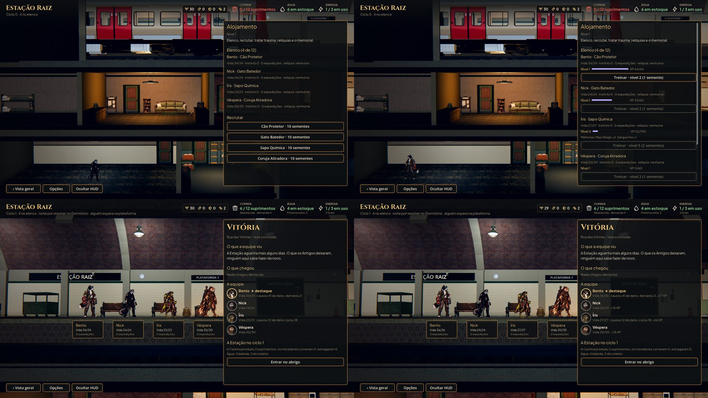
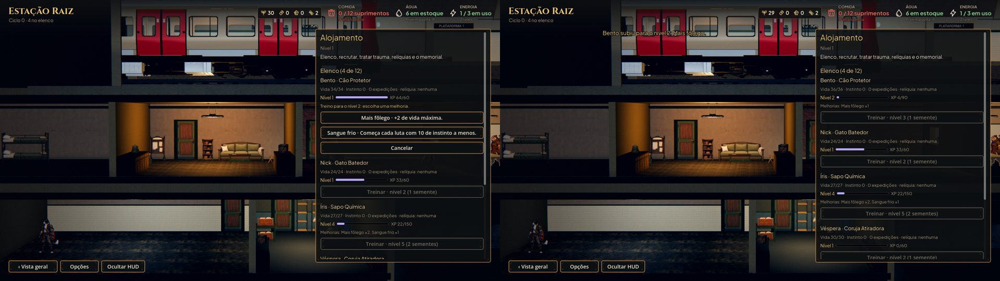

# Nível dos heróis, XP e Treino (#90)

Fotos de `tools/capture_levels.gd` (1920x1080, gl_compatibility): o Alojamento com o Bento pronto para treinar, o Nick
no meio do caminho e a Íris no nível 4; a escolha do Treino; e o relatório de uma volta com o XP.

À esquerda, o antes, na `main`: o Alojamento só com a vida, o instinto e a relíquia, e o relatório sem o XP. À
direita, o depois: o nível e a barra do XP de cada um, o Treino (com o custo em sementes), as melhorias escolhidas e
o XP de cada herói no relatório.

A escolha do Bento entre as duas melhorias do cão, e o Bento no nível 2 com Mais fôlego (vida 36).

## Como funciona

- **O XP** (`data/hero-xp.json`):
  - cada herói que lutou ganha 8 por luta, 3 por inimigo derrubado, 2 por proteção (a guarda ou o bloqueio dado a
    outro herói), 1 a cada 5 de cura e 1 a cada 10 de dano (o `tally` da luta);
  - a fuga não dá o XP da luta;
  - cada herói vivo da equipe ganha 15 na jornada concluída;
  - os recrutas ganham 1,5 vez isso.

  O relatório da volta mostra o XP de cada um. No nível 10, o XP para de acumular.
- **O Treino** (no Alojamento, a Sala dos Personagens): com o XP do nível (`data/hero-levels.json`, de 60 a 300) e as
  sementes (de 1 a 4), o herói sobe um nível e escolhe uma de duas melhorias da espécie (`data/hero-upgrades.json`):

  | Melhoria | O que faz | Limite | Espécies |
  |---|---|---|---|
  | Mais fôlego | +2 de vida máxima | 9 | cão, sapo, rato, tatu (e reserva) |
  | Sangue frio | começa cada luta com 10 de instinto a menos (só na luta: depois, o instinto volta) | 4 | cão, sapo, tatu (e reserva) |
  | Passo ligeiro | +1 de velocidade | 1 | gato, coruja, rato |
  | Mão treinada | +1 no dano ou na cura da habilidade principal (Corte de Fase, Disparo Perfurante) | 2 | gato, coruja |

  Com uma melhoria da espécie no limite, as de reserva completam as duas, para todos chegarem ao nível 10. Quem esgota
  também o Sangue frio (o cão, o sapo, o tatu e o rato, nos níveis altos) fica só com Mais fôlego.
- **Na luta,** o nível só soma por cima (`AHHeroLevels.combat_bonus`):
  - a vida fica no máximo do herói;
  - a velocidade e o +1 na habilidade, como o treino da Pesquisa (a faixa na tela da luta já mostra o +1);
  - o instinto a menos no começo da luta.

  Um herói de nível 1 é igual ao de antes, e a paridade com a Unreal continua 48/48.
- **O save** passou para a versão 2, com `level`, `xp` e `upgrades` em cada herói. O save da versão 1 abre migrado:
  cada herói vivo no nível 1, sem melhorias, com 70 de XP por fase já concluída (o piso da média medida de uma jornada), para treinar e
  escolher ele mesmo. O save não diz quando cada um chegou: o recruta recebe o mesmo.

## O equilíbrio (`tools/measure_balance.gd`, 40 sementes, política auto, sem gear)

**Decisão do Lucas (25/10):** a curva e as melhorias ficam mais conservadoras, com as fases 3 e 4 perto de 50% de
vitória no nível típico, e não em 78%.

**O nível típico agora sai da curva.** Antes era uma constante fixa da ferramenta (1, 3, 4, 6 e 7). Agora
`--levels=typical` joga as fases em ordem, uma vez cada. Ao entrar numa fase, cada fundador está no nível que o XP das
jornadas anteriores paga na curva. O XP é a média medida: cerca de 71 a 76 por fundador por jornada. Assim, o antes e o
depois são medidos cada um com a sua curva. A constante antiga continua em `--levels=fixed`.

**O que mudou:**
- **A curva** (`hero-levels.json`):

  | | Nível 2 | Nível 3 | Nível 4 | Nível 5 | Nível 6 | Nível 7 | Nível 8 | Nível 9 | Nível 10 |
  |---|---|---|---|---|---|---|---|---|---|
  | Antes | 30 | 40 | 50 | 60 | 75 | 90 | 105 | 120 | 140 |
  | Depois | 60 | 90 | 120 | 150 | 180 | 210 | 240 | 270 | 300 |

  As sementes de cada nível não mudaram.
- **As melhorias** (`hero-upgrades.json`): o limite do Passo ligeiro caiu de 2 para 1, e o da Mão treinada de 3 para
  2. A velocidade e o +1 na habilidade principal eram o maior salto de poder por nível.
- **O XP** (`hero-xp.json`): a migração dá 70 por fase concluída, e não 85. É o piso da média medida de uma jornada
  (71 a 76), para o save migrado chegar a cada fase no mesmo nível da campanha nova. Com 75, um save com 2 fases
  receberia 150 e fecharia o nível 3 (60 + 90), e a fase 3 iria para 78%. O XP das lutas e da jornada não mudou.

**Os níveis típicos:**

| Fase | 1 | 2 | 3 | 4 | 5 |
|---|---|---|---|---|---|
| Antes | 1 | 3 | 4 | 5 | 6 |
| Depois | 1 | 2 | 2 | 3 | 4 |

**A jornada com cuidados chega ao fim do guardião** (entre parênteses, quantos dos 4 heróis voltam):

| Fase | Sem nível | Típico, antes | Típico, depois | Nível 10, depois |
|---|---|---|---|---|
| 1 | 100% (3,75) | 100% (3,75) | 100% (3,75) | 100% (4,00) |
| 2 | 92% (3,02) | 98% (3,45) | 95% (3,25) | 100% (4,00) |
| 3 | 35% (0,95) | 78% (2,48) | **42% (1,23)** | 100% (3,77) |
| 4 | 30% (0,72) | 75% (2,40) | **52% (1,43)** | 95% (3,48) |
| 5 | 0% (0,00) | 2% (0,07) | 0% (0,00) | 12% (0,28) |

As fases 3 e 4 ficam em 42% e 52%, com média de 47%. O nível é inteiro: na fase 3, o nível 2 dá 42% e o nível 3 dá
78%, então não há um meio-termo exato. Quem repete fases, ou tem recrutas (1,5 vez o XP), chega com mais nível. A fase 5
continua difícil, como já era sem nível. Atenção ao limiar: na fase 3 faltam uns 7 XP para o nível 3, então quem
fizer um pouco mais de XP que a política automática (ou repetir uma luta) já chega ao degrau de 78%.

## A revisão do PR (lucasyemz/after-humans-godot#102)

- **O Sangue frio não apaga a crise.** Quem terminou a luta em crise (o instinto no máximo, ou com o colapso ou a
  superação) continua nela depois que o instinto do Sangue frio volta. Sem crise na luta, o que volta para um ponto
  antes dela, como antes.
- **O `calm` é limpo junto com o `tally`.** O instinto devolvido passa para a unidade da luta, e gravar a sessão de
  novo dá o mesmo resultado, sem devolver o Sangue frio em dobro.
- **Um teste do `is_recruit`:** nenhum fundador conta como recruta, e o recruta de cada classe conta.
- **A curva e as melhorias ficaram mais conservadoras** (a seção do equilíbrio, acima).

## Testes

`tests/test_hero_levels.gd` (62 verificações) confere:
- as tabelas: os níveis 2 a 10 e duas melhorias para cada classe;
- o Treino:
  - sem XP, não treina;
  - com XP e sementes, treina e gasta os dois;
  - a melhoria de outra espécie é recusada;
  - Mais fôlego dá +2 de vida;
  - o limite de cada melhoria, com a reserva completando as duas;
  - o limite no 10, e no 10 o XP não acumula;
- na luta: a velocidade, o +1 no Corte de Fase (com a mesma semente, o golpe nunca sai menor e às vezes sai maior) e o
  instinto a menos;
- o XP: o da luta pelo que cada um fez, o recruta ganhando mais, a jornada concluída e o relatório;
- o save: o nível, o XP e as melhorias voltam; o save da versão 1 abre migrado; uma versão de depois não abre;
- o Alojamento: o nível, o XP, o Treino, a escolha e o nível novo.

A paridade (`test_combat_parity`) continua 48/48.

## Rodadas da QA

- **Rodada 1 (reprovada):**
  - o Sangue frio gravava o instinto descontado, uma cura de graça a cada luta. Agora o desconto volta no fim da luta;
  - a tela da luta não mostrava o +1 da Mão treinada. Agora a faixa e a descrição somam o nível de quem age;
  - proteger não dava XP. Agora a guarda e o bloqueio dados a outro herói contam.
  - Também de gravidade baixa:
    - a escolha do Treino fecha com o painel;
    - a fuga não dá XP de luta;
    - a migração dá o XP de uma fase jogada (85, na época) por fase concluída, e não aos mortos;
    - a mensagem do herói morto no Treino ficou clara.
- **Rodada 2 (aprovada):** as correções conferidas com saves v1 reais, o Alojamento com 12 heróis e o texto Maior.
  Ficam de gravidade baixa: o Sangue frio junto com um efeito que leva o instinto a 0 devolve um pouco a mais, e o
  recruta que chegou depois das fases recebe o XP da migração.
- **Rodada 3, a revisão do PR (reprovada):** achou três problemas médios, todos corrigidos com teste ou captura:
  - a ficha da Preparação (#89, que veio no merge) ignorava o Passo ligeiro: mostrava 7 de velocidade, e a luta 8. A
    ficha agora soma o nível e lista as melhorias nos passivos;
  - a captura do relatório parava na caixa do debriefing (#88). Ela agora passa pela caixa, e as fotos foram refeitas;
  - com 75 por fase, o save migrado chegava à fase 3 no nível 3 (78%). A migração agora dá 70.

  As observações baixas também entraram: o teste do limite do Passo ligeiro lê o limite da tabela e confere a recusa;
  e a medição avisa que o XP médio conta só quem volta.
- **Rodada 4 (aprovada):**
  - a ficha confere com a luta dentro e fora dela (velocidade 8 e 8);
  - as capturas do relatório mostram o relatório sem XP e com XP;
  - a migração de 70 bate com os níveis típicos.

  Fica uma observação baixa: a linha "Sangue frio ×2" mostra a descrição de uma escolha só (10 de instinto), e o total
  é 20.
