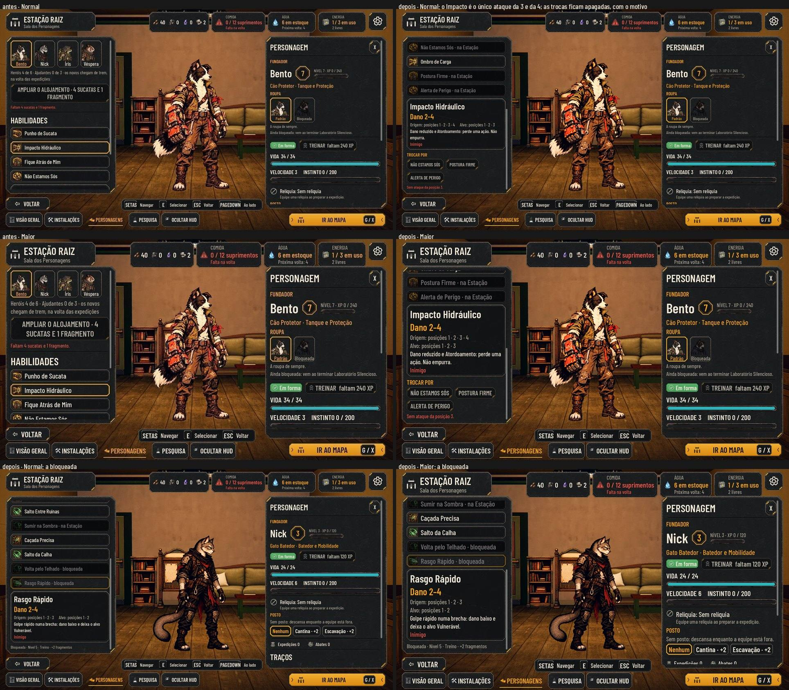
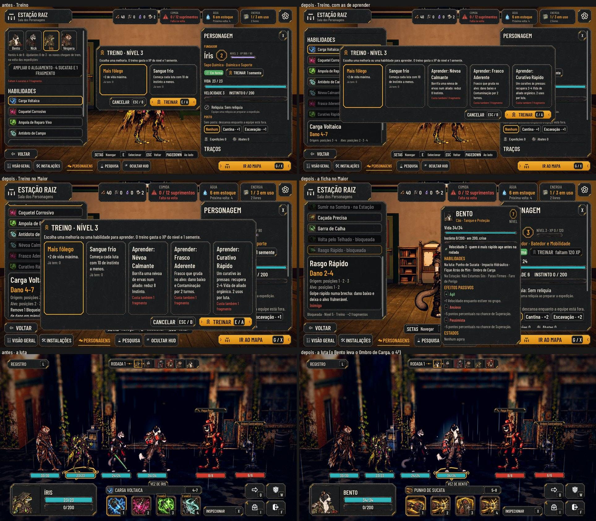

# As sete habilidades de combate (#259)

A proposta aprovada pelo Lucas em 01/11 é a Revisão 1 do comentário da #259. Cada classe tem 7 habilidades: as 4 de
base de sempre e 3 desbloqueios novos. A regra é a mesma para fundadores e recrutados.

As fotos saem de `tools/capture_259.gd` (`--text-size=2`). O antes é o mesmo roteiro no código da `main`.

## A regra
| Camada | O que é | Onde fica |
| --- | --- | --- |
| Catálogo | As 7 da classe: as 4 de base e os 3 desbloqueios | `data/classes.json`: `AbilityIds` e `UnlockIds` |
| Desbloqueadas | As de base mais as aprendidas no Treino | no save do herói: `unlocked` |
| Equipadas | As 4 que vão para a luta | no save do herói: `loadout` (`[]` são as 4 de base) |

- **O Treino:** ao subir para os níveis 3, 5 e 7, uma das opções é "Aprender: \<habilidade\>".
  - Custa o do nível mais 1, 2 e 3 fragmentos (`data/hero-skills.json`).
  - No nível 10, a vaga que sobrou continua: o Treino ensina só pelos fragmentos, sem subir de nível.
  - O jogador escolhe a ordem.
  - Quem escolhe uma melhoria no lugar não perde a vaga: ela continua no treino seguinte.
  - Aprender não equipa. O aviso diz onde escolher: "Na Sala, escolha as 4 que leva.".
- **A Sala:** mostra as 7, cada uma num estado: na luta, "na Estação" ou "bloqueada" (as duas últimas apagadas).
  - Apontar uma das 4 da luta mostra "Trocar por", com as que ficam na Estação.
  - Apontar uma que fica mostra "Levar no lugar de", com as 4 da luta.
  - A bloqueada diz o requisito: "Nível 5 · Treino · +2 fragmentos".
  - A coluna rola até o detalhe e a troca, porque com 7 linhas ela passa da altura.
- **A garantia das posições:** a troca que deixaria uma posição, de 1 a 4, sem **ataque** que parta dela fica apagada,
  com o motivo à vista ("Sem ataque da posição 3.").
  - **Por que ataque:** a partida (#95) exige um ataque da posição. Contando qualquer habilidade, como na proposta,
    a Sala aceitava escolhas com que o herói não partia de lugar nenhum. A QA achou 4 combinações sem ataque nenhum.
  - **Com o ataque de cada posição,** toda escolha aceita parte de qualquer lugar da formação.
  - **Quantas combinações valem, das 35 de cada classe:** Protetor (`cao`) 20, Batedor (`gato`) 29, Química (`sapo`) 20, Atiradora (`coruja`) 29, Sabotador (`rato`) 16 e Resgate (`tatu`) 16.
    As 4 de base valem sempre.
  - O save editado que quebre a regra volta para as 4 de base.
  - A formação salva com alguém sem ataque da posição (#95) troca de ordem ao abrir, e a plataforma faz o mesmo com quem
    entra no lugar de quem caiu.
- **A ficha** (a da Preparação) ganha a seção **Habilidades**: as 4 da luta, as da Estação e as bloqueadas, com o
  requisito.
- **A luta:** leva as 4 escolhidas.
  - Sem alvo, o botão já fica apagado com o motivo ("Sem alvo válido"), e Mover e Defender continuam na barra.
  - A Ampola fora da luta só cura se estiver entre as 4.

## Os 18 desbloqueios
A classe é o papel (a direção do Lucas na #189: a espécie fica com o indivíduo). Os ids de classe não mudam, e os nomes das habilidades falam do papel, não da espécie.

Os números ficam em `data/abilities.json`. Todos usam efeitos que a luta já aplica, e nenhum atordoa. O dano fica
abaixo do golpe principal da classe.

| Classe (o papel) | Desbloqueios (posições de onde partem) |
| --- | --- |
| Protetor (`cao`) | Ombro de Carga [1–2] · Postura Firme [1–4] · Alerta de Perigo [1–3] |
| Batedor (`gato`) | Salto da Calha [2–4] · Volta pelo Telhado [2–4] · Rasgo Rápido [1–3] |
| Química (`sapo`) | Névoa Calmante [1–4] · Frasco Aderente [2–4] · Curativo Rápido [1–4] |
| Atiradora (`coruja`) | Mira no Marcado [3–4] · Tiro de Aviso [1–4] · Posição Elevada [1–2] |
| Sabotador (`rato`) | Curto-Circuito [2–4] · Faísca nos Olhos [2–4] · Remendo de Fio [1–4] |
| Resgate (`tatu`) | Placa de Proteção [1–3] · Avanço de Resgate [2–4] · Fôlego de Resgate [1–4] |

- **A arte:** até a entrega de design, cada desbloqueio usa a de uma habilidade parecida da mesma classe, pelo campo
  `ArtOf`. Isso vale para o ícone, as poses, o efeito e o som. Por isso, na luta, o Ombro de Carga aparece com o ícone
  do Impacto Hidráulico. O pedido de arte vai numa issue de design.
- **A descrição da Placa de Proteção** diz "remove Sangramento e Contaminação", porque a limpeza de dano por turno da
  luta tira os dois. A proposta dizia só Contaminação.

## O que continua igual
- Nenhum id muda.
- Os fundadores de `loadout` vazio lutam com as 4 de base, e a paridade continua 48/48.
- A barra da luta continua com 4 botões.
- **Os bônus de habilidade:** a "Mão treinada" e o "Treino: X" da Pesquisa contam pelo id, então valem para qualquer
  personagem da classe que leve a habilidade.
- **O save de antes** abre com as 4 de base e não perde nada.

## Como testar
- `tests/test_hero_skills.gd`, com 232 checagens, cobre:
  - os dados e o equilíbrio;
  - **a regra das posições:** as 4 de base e as 35 combinações de cada classe. A Sala aceita exatamente as que têm
    ataque de cada posição, e toda escolha aceita parte de qualquer posição;
  - o Treino: os níveis, os fragmentos, a ordem e a vaga que não se perde;
  - a escolha das 4;
  - a luta e a Ampola;
  - **as 130 lutas automáticas:** cada combinação aceita, numa equipe de quatro da classe, com os 18 desbloqueios em
    ação;
  - **o nível 10:** aprender sem subir de nível, e o requisito sem "Nível 11";
  - o save: o de antes, o editado e a formação;
  - a Sala e o Treino na tela.
- `tests/run_all.gd` passa inteiro, com a paridade 48/48.
- **Para jogar:**
  - Treine um herói até o nível 3 com a Barra de Admin. O Treino mostra as 3 de aprender.
  - Na Sala, aponte uma das 4 da luta e troque por uma que fica na Estação.
  - A troca que deixa uma posição sem nada fica apagada, com o motivo.
