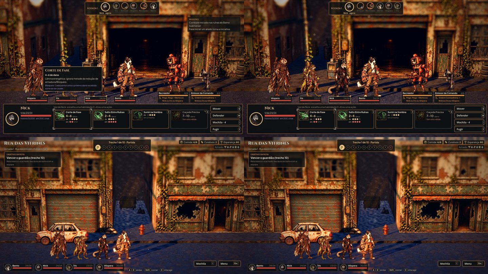

# HUD enxuto, a parte segura (#56)

`tools/capture_ui.gd`, antes à esquerda e depois à direita. Na luta, a vez começa sem a dica da habilidade aberta por
cima dos personagens e sem o registro no canto: o registro mostra só a linha de cada lance por 2 s (a tecla L, trocável
nas Opções, abre as últimas linhas); a dica abre com o mouse em cima ou quando o jogador anda o foco. Na exploração, a
dica das teclas embaixo continua na primeira jornada (a da captura) e não aparece depois da primeira volta à Estação.
O resto do HUD espera as telas do Codex (#58) e a biblioteca de componentes (#60).
