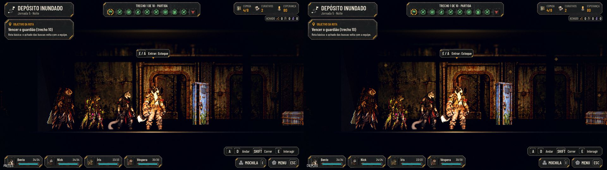
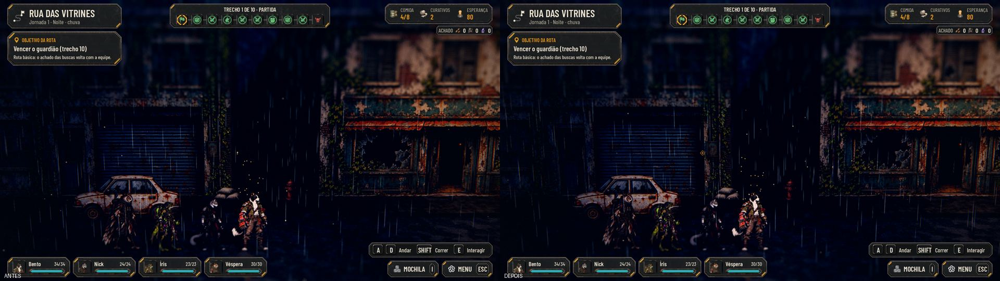
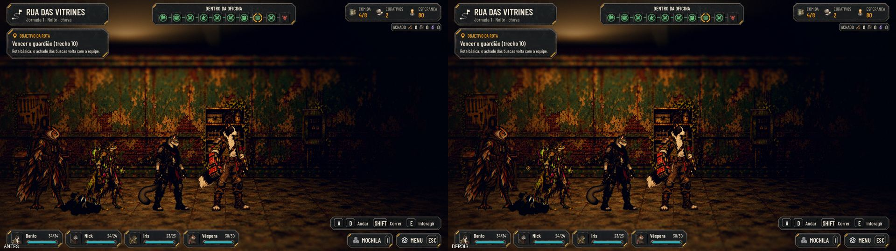
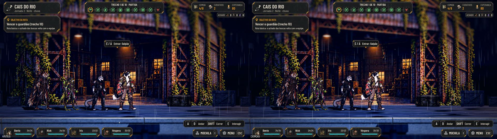
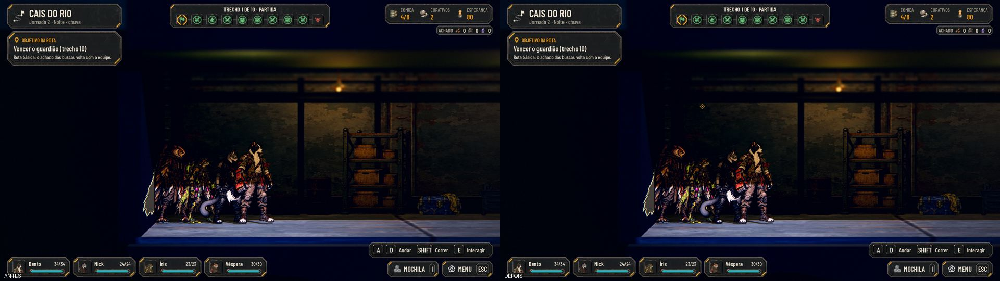
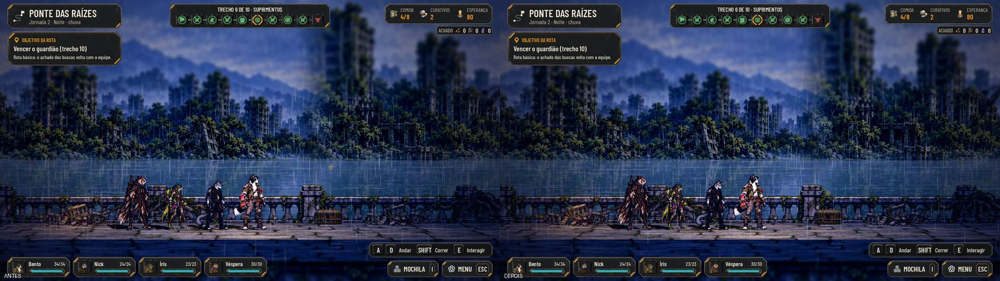
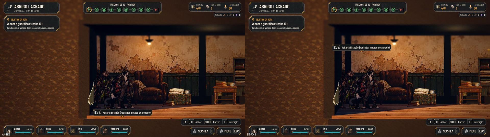
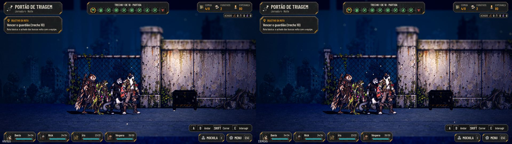
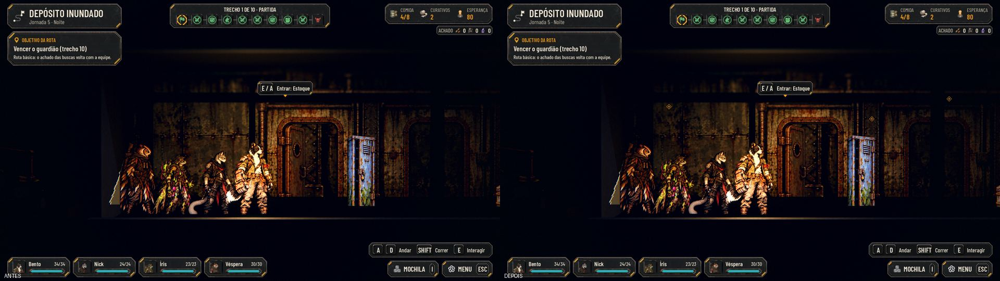
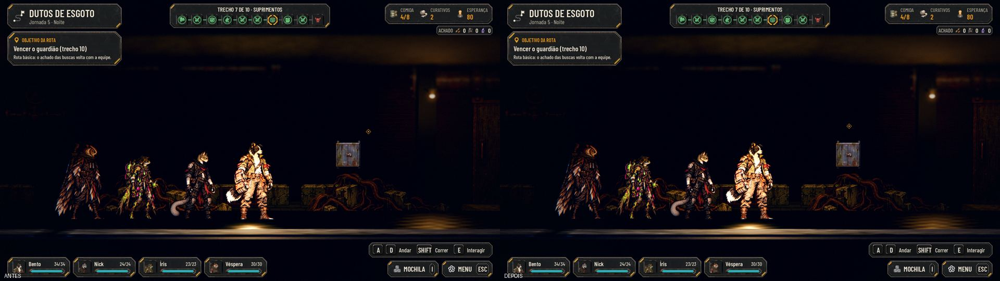

# O indicador de interação em todos os mapas (#142)

A marca de interação (o losango sobre o que se usa) agora aparece do mesmo jeito em todos os mapas: na Rua das
Vitrines, nos seis cenários, nos interiores laterais e nas casas.

## O que muda

- **O ponto da marca** de cada prop dos cenários fica em cima do desenho dele (`AHScenarioWorld.prop_marker_point`),
  e não no piso.
- **Tudo ao alcance já tem a marca:** antes, nos cenários, um objeto só ganhava a marca quando a equipe pisava no
  trecho dele. Agora, com o caminho livre (nenhuma patrulha de pé no meio), o que está na zona já aparece marcado.
  Vasculhado, sai das marcas.
- **Os interiores laterais** ganharam as marcas dos props e da porta de volta, como no corredor; a fogueira e a porta
  das lojas nas casas também.
- **A saída para a Estação** tem a marca no começo do mapa da fase.
- **O aviso da vez** fica sobre o objeto que a tecla usa: nos interiores laterais, o mais perto; nas casas, a fogueira
  (Acampar) e a porta (Sair) também têm o aviso no lugar delas. As alturas das marcas das portas e da fogueira são
  constantes do `street_corridor.gd` (`MARKER_DOOR_HEIGHT`, `MARKER_CAMP_HEIGHT`).

## Testes

- `tests/run_all.gd`: 64 de 64, com a paridade 48/48.
- `tests/test_interaction_markers.gd` (novo, 114 verificações): os seis cenários pela cena de verdade, com a equipe ao
  lado de cada prop, de cada porta de interior e da saída; o que está à frente marcado de longe; o vasculhado sem marca;
  andando pelos interiores de 0,1 em 0,1 m, o aviso sobre o objeto mais perto; com a patrulha de pé em cada trecho de
  luta do Cais, nada atrás dela marcado; a casa do acampamento (a fogueira e a porta, e a fogueira sem marca depois de
  acampar).
- `tools/capture_142.gd`: as capturas de antes e depois (também roda na main de antes).
- A captura da rua (`-- --capture=`), com a colisão: `08-collision-car` e `09-collision-facade` PASS.

## Antes e depois, mapa a mapa

| | |
|---|---|
| Rua das Vitrines  | A casa do acampamento  |
| Cais do Rio  | Um interior do Cais  |
| Ponte das Raízes  | Abrigo Lacrado  |
| Portão de Triagem  | Depósito Inundado  |
| Dutos de Esgoto  | |

## QA

| Rodada | Veredito | O que a QA achou | Como ficou |
|---|---|---|---|
| 1 | REPROVADO | **Médias:** nos interiores, o aviso de um objeto apontava para o vizinho; nas casas, a marca da fogueira e a da porta sumiam quando viravam a da vez, e o teste não cobria as casas nem a patrulha de pé; faltavam as capturas dos seis cenários. **Baixas:** a marca da fogueira 1 m acima dela; os números repetidos | Todas corrigidas, com os casos novos no teste e as capturas acima |
| 2 | APROVADO | Baixas: um comentário no lugar errado; num caso de borda (o inimigo da casa de pé), o aviso podia apontar para a fogueira com o texto da busca | Corrigidas depois do veredito |

## Para o Lucas

- A marca da saída para a Estação (e a da porta de volta dos interiores) fica no ar sobre a ponta do mapa, sem uma porta
  desenhada embaixo. Fica assim?
- Vários props do Abrigo Lacrado e do Portão de Triagem se chamam "Objeto" no aviso ("Vasculhar: Objeto"). Isso já
  existia; vale uma issue à parte para dar nome a eles.
