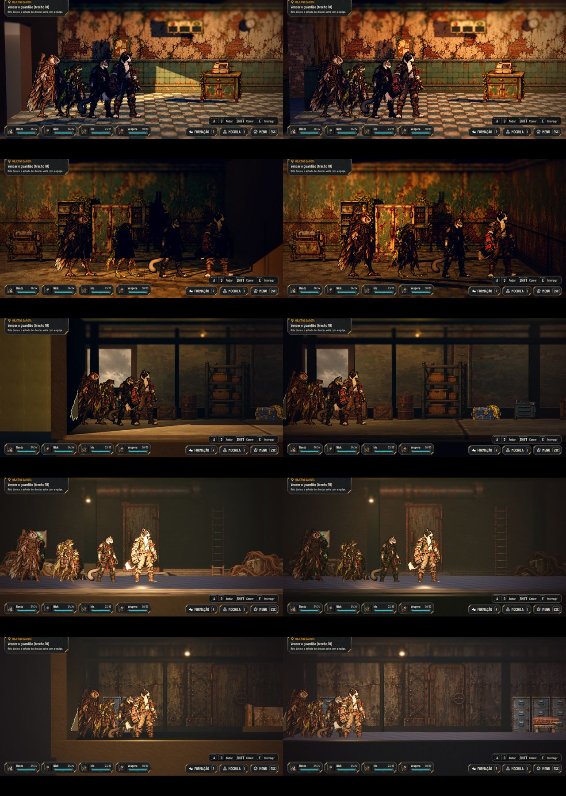

# Os interiores e os cômodos fechados (#175)

## O que estava errado

Levantamento com `tools/capture_175.gd`, que passa pelas três lojas da Rua (na porta, no meio e no fundo) e por cada zona dos
cenários (nas duas pontas e no meio), no fim de tarde e de noite:

- **As lojas:** o sol baixo entrava na diagonal pela frente aberta da sala. Ele riscava o chão e a parede do fundo e
  deixava a parede do lado da porta clara e lisa. As paredes do lado eram de reboco sem textura.
- **As zonas cobertas dos cenários** (o Cais do Rio por dentro, o Abrigo Lacrado, o Depósito Inundado e os Dutos de
  Esgoto): o mesmo sol iluminava a equipe e as paredes como se não houvesse teto.
- **A porta das lojas:** o vão abria para o céu, um retângulo liso, cinza de dia e azul de noite.
- **As pontas das zonas cobertas:** a câmera ia até 4 m além da parede do lado e mostrava o vazio por fora da sala
  (no Depósito Inundado, um plano liso e a quina clara da parede).
- **Ao ar livre** (a Ponte das Raízes, o Portão de Triagem e o cais): nada a corrigir.

## O que muda

- **O sol sob teto** (a sala de uma loja ou uma zona coberta de cenário): fica com 30% da força (`COVERED_SUN`), sem
  sombra. Somem os raios e o clarão, e a equipe continua legível. A luz da sala fica com as luminárias, a porta e a
  ambiente. Ao sair para a rua, o sol volta inteiro. Trocar a qualidade gráfica dentro da sala não devolve a sombra.
- **As paredes do lado das lojas:** usam a arte da parede do fundo de cada loja, um pouco mais escura e projetada pelo
  mundo, para não esticar na profundidade.
- **A porta das lojas:** do lado de fora fica um pedaço da rua: o asfalto, o muro de tijolo em frente e o do lado, e o
  beiral. Pelo vão se vê a rua, não o céu.
- **As pontas das zonas cobertas:** o quadro vai só 1,5 m além da ponta (`COVERED_EDGE_REACH`), o bastante para a
  equipe ficar inteira na tela, e essa faixa é fechada por uma coluna de cada lado, na frente da faixa, com a arte da
  parede do lado do mapa (`AHScenarioWorld.close_zone_ends`). Ao ar livre a câmera segue como na Unreal, com os 4 m de
  folga.
- **O relâmpago:** sob teto, o clarão não tinge mais a sala de azul.
- **Os cenários:** as paredes do lado já tinham textura de concreto, e pareciam lisas por causa do sol. Ficam como
  estão.

## Testes

- `tests/test_interiors.gd` (novo, 115 verificações):
  - as paredes do lado das três lojas com a arte da loja; lá fora, o asfalto e os dois muros de tijolo (pela arte), sem
    encostar em nenhuma outra peça da cena com a sala aberta de verdade; os materiais montados uma vez só;
  - nas zonas cobertas dos quatro mapas (os galpões do Cais, o Abrigo, o Depósito e os Dutos): o sol sem sombra (e
    fraco, comparado ao cais aberto) e, nas duas pontas de cada zona, o líder a mais de 0,8 m da borda do quadro, os
    cantos de cima e de baixo do quadro batendo na coluna da ponta e a coluna sem atravessar peça do mapa;
  - na rua, o sol com sombra;
  - na loja, o sol sem sombra e a 30%, mesmo depois de trocar a qualidade;
  - de volta à rua, o sol inteiro.
- `tests/run_all.gd` inteiro.
- O modo de captura da Rua, com o teste de colisão.
- `tools/capture_175.gd`: as capturas de antes (na `main`) e de depois, com as mesmas posições.

## QA

- **Rodada 1: REPROVADO.** O sol e as paredes estavam certos, e o `run_all` deu 75/75. Dois problemas médios:
  - o vão da porta das lojas mostrava o céu, confirmado trocando o fundo por magenta;
  - a ponta da zona 3 do Depósito Inundado mostrava o vazio por fora da sala.

  E três baixos:
  - o relâmpago tingia a sala;
  - faltava o caso de cenário no teste;
  - faltava dizer o renderizador.

  Correções:
  - a rua do lado de fora da porta;
  - a câmera parando na parede do lado nas zonas cobertas;
  - o clarão só ao ar livre;
  - o Cais do Rio no teste.

  As capturas saem no Compatibility, por software (xvfb).
- **Rodada 2: REPROVADO.** A porta, o relâmpago e o teste do Cais ficaram certos (`run_all` 75/75). A câmera parando
  exatamente na parede cortava o líder ao meio na borda do quadro quando ele chegava à ponta da zona. Correção: 1,5 m
  de folga e as colunas da ponta, com a arte da parede do mapa; o teste confere a distância do líder à borda.
- **Revisão do PR: AJUSTAR ANTES.** As colunas só estavam provadas no Cais e na largura. O teste passou a cobrir os
  quatro mapas cobertos, o topo e a base do quadro e o cruzamento com as peças do mapa; a porta pela arte do asfalto e
  do tijolo; a rua de fora sem encostar em outra peça; e os materiais da loja num cache.
