# O kit da HUD no jogo (#60)

A biblioteca de componentes (`scripts/ui/kit/`), aplicada na HUD da luta e nas duas telas da Estação (relatório da
volta e Sala dos Personagens). As medidas e os passos são os de [hud-target.md](../design/hud-target.md) e
[hud-station.md](../design/hud-station.md).

**O padrão é o kit da Awesomic** (`art/ui/kit/station`), em toda a HUD, a luta também. É a decisão do Lucas em
[hud-direction.md](../design/hud-direction.md), "Padrão de componentes". Do kit do Codex (`art/ui/kit/combat`) ficam só
as peças da luta sem equivalente: `round_strip`, `ability_header`, `ability_slot`, `target_tab` e `actor_ring` (com o
`selected_slot` e o ícone de saída).

## A biblioteca

- **Os componentes** (`AHKit`, `scripts/ui/kit/kit.gd`): as telas pedem componentes, e não arquivos de arte. A tabela
  `COMPONENTS` liga cada componente às peças da Awesomic, então trocar uma peça muda todas as telas.

  | Componente | Função | Peças da Awesomic |
  |---|---|---|
  | Painel | `panel_box("large" \| "inset" \| "band")` | `panel_large`, `panel_inset`, `report_band` |
  | Plaqueta | `plaque()`, ou `style_as(botão, "plaque")` no Registro | `room_plaque` |
  | Botão, com os estados | `button(texto, tipo)` e `style_as(botão, tipo)` | `primary_button`, `secondary_button`, `icon_button`, `chip_button`, `train_button` |
  | Barra | `bar(cor, valor, máximo)` (`AHKitBar`) | `main_bar` e `bar_fill` tingido |
  | Chip | `chip("cost" \| "result" \| …)` e a pílula `AHKitPill` | `cost_chip`, `result_chip`, `status_pill`… |
  | Aba | `tab("card")`, `style_as(botão, "nav" \| "hero")` | `card_tab`, `nav_tab`, `hero_tab` |
  | Linha de lista | `style_as(botão, "list" \| "list_selected")` | `list_row` |
  | Tecla | `AHKitKey.make(ação, texto, "tab" \| "button")` | `key_tab`, `button_key`, `keys_bar` |
  | Carta | `card("hero" \| "upgrade")` | `hero_card`, `upgrade_card` |
  | Foco e escolha | o foco de todo botão, e `selected_overlay()` | `focus_frame`, `selected_frame` |
- **O resto do `AHKit`:**
  - `style(peça)` monta o StyleBoxTexture: `nine_slice_ltrb` nas `texture_margin_*`, o recuo de `content_xywh` nas
    `content_margin_*` e `TILE_FIT` nas peças grandes;
  - as fontes são a Barlow Condensed Medium e SemiBold. Os tamanhos de cada uso (`SIZE`) passam pelo
    `AHUiStyle.px()`, então o texto Maior (130%) vale na hora;
  - as cores dos alvos, com as do daltonismo. O Instinto fica em ferrugem e o XP em violeta (decisões do Lucas);
  - os estados de vida (decisão do Lucas): Em forma acima de 75%, Ferimento leve de 50% a 75% e Ferimento grave abaixo
    de 50%.
- A Barra, a pílula e a Tecla recolorem no `restyle()` quando o daltonismo muda. A Tecla também acompanha as trocas das
  Opções.
- **O anel de quem age** (`scripts/combat/actor_ring.gd`): a peça `actor_ring` num plano deitado no chão, sob os pés,
  com teste de profundidade. O corpo esconde a parte de trás, e a profundidade do plano sai da inclinação da câmera,
  para a elipse ter a proporção do desenho na tela.
- **Galeria:** `tools/capture_kit.gd` mostra as peças e os componentes sobre o aço.
- **Teste:** `tests/test_kit.gd` confere:
  - o manifesto, as margens, o TILE_FIT, as fontes e o Maior;
  - os limites dos estados, as cores do daltonismo e a tecla;
  - o padrão: todo componente usa uma peça da Awesomic, e nenhuma peça aposentada do Codex (`RETIRED`: `panel`,
    `hero_panel`, `register`, `action_button`, `health_*`, `active_health`) aparece no código.

## A luta

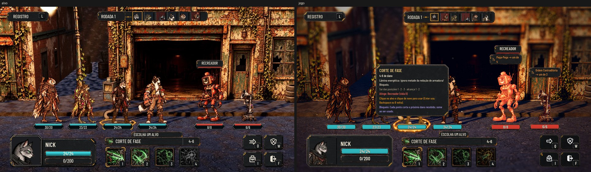

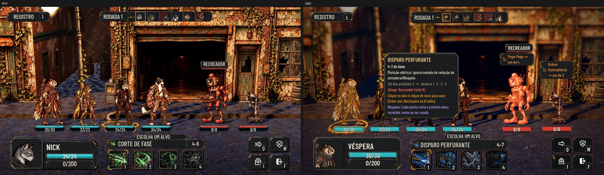

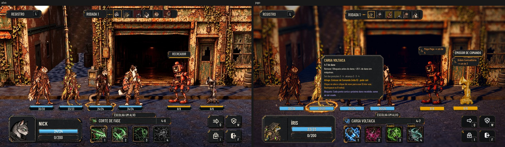

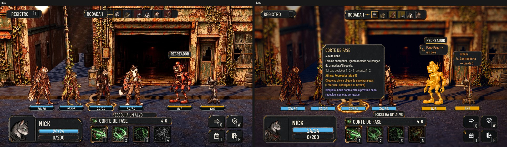

À esquerda, o alvo aprovado (`docs/design/hud-target/hud*.webp`); à direita, o jogo, com as fotos de
`tools/capture_combat_kit.gd`. As peças estão nas posições do alvo (na base de 1920x1080):

- **Registro:** a Plaqueta, no alto à esquerda, com a tecla L em aba. Um clique abre as últimas linhas logo embaixo,
  num Painel de dentro.
- **Faixa da rodada:** "RODADA n", a linha com o ponto e os retratos quadrados da ordem. As máquinas têm o fundo
  avermelhado, e quem age, a borda âmbar.
- **Vida sob as unidades:** a Barra (`main_bar`), ciano nos heróis e vermelha nas máquinas, com o número dentro. Quem
  age ganha a moldura âmbar da escolha (`selected_frame`).
- **Anel:** sob os pés de quem age, no chão.
- **Nome do alvo:** a plaqueta escura com a linha na cor do lado, acima do apontado.
- **Painel do herói:** o Painel grande (`panel_large`), com o retrato quadrado grande, o nome, a vida e o instinto.
- **Habilidade:** a aba "ESCOLHA UM ALVO" (na vez: "VEZ DE NICK"), a barra com o ícone, o nome e a faixa de dano, e
  os quatro slots com a tecla na aba. A escolhida ganha os cantos âmbar.
- **Ações:** a grade 2x2 de Botões de ícone (`icon_button`), com o ícone branco e a tecla em aba. F é a porta com a
  seta de saída.

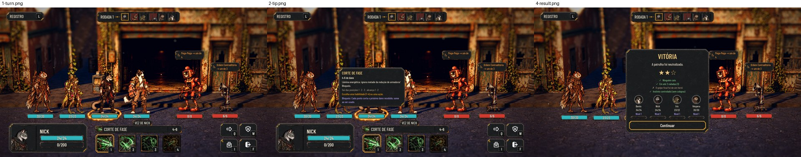

A dica, a tela do fim e o registro também passaram para o aço e a Barlow do kit.

**O que ficou diferente do alvo, e por quê:**
- **A intenção das máquinas continua:** uma plaqueta pequena acima da cabeça delas ("Pega-Pega → um de 4"). O alvo não
  a mostra, mas ela é a informação que diz o que a máquina vai fazer. Ela nunca cobre o corpo, e a barra fica na linha
  das outras, sob os pés.
- **A barra da vida não tem mais a aba do herói nem o recorte da máquina** (as `health_*` do Codex): a Barra da
  Awesomic é a mesma dos dois lados, e a cor diz o lado. No daltonismo, a forma do inimigo segue nas cores (ciano e
  laranja), até a Awesomic redesenhar as peças só da luta.
- **A aba diz o que fazer na vez:** "VEZ DE NICK", e na mira "ESCOLHA UM ALVO". A instrução inteira ("escolha uma
  habilidade (1–4) ou uma ação"; "clique no alvo e clique de novo para usar") fica na dica do kit da habilidade e do
  alvo apontado, que abre com o mouse, o foco e o toque.
- **Usos e recarga** aparecem numa aba pequena no alto do slot, quando existem. O alcance ("Sai das posições 1 · 2 ·
  alcança 1 · 2") e a descrição completa ficam na dica da habilidade.
- **As áreas de toque** são as do alvo (Registro 272x112, ações 128x112, habilidades 140x140), numa camada invisível em
  volta de cada botão: o desenho continua com as medidas do alvo.
- **A ordem é a da sessão real,** e não a ilustração do alvo.

## A Estação

### O relatório da volta

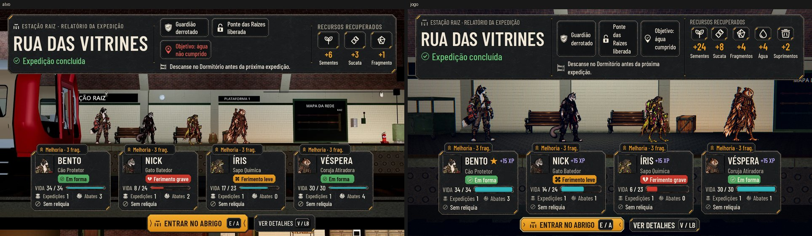

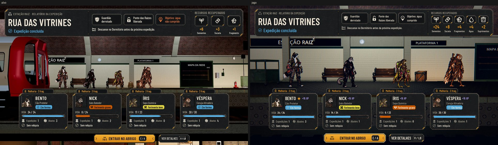

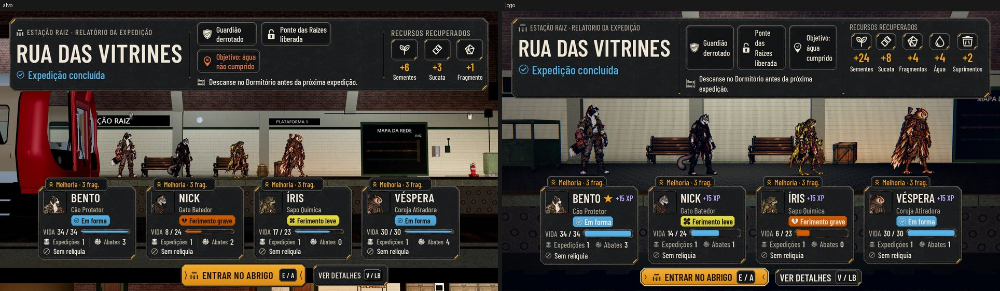

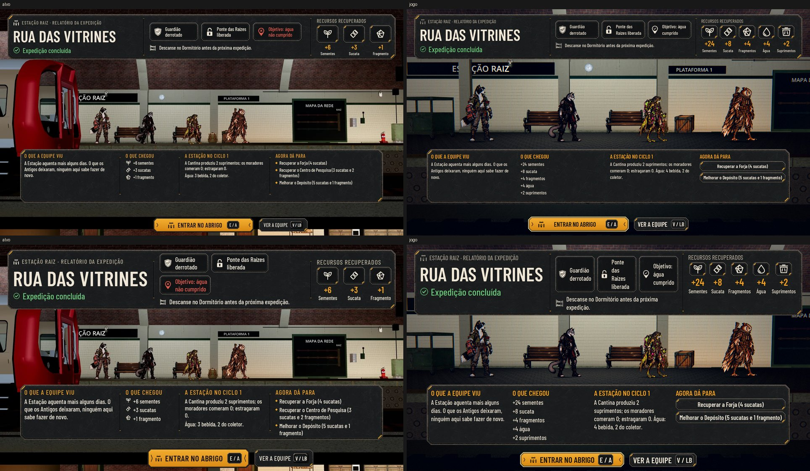

O relatório é a tela inteira (`scripts/ui/station/station_report.gd`), por cima da fila na plataforma. O título, os
recursos e o canto da Estação saem enquanto ele está aberto.
- **A faixa do alto:**
  - a fase e o resultado;
  - os chips do que aconteceu: o guardião, o lugar liberado na primeira vitória da fase, e o objetivo da rota,
    cumprido ou não;
  - a dica da noite;
  - os recursos recuperados.

  No Maior, a faixa cresce para baixo e os chips quebram em duas linhas. O nome longo da fase diminui até caber.
- **As cartas:** uma por herói, na ordem da fila, com o topo em y 678 e 416 px entre os centros.
  - Cada carta tem o retrato, o nome, a classe, a pílula do estado, o XP da volta, a vida e os contadores
    (Expedições e Abates da carreira).
  - Tem também a relíquia e a aba "Melhoria · 3 frag." quando a Pesquisa da classe está aberta.
  - O destaque da volta ganha a ★.
  - **A fila fica alinhada às cartas** (ajuste da revisão do #104): cada herói fica de pé sobre o centro da sua carta,
    pela chave da câmera do relatório, e nenhuma carta corta um herói.
- **VER DETALHES (V/LB)** troca as cartas pela segunda faixa: o que a equipe viu, o que chegou, a Estação no ciclo e
  "Agora dá para". VER A EQUIPE volta.
- **ENTRAR NO ABRIGO (E/A)** segue para a noite, o trem ou o cômodo.

### A Sala dos Personagens

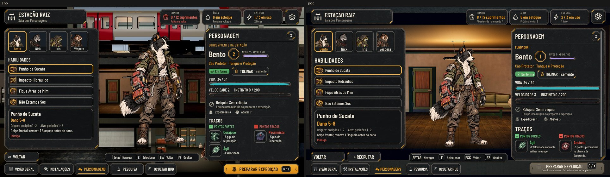

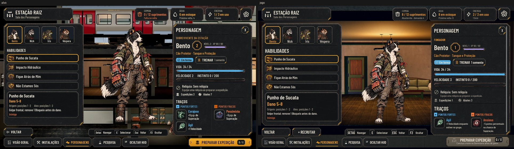

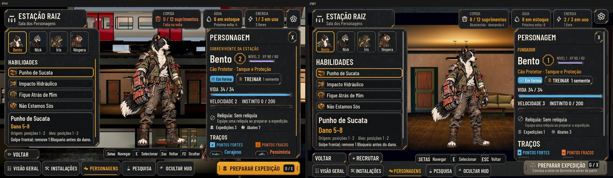

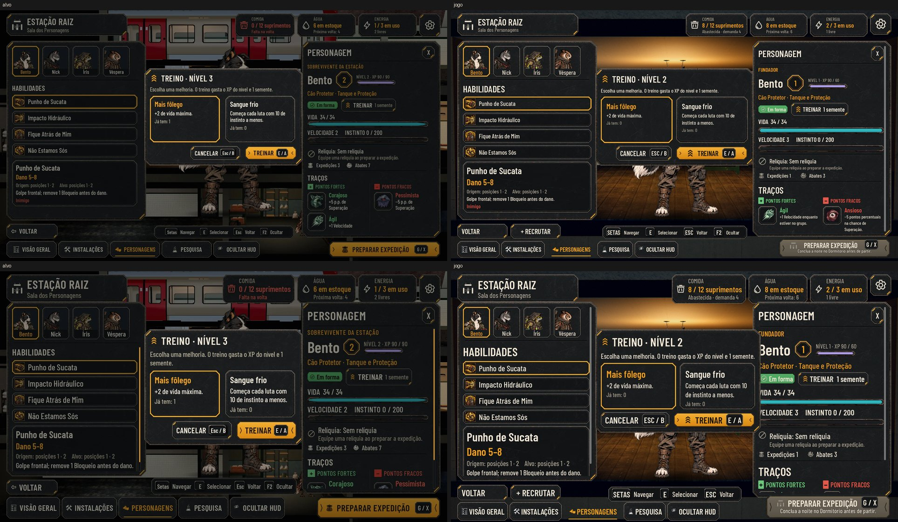

A Sala (`scripts/ui/station/character_room.gd`) também é a tela inteira:
- **No alto:** a plaqueta, Comida, Água e Energia, e a engrenagem (as Opções).
- **À esquerda:** as abas dos heróis, as HABILIDADES e o detalhe da escolhida (a faixa com o treino da Pesquisa e do
  nível, as posições e em quem vale).
- **No meio:** o herói de corpo inteiro, na pose idle com a respiração, sobre a sombra.
- **À direita, o painel PERSONAGEM:**
  - "Fundador" nos quatro do começo e "Recruta" nos que vieram pelo trem (decisão do Lucas);
  - o nível, o XP em violeta e TREINAR (bloqueado, diz o que falta);
  - a vida, a velocidade e o instinto em ferrugem;
  - a relíquia (com Trocar), o trauma (com Tratar), os contadores e os traços pintados com o + e o −.
- **Embaixo:** VOLTAR, + RECRUTAR (o recrutamento e o Memorial, que estavam no painel antigo), as teclas, as abas da
  Estação e PREPARAR EXPEDIÇÃO (G/X). Bloqueado, o motivo fica dentro do botão.
- **O fundo é o próprio cômodo** (ajuste da revisão do #104): a câmera fecha na altura do Alojamento (do teto ao piso,
  entre a plaqueta e o pé do herói), sem a plataforma e o trem em cima nem o andar de baixo. Todos os moradores somem
  enquanto a Sala está aberta, para ninguém aparecer no vão entre os painéis.
- **As Opções (a engrenagem) e o Plano (INSTALAÇÕES)** abertos da Sala voltam para ela ao fechar.
- **TREINAR** abre o diálogo com as duas melhorias da espécie. A escolhida ganha a moldura âmbar; TREINAR confirma e
  CANCELAR volta.

**As teclas novas** (decisão do Lucas, só nas telas da Estação):
- `report_details` (V/LB) e `station_prepare` (G/X), em `tools/define_input.gd`;
- as duas podem ser trocadas nas Opções.

**O que ficou diferente do alvo, e por quê:**
- **Os ícones de recurso pintados ainda não existem** (ajuste da revisão do #104). O código já procura
  `art/ui/kit/station/icons/resource_<seeds|scrap|fragments|water|supplies|food|power>.webp` e usa o pintado quando
  ele existir. Até lá, mostra o SVG do jogo. **Pendente para o Codex.**
- **Abates** é a conta da carreira (`kills_count`, que existia no herói sem ser contado). A volta agora soma nela as
  máquinas derrubadas. Os saves antigos começam do zero.
- **+ RECRUTAR** fica ao lado de VOLTAR: as quatro abas dos heróis enchem a coluna, como no alvo.
- **A barra das teclas diz "Esc Voltar":** o Esc volta sempre, com qualquer troca nas Opções (o nome de Backspace não
  cabia). Ela fica entre os dois painéis; no Maior, os pares do fim que não cabem saem (Ocultar e Voltar também estão
  nas abas e no VOLTAR).

## Rodadas da QA

1. **A luta, reprovada.**
   - **Alta:** a intenção das máquinas cobria o corpo delas no Maior (a #63 voltou). Corrigido: a intenção é uma
     plaqueta à parte, acima da cabeça, e a barra fica sob os pés. A placa (os estados e a barra) que cobriria mais de
     um quinto do corpo também sobe. A largura da intenção desconta as margens da plaqueta. O teste novo
     `test_plates_crowd` cobre uma luta de quatro máquinas, no Normal e no Maior.
   - **Médias, todas corrigidas:**
     - o tooltip nativo saía junto com a dica do kit;
     - a instrução da aba não chegava ao jogador;
     - o alcance das habilidades tinha sumido;
     - a aba do Examinar era larga demais no Maior;
     - o retrato do Rastejante saía vazio. Agora o recorte cai no corpo inteiro, e um teste confere todos os
       retratos;
     - a ficha estava na fonte antiga e cobria o nome do alvo. Agora está no aço e na Barlow, e o nome fica por cima;
     - as áreas de toque eram menores que as do alvo.
   - **Baixas corrigidas:** a crise em ferrugem e o anel saindo já na tela do fim.

2. **A Estação (e a regressão da luta), reprovada.** A regressão da rodada 1 passou.
   - **Médias, corrigidas:**
     - O fundo da Sala mostrava o trem, a plataforma e moradores de outros andares. A câmera agora fecha na altura do
       cômodo, e todos os moradores somem. Havia também um defeito antigo: a passagem, ao terminar, voltava à chave de
       antes e desfazia o enquadramento pedido no meio dela.
     - A carta do herói caído estourava a largura no Maior: o texto agora quebra a linha.
     - G abria o mapa por cima do Treino: com o diálogo aberto, G não faz nada.
     - As Opções e o Plano abertos da Sala não voltavam para ela: agora voltam.
     - Faltavam testes das regras novas. Entrou `tests/test_station_kit.gd`, que cobre:
       - o foco e o objetivo no relatório;
       - a fase liberada só na primeira vitória, e não na última fase nem num save antigo;
       - os abates somados uma vez;
       - a fila sobre as cartas, a menos de 20 px;
       - V e G no relatório e no Treino;
       - as Opções voltando à Sala;
       - os moradores escondidos.
   - **Baixas, corrigidas:**
     - a barra das teclas e o Cancelar do Treino mostram a tecla de Voltar;
     - as folgas no Maior;
     - o ícone afastado do título nos botões principais;
     - o caído sem a ★.
   - **Baixa, fica como está:** VOLTAR e o X não são alcançados só com as setas na Sala. O Esc e o B fazem as duas coisas.
3. **A luta nos componentes e a Estação, reprovada.** As correções da rodada 2 se confirmaram.
   - **Médias, corrigidas:**
     - na mira, o nome do alvo cobria a ficha: a ficha agora fica ao lado do corpo, do nome e da intenção do apontado;
     - a ação bloqueada parecia apertável no `icon_button`: o ícone apaga, como nas habilidades.
   - **Baixas, corrigidas:**
     - a volta à Sala vazava pelo "Ver …" do Plano: abrir outra tela limpa a volta;
     - no Normal, a barra da Sala largava "F2 Ocultar": a tecla de Voltar é o Esc, curto, e os quatro pares cabem.
4. **Rodada 4, aprovada.** As quatro correções da rodada 3 se confirmaram, e a regressão das rodadas 1 a 3 passou.
   Ficam duas notas baixas:
   - no Maior, a barra da Sala larga "F2 Ocultar" (a aba OCULTAR HUD continua embaixo);
   - na luta cheia, a ficha pode cobrir a intenção do vizinho do apontado. O apontado, o nome dele e a intenção dele
     ficam livres.
5. **Decisão do Lucas, antes da rodada 3:** o padrão dos componentes é o kit da Awesomic, também na luta. O Painel, a
   Plaqueta, os Botões e a Barra da luta passaram para os componentes, e um teste confere que as peças aposentadas
   do Codex não voltam.

## Testes

- `tests/run_all.gd` passa inteiro.
- `tests/test_kit.gd` é novo, e confere também que nenhum retrato da ordem sai vazio.
- `tests/test_plates_crowd.gd` é novo: as placas de quatro máquinas não cobrem o corpo nem umas às outras.
- `tests/test_hero_levels.gd` treina pela Sala nova: TREINAR, a melhoria e a confirmação.
- `tests/test_screen_fit.gd` confere os cantos de escolhida na habilidade (a camada `Selected`, `selected_slot`).
