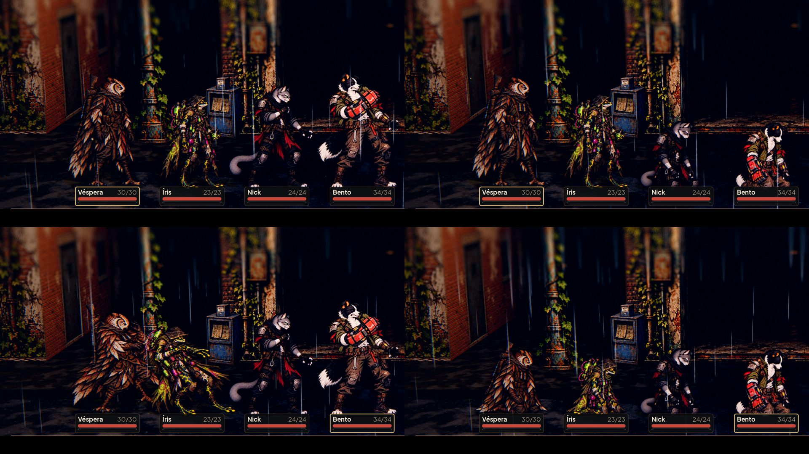

# Quedas ajoelhadas da Íris e da Véspera (#13)

Na luta da Rua das Vitrines, à noite com chuva (`tools/capture_reactions.gd`). Em cima, antes: o dano e a queda (à
direita, Bento e Nick ajoelhados, Íris e Véspera de pé, sem pose). Embaixo, depois: o dano (à esquerda) e a queda
ajoelhada dos quatro fundadores, com o pé no lugar do parado.

O dano da Íris é largo e encosta na Véspera quando as duas são atingidas juntas: fica para o Lucas decidir se o
espaçamento basta.
