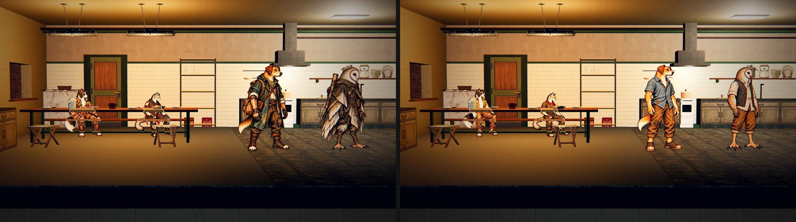
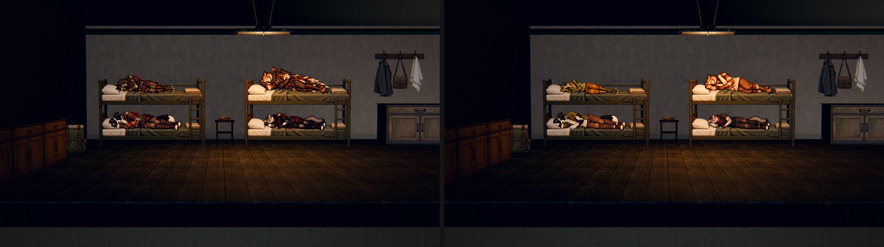
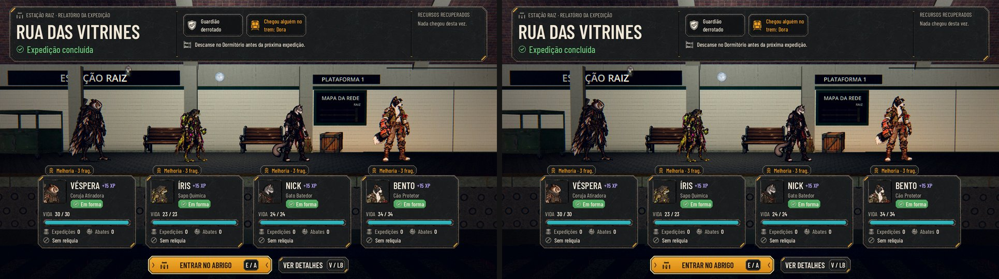
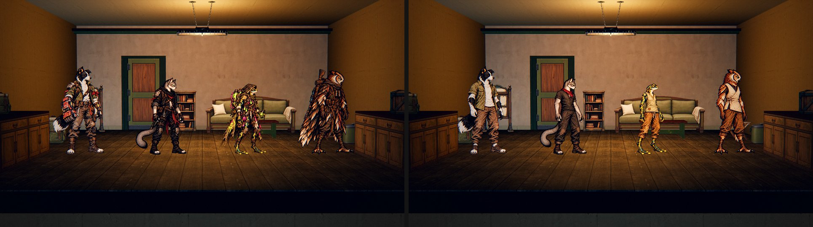

# A roupa confortável do lobby (#249)

Os moradores da Estação vestem a roupa confortável nos cômodos. Os figurinos foram aprovados na #243 e as poses no PR
#267. A roupa de expedição, com a skin gravada, continua em tudo o que não é cômodo. Em cada par, o antes (a `main`)
fica à esquerda e o depois à direita, com a mesma câmera e as mesmas posições.

## Quando cada roupa aparece

| Onde | Roupa |
| --- | --- |
| Cômodos: parado, andando, no banco da Cantina, no beliche, no leito de recuperação, no posto de trabalho | Lobby |
| A chegada de trem, a fila do relatório e a saída da plataforma | Expedição |
| A fila da partida, a rua, a luta e o acampamento | Expedição |
| Ver personagem (a figura da Sala dos Personagens) | Expedição, na skin gravada |

- **Depois da chegada:** quem volta desce do trem, faz a fila do relatório e sai da plataforma na roupa de expedição.
  Ao sair da plataforma, aparece no cômodo na roupa do lobby. Enquanto está no trem, na fila ou saindo dela, ele não
  aparece no cômodo; antes, quem ainda estava no trem aparecia no cômodo ao mesmo tempo.
- **Abrindo o jogo na Estação:** sem uma volta pendente, todos já estão na roupa do lobby. Se o jogo fechou no meio da
  chegada ou do relatório, a chegada recomeça na roupa de expedição, como antes.
- **A skin** (a Ronda do Bento, #138) é a roupa de expedição: ela muda a figura de Ver personagem, a fila e a rua, mas
  não o cômodo.

## Arte e dados

- `tools/sync_lobby_outfits.py --sources <pasta>` lê as fontes da Release `awesomic-249-lobby-originals`. Ele confere o
  sha256 de cada fonte no contrato (`docs/design/lobby_poses/contract.json`) e grava 34 WebP em `art/station/lobby/`
  (2,1 MB) e o manifesto `data/presentation/lobby_outfits.json`, com o canvas, a âncora e a altura de referência do
  contrato.
- **O que entra agora:**
  - os quatro fundadores, com parado, banco, beliche e trabalho;
  - os seis recrutas machos, com parado, banco e beliche.
- **As fêmeas ficam para depois.** Elas entram com as poses de expedição da #250: sem elas, uma recruta não teria
  roupa para sair.
- `AHLobbyOutfit.poses_of` (`scripts/flow/lobby_outfit.gd`) encontra as poses pelo id do fundador ou pela variação de
  arte do recruta (`art_variant`).
- **Na Estação** (`station.gd`), cada morador guarda as poses da roupa que veste (`walker.poses`). É a do lobby, ou a
  de expedição para quem ainda não tem a do lobby. As duas nunca se misturam: sem a pose na roupa que veste, o
  morador não senta, não trabalha ou não deita.
- **Os recrutas agora sentam e deitam.** Antes, só os fundadores tinham essas poses.

## Testes

- `tests/test_lobby_outfit.gd`, com 30 verificações:
  - o manifesto e a arte;
  - o jogo aberto na Estação, com todos na roupa do lobby, inclusive no banco, no beliche e no posto;
  - o recruta sentado;
  - a noite;
  - a skin, que muda Ver personagem mas não o cômodo;
  - a fila da partida;
  - a volta, em que ninguém aparece no cômodo enquanto está no trem, nem com uma tela abrindo e fechando no meio, e
    em que a roupa troca depois de a equipe sair da plataforma.
- `tests/test_skins.gd`: trocar de skin muda a figura da Sala, e a placa no cômodo continua na roupa do lobby.
- `tests/run_all.gd`: 97 de 97.
- **Capturas:**
  - comando:
    `xvfb-run -s "-screen 0 1920x1080x24" "$GODOT" --path . --rendering-driver opengl3 --resolution 1920x1080 -s res://tools/capture_249.gd -- --out=<pasta> --wait=1`;
  - rodadas na `main` (`fcffee0`) e nesta branch, sem placa de vídeo (renderer Compatibility).

## QA

**Rodada 1, VEREDITO: APROVADO.** Nada de gravidade alta ou média.

O que a QA conferiu:
- **Suíte:** 97 de 97.
- **Conversão:** refeita a partir da Release, com os 34 WebP e o manifesto iguais byte a byte.
- **A volta pela passagem de verdade:**
  - recarregando no meio da chegada, no relatório e na saída;
  - com a Sala aberta durante a saída;
  - com a noite pendente;
  - com heróis caídos no leito e no Dormitório.
- **Outros casos:**
  - skin trocada com o herói sentado e no posto;
  - partida cancelada;
  - recruta acolhido do trem com a fila saindo;
  - o candidato do trem no passeio;
  - Guaxinim de save antigo sem variação;
  - 600 quadros de passeio sem misturar as roupas.
- **Medidas:** os recrutas em pé têm a mesma altura nas duas roupas. Sentados, têm a altura do fundador da família.
  Deitados, o comprimento é a altura do corpo.

Observações baixas:
- **`.uid` da captura:** faltava o `.uid` de `tools/capture_249.gd`. Foi versionado.
- **O galão da Cantina:** o galão em x 17,6 cobre a cabeça de quem senta no primeiro lugar. Agora os recrutas também
  sentam ali. Isso já foi apontado no #267 e fica para outra issue: afastar o galão ou o lugar.
- **Recruta sem variação:** um recruta de cão, gato, sapo ou coruja gravado com `art_variant` vazio fica com a arte de
  expedição do fundador no cômodo, só de pé. O jogo de hoje não cria esse caso.
