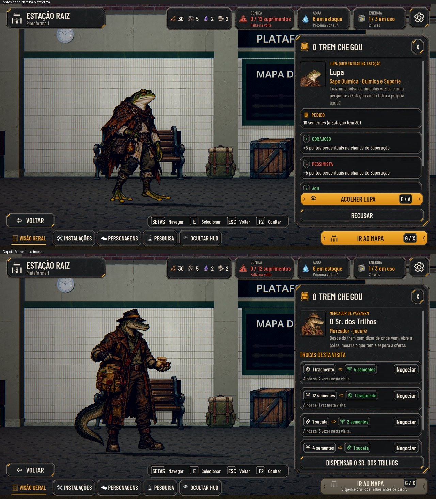
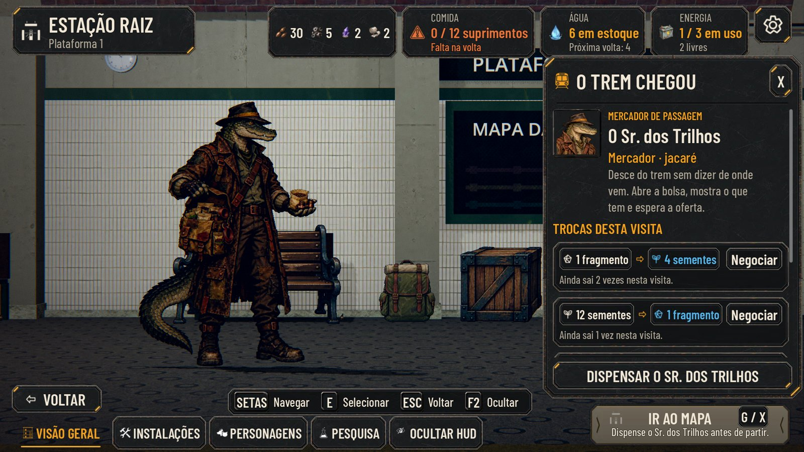

# Mercador: integração no Windows

PR #271, parte 2 da #182. Conferência em 30/10/2026, Godot 4.7.2, Vulkan Forward+ na NVIDIA RTX 3050, 1920×1080.

## Antes e depois

O antes usa a main `968f2bba`, com trem verde e Dormitório/Bar integrados. O depois usa a integração do PR #271 com essa mesma base. Campanhas de captura próprias, sem gravação nos saves do jogador.

O roteiro original `tools/capture_182_merchant.gd` fotografa o painel reaberto depois da chegada. No PC foi usada uma cópia temporária fora do projeto, mantendo o candidato no trem ao abrir a Estação e esperando a chegada real terminar. O log registrou `warning`, `brake`, `stop`, `doors_open`, `candidate_out`, `candidate_ready`, `camera_on_candidate` e `arrival_complete: true` antes das fotos.

## Texto Maior e daltonismo

Conferidos a pose de oferta, as taxas, o limite esgotado depois de negociar, o bloqueio da preparação enquanto o Mercador espera, a dispensa e o relatório da volta. O painel tem rolagem para as linhas que excedem a área disponível. A captura também foi feita no texto Normal. Ambos os processos terminaram com código 0 e sem erros no log.

## Integração e limites

- Código de trem, Dormitório/Bar e Mercador unido sem conflitos de GDScript.
- Conflitos de `en.po` resolvidos por comparação com o ancestral comum e regeneração por `tools/i18n_update.gd`: 2.001 textos atuais, todos traduzidos, e 256 traduções obsoletas preservadas.
- `tools/i18n_ignore.txt` mantém as entradas dos dois lados.
- A suíte completa e o CI do head final são registrados no comentário do PR após a validação.
- Chances e preços continuam propostas ajustáveis nos dados. Nenhum novo valor de balanceamento foi escolhido nesta integração.
- As capturas não substituem a avaliação de aparência, ritmo e som pelo Lucas em Play; a #182 permanece aberta.

Logs e PNGs completos ficam fora do Git, em `merge_oct30/` na pasta local de artefatos da conversa. Aqui entram apenas duas imagens JPEG leves de comprovação.
