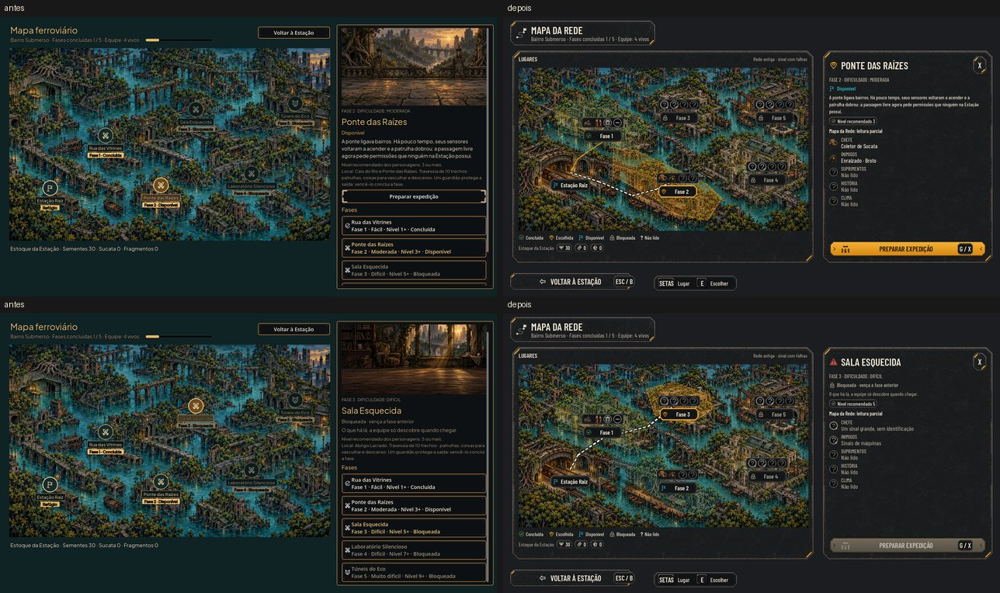

# O Mapa da Rede com o radar (#87)

A tela do Mapa de [hud-fluxo.md](../design/hud-fluxo.md), com a arte e o contrato de
[phase-map.md](../design/phase-map.md) (#86), e o radar que lê o que a equipe vai encontrar em cada lugar.

As maquetes (à esquerda) e o jogo (à direita):
- [Normal](network_map/target_game.jpg)
- [Maior](network_map/target_game_large.jpg)
- [Daltonismo](network_map/colorblind.jpg)

As fotos saem de `tools/capture_87.gd` (`--text-size=2` e `--colorblind`). A campanha das fotos tem a fase 1 concluída
e a Pesquisa recuperada, e usa a semente 4242 do exemplo da #86.

## O mapa

- A pintura da #86 (1120 x 630, sem escala) fica em 60,196, com o sombreado do terminal (62/255 de preto). As camadas
  e os polígonos de clique vêm do contrato, copiado para `data/presentation/network_map.json`.
- **Cada lugar** mostra a projeção do estado (as máscaras brancas tingidas pelo kit):
  - disponível, no azul do kit;
  - escolhido, em âmbar;
  - concluído, na cor de bom (o daltonismo troca);
  - bloqueado, apagado.
- **Os rótulos** são botões: concluído com o check, escolhido com a moldura âmbar, disponível com a bandeira e
  bloqueado com o cadeado.
- **As rotas:** a percorrida (as fases concluídas) em âmbar e a que falta até a escolhida em claro com contorno escuro
  (a camada da hud-fluxo, `route_<lugar>_remaining_kit.webp`).
- **Sobre cada fase**, os sinais do radar numa chapinha: o guardião, os inimigos, os suprimentos e a história.
  - Conhecido, o rosto (os recortes da #86).
  - Não lido, a pergunta; parcial, a pergunta com interrupção.
  - A história sem sinal tem o traço próprio.
- **Escolher:** clicar ou tocar no próprio lugar (o polígono) escolhe a fase; o rótulo também. As setas andam pelos
  lugares na ordem da rede, Interagir escolhe e, com a fase escolhida, o foco vai para PREPARAR EXPEDIÇÃO.
- **À direita,** o painel da fase:
  - a dificuldade e o estado;
  - a descrição (bloqueada: "O que há lá, a equipe só descobre quando chegar.");
  - o nível recomendado;
  - a leitura do Mapa da Rede, uma linha por sinal (chefe, inimigos, suprimentos, história e clima);
  - PREPARAR EXPEDIÇÃO (G / X, também pela tecla; ela segue a troca nas Opções), travado na fase bloqueada;
  - o X tira a escolha e volta aos Lugares (a Estação e a lista das fases).
- **Embaixo:** VOLTAR À ESTAÇÃO (Esc / B) e a barra das teclas.

## O radar (`AHNetworkRadar`)

- **Tem que ser verdade:**
  - a semente da rota de cada fase fica na campanha (`station.route_seeds`) na primeira vez que o mapa a lê;
  - a partida usa a mesma semente, e depois dela a fase ganha outra;
  - o radar lê da rota que a partida monta (`create_corridor`, `corridor_enemies`, e na rua `assign_search_sites` com
    as portas fixas da montagem), sem sortear outra.
- **O que ele lê:**
  - **guardião:** o primeiro do grupo do último trecho;
  - **inimigos:** os mais comuns das patrulhas primeiro, com empate pelo id;
  - **suprimentos:** quantos pontos de busca (na rua, as casas sorteadas e os objetos dos trechos de suprimentos; nos
    cenários, os objetos vasculháveis), em poucas palavras com o número;
  - **história:** se a rota vai mostrar o evento de história (a fase ainda o tem e a Passagem cai no mapa da fase, não
    na travessia);
  - **clima:** o tempo da rota.
- **A leitura melhora com a Estação** (decisão do Lucas):
  - a Pesquisa recuperada lê o guardião e os inimigos;
  - o Depósito melhorado (nível 2) lê os suprimentos;
  - a Forja recuperada (a antena do terminal remendada na bancada) lê a história e o clima;
  - a fase concluída fica conhecida;
  - sem o cômodo, "Não lido";
  - com o cômodo e a fase bloqueada, o sinal sem identidade ("Um sinal grande, sem identificação", "Sinais de
    máquinas").
- **Na Estação:** o texto da Pesquisa, do Depósito melhorado e da Forja no Plano e no Próximo passo diz o que o cômodo
  passa a ler no Mapa da Rede.
- **O save:** a tabela das sementes é opcional; um save de antes dela abre normal e ganha as sementes na primeira
  leitura.

## Decisões para o Lucas

- **O terceiro passo da leitura** (a história e o clima): a **Forja**, que remenda a antena do terminal. O Bar seria o
  lugar natural (os rádios dos moradores), mas ele ainda não tem recuperação no jogo ("chega numa próxima fase"). Quando
  o Bar ganhar a recuperação, é uma linha em `AHNetworkRadar.READERS`.
- **O Depósito é básico** (nível 1 desde o começo): para ler os suprimentos, ele precisa estar melhorado (nível 2).
- **O nome na tela:** a maquete dizia "Rede antiga · VIGIA", mas a regra de consistência não deixa o nome aparecer antes
  do fim da escada (`test_narrative_terms`). Na tela ficou "Rede antiga · sinal com falhas" e "a rede antiga de
  vigilância".

## A trava do padrão

`phase_map.gd` saiu de `tools/kit_guard_exceptions.txt`. A lista de exceções ficou vazia: todas as telas usam o kit.

## Testes

- `tests/run_all.gd`: 57 de 57, com a paridade 48/48.
- `test_network_radar` (novo):
  - em 4 sementes x 5 fases, o guardião, os inimigos das patrulhas e o clima do radar são os da rota de
    `start_expedition` com a mesma semente;
  - os pontos de busca batem com a rua e com um cenário montados de verdade;
  - a leitura muda com a Pesquisa, o Depósito melhorado, o Bar e a fase concluída;
  - a semente nasce, volta do save, vale na partida e sai depois dela;
  - a história: andando a rota até a Passagem, o evento abre exatamente quando o radar disse (fases 2, 3 e 5, 60
    sementes cada, com rotas dos dois jeitos).
- `test_phase_map` (novo):
  - o mapa cobre a tela;
  - um save sem as sementes abre e as grava;
  - o clique no polígono da Ponte escolhe a fase;
  - "Não lido" sem a Pesquisa e o guardião da rota com ela;
  - G / X prepara a fase escolhida;
  - a fase bloqueada não prepara;
  - ↓ anda da Estação para a Fase 1 e Interagir escolhe;
  - o X volta aos lugares.
- Atualizados: `test_full_journey` e `test_keyboard_navigation` (os rótulos do mapa) e `test_live_options` (os rótulos
  centrados no lugar no Maior).

## Rodadas da QA

### Rodada 1: REPROVADO

**Alta, corrigido:** o radar dizia "Algo fala no rádio" em cerca de 1/3 das rotas das fases 2 e 5, quando a Passagem
caía na travessia e o evento não disparava. Agora `story_ahead` exige a Passagem no mapa da fase, e o
`test_network_radar` anda a rota até a Passagem e confere o evento contra o radar.

**Média, corrigidos:**
- PREPARAR EXPEDIÇÃO mostrava "G / X", mas a tecla não fazia nada no mapa. Agora prepara, e a tecla do botão segue a
  troca nas Opções (`ah_action`). O `test_phase_map` confere.
- O Bar lia a história e o clima, mas ele ainda não tem recuperação. Agora é a Forja (recuperável por 4 sucatas), que
  remenda a antena do terminal. Ficou anotado para o Lucas.

**Baixa, corrigido:** sem fase escolhida, a Estação aparecia em âmbar como "Escolhida". Agora ela fica sempre como o
ponto de partida.

**Baixa, fica:** trocar o foco da rota na Preparação depois de ver o mapa pode mudar os pontos de busca da rua; reabrir
o mapa mostra a leitura com o foco novo.

### Rodada 2: APROVADO

A história contra a Passagem em 200 sementes por fase (nenhuma errada), os pontos de busca das fases 2 e 5 nos dois
mapas, o guardião da fase 5, G / X na fase aberta, na bloqueada e sem fase, e o Esc entre a Preparação e o mapa.

As observações baixas da rodada que entraram:
- a frase da antena só no nível 1 da Forja (melhorá-la não lê mais);
- o clique que a Godot imita do toque não escolhe o lugar duas vezes.
