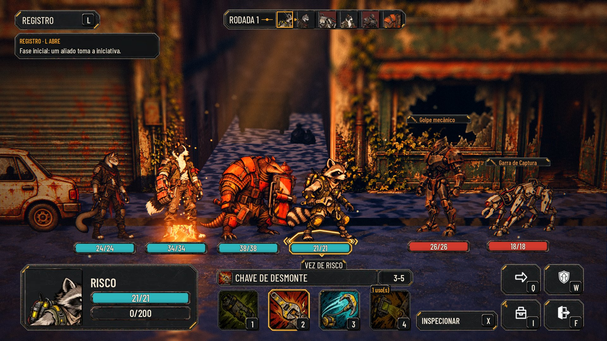
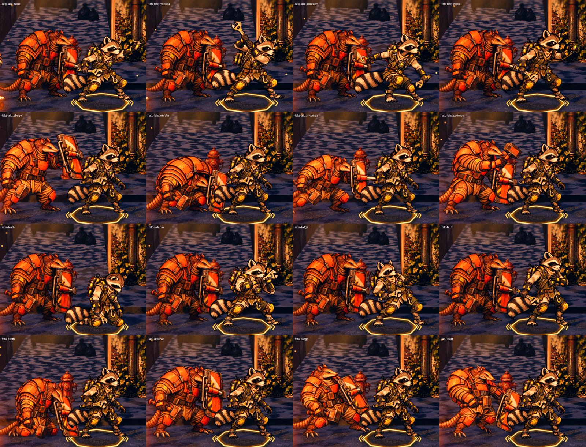
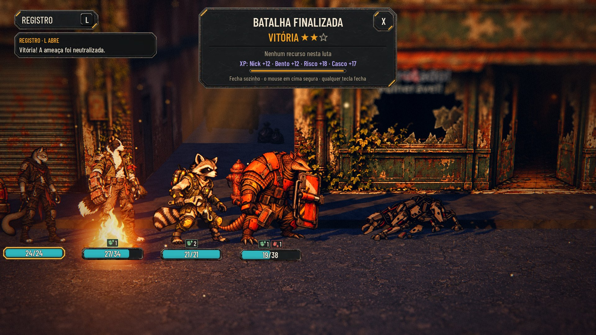

# O Guaxinim e o Tatu na luta (#187)

Captura no Forward+ (RTX 3050, 1920x1080) com `tools/capture_187.gd`. O trem traz o Guaxinim (Risco, `rato`) e o Tatu
(Casco, `tatu`), a Estação acolhe os dois, e a equipe (Guaxinim, Tatu, Bento e Nick) luta na rua contra um robô e um
cão eco.

- **A formação:** os quatro com os pés no chão (y = 0) e na escala ao lado dos fundadores. Alturas: o Guaxinim 1,42 m,
  o Tatu 1,48 m, o Bento 1,72 m e o Nick 1,50 m.

  

- **As poses:** um golpe por habilidade, e o dano, a esquiva, o bloqueio e a queda. Todas usam o pé e a altura do
  parado.

  

- **A luta automática até o fim:** vitória. O Tatu vai para a frente com o Aríete.

  

## Pendências (baixas)

- As ações dos dois ainda não têm som (`HERO_CUES` só tem as quatro classes dos fundadores).
- A pose `heal-received` da origem ficou de fora. Usar item, comer e a superação da crise mostram o parado.
- Não há retrato recortado no padrão da entrega #26: o HUD recorta o rosto do parado.
- O escudo largo do Tatu cobre um pouco o vizinho na formação.
