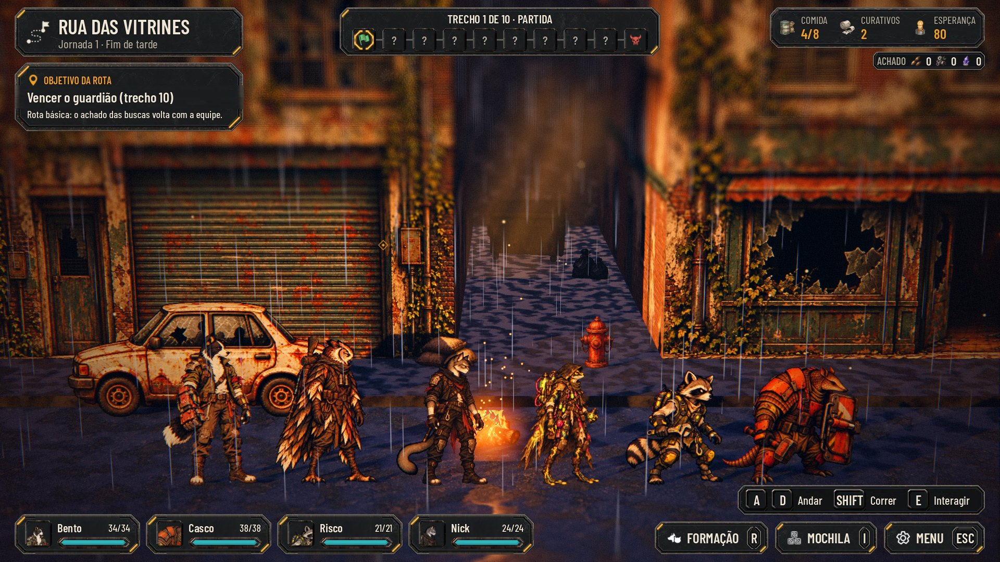

# O Guaxinim e o Tatu na luta (#187)

Captura no Forward+ (RTX 3050, 1920x1080) com `tools/capture_187.gd`. O trem traz o Guaxinim (Risco, `rato`) e o Tatu
(Casco, `tatu`), a Estação acolhe os dois, e a equipe (Bento, Tatu, Guaxinim e Nick) luta na rua contra um robô e um
cão eco.

- **A escala (segunda rodada, o Lucas no #196):** com 1,42 m e 1,48 m os dois pareciam grandes demais. A medida da
  arte é igual à dos fundadores (do topo das orelhas ao pé, pelo alfa), mas a arte legada é mais encorpada, com cabeça
  grande, cauda e escudo. Agora o Guaxinim tem 1,30 m, um pouco abaixo da Íris (1,38 m), e o Tatu tem 1,35 m. Os seis
  lado a lado, com os pés na mesma linha (y = 0): Bento 1,72, Vespera 1,66, Nick 1,50, Íris 1,38, Guaxinim 1,30 e
  Tatu 1,35.

  

- **A formação:** o Tatu fica entre o Bento e o Guaxinim, e o escudo não cobre nenhum dos dois. A ferramenta mede também
  a largura do corpo (`body_width_pixels`). Na fila, o espaço entre dois vizinhos continua 1,2 m, mas cresce quando as
  meias larguras somadas, mais 0,1 m, passam disso. Só o Tatu (1,48 m de largura) chega a isso. As lutas só com os
  fundadores ficam iguais.

  

- **As poses:** um golpe por habilidade, e o dano, a esquiva, o bloqueio e a queda. Todas usam o pé e a altura do
  parado.

  

- **A luta automática até o fim:** vitória. O Tatu vai para a frente com o Aríete e continua com o espaço dele.

  

## Pendências (baixas)

- As ações dos dois ainda não têm som (`HERO_CUES` só tem as quatro classes dos fundadores).
- A pose `heal-received` da origem ficou de fora. Usar item, comer e a superação da crise mostram o parado.
- Não há retrato recortado no padrão da entrega #26: o HUD recorta o rosto do parado.
