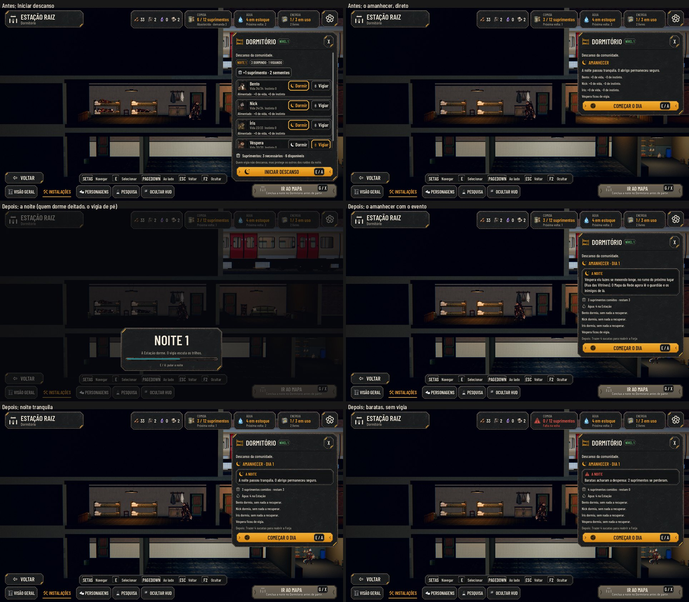

# A noite e o amanhecer (#132)

O pedido do Lucas (26/10): "Precisamos da transição do descanso para começar o dia, e dos eventos que ocorreram à
noite."

No Maior e no daltonismo: [screens.jpg](night/screens.jpg). As fotos saem de `tools/capture_132.gd` (`--text-size=2`,
`--colorblind`). O antes é o mesmo roteiro no código da #119: Iniciar descanso abria o amanhecer direto.

## A cena da noite

- **Ao INICIAR DESCANSO:**
  - a regra resolve a noite e salva antes da cena, então o save no meio da noite abre no amanhecer;
  - as luzes dos cômodos caem até 15% em 0,9 s, e uma sombra escurece a tela (as paredes e as dicas de baixo);
  - quem dorme fica deitado no beliche, e o vigia de pé no Dormitório;
  - o cartão "Noite N" aparece embaixo, acima das teclas, para o Dormitório ficar à vista. Ele traz uma linha ("O vigia
    escuta os trilhos", ou "Ninguém vigia esta noite") e o tempo correndo numa barra por 2 s;
  - a luz da manhã volta, todos se levantam, e o amanhecer abre.
- **Pular:** Interagir, Esc, Voltar, um clique ou um toque pulam para o amanhecer. Nada passa para trás da cena.
- **Com "Reduzir efeitos",** a Estação não escurece: só o cartão.
- **Quando a noite acaba** (pulada ou sozinha), o amanhecer ignora Interagir por meio segundo (a mesma trava da
  chegada): quem martela E ou A vê o resumo antes de começar o dia.
- **O foco** do teclado e do controle volta para COMEÇAR O DIA, pulando ou esperando.

## O amanhecer

O painel do Dormitório abre "Amanhecer · Dia N", com:
- **o evento da noite,** num quadro. O ruim vem com o ícone de alerta e o título em vermelho (no daltonismo, o ícone
  avisa); o bom ou neutro vem com a lua;
- **as condições:** a fome e a sede, quando faltou comida ou água;
- **o que a noite gastou:** "3 suprimentos comidos · restam 3" e a água da Estação;
- **quem descansou:** só o que mudou ("+5 de vida, −15 de instinto"), "dormiu, sem nada a recuperar", "ficou de
  vigia", ou "não pegou no sono" (o sem sono);
- **a Enfermaria (#121):** cada caído e quando volta;
- **o Depois:** o passo seguinte ao amanhecer (o Próximo passo de depois de COMEÇAR O DIA).

## Os eventos da noite

Um sorteio por noite, de `data/night-events.json`. A semente é a da expedição, então a mesma volta sorteia sempre o
mesmo, e salvar e voltar não troca o evento. Os números são **propostas para o Lucas**:

| Evento | Peso | O que faz | Com vigia |
|---|---|---|---|
| Noite tranquila | 30 | Nada. | — |
| Ruídos distantes (ruim) | 14 | Quem dorme baixa 3 de instinto a menos. | O vigia verifica: nada. |
| Barulho na plataforma | 10 | A chance do próximo trem sobe um passo, como uma volta vazia (#122). O texto diz "pode ser". | — |
| Goteira (ruim) | 12 | 2 de água a menos (o texto conta o que de fato caiu; sem água, "não havia água para perder"). | O balde segura: nada. |
| Baratas na despensa (ruim) | 12 | 2 suprimentos a menos, depois da ceia. O Depósito no nível 2 protege. Com a despensa vazia, "não havia o que estragar". | O vigia espanta: nada. |
| O vigia vê algo | 10 | Só com vigia: o próximo lugar liberado fica lido no Mapa da Rede (o guardião e os inimigos). | — |
| Um morador conversa | 10 | Só com a Dora, o Otto ou a Cora na Estação: uma fala curta de quem estiver. | — |
| Sem sono (ruim) | 8 | Só com alguém com trauma que dormiu: ele não pega no sono e perde o desconto do sono no instinto (a sede pesa igual). | Não evita. |

- **O sorteio não olha o vigia:** os pesos são sempre os da tabela, então trocar quem vigia não escolhe a noite (a
  revisão do #172). O vigia muda o que o evento sorteado faz: os ruídos, a goteira e as baratas viram o texto de "o
  vigia evitou", sem perda. O preço é o de antes: o vigia não dorme.
- **Sem quem o evento pede** (o vigia e um lugar por ver, um morador, alguém com trauma que dormiu), a noite sai
  tranquila.
- **Medido em 1000 noites** com a equipe dos fundadores: 33% das noites têm um evento ruim, com ou sem vigia; sem vigia,
  todas essas custam algo; com vigia, nenhuma.
- **O pedido dizia "um rato na despensa".** Na lore, os roedores são povos (os ratos, os esquilos), então a praga virou
  baratas. A fala dos moradores segue o que cada um faz na Estação (a Dora, cozinheira, que evita
  desperdício; o Otto, técnico, no gerador; a Cora, pesquisadora, nos fragmentos).
- **O evento antigo** (os ruídos sempre presentes, de antes da #132) continua nos saves velhos, com o texto de antes.

## Testes

- **`test_night_events` (novo):**
  - o sorteio: a mesma noite sorteia o mesmo, e em 80 noites saem vários eventos;
  - o vigia: em 300 noites, menos noites ruins com ele;
  - cada evento: o efeito (instinto, água, suprimentos, trem, radar) e o texto, com e sem vigia, e o Depósito melhorado;
  - os eventos que pedem vigia, morador ou trauma, que não saem sem eles;
  - o save no meio da noite, que abre no amanhecer com o mesmo evento;
  - a tela:
    - a cena abre com o cartão;
    - a Estação escurece, ou não, com "Reduzir efeitos";
    - quem dorme fica deitado e o vigia de pé;
    - Interagir pula, a luz volta e todos se levantam;
    - o amanhecer mostra os números, o evento, o Depois certo e nenhum "+0".
- **`test_keyboard_navigation`:** Iniciar descanso abre a cena; Interagir pula, e o foco fica no amanhecer.
- **`test_station_rules`:** a sede passa a ser uma condição da noite, à parte do evento.

## Rodadas da QA

### Rodada 1: REPROVADO

**Médias, corrigidas:**
- **Interagir duas vezes pulava a noite e o amanhecer:** o segundo toque caía no COMEÇAR O DIA. Agora o amanhecer
  recém-aberto pelo pulo ignora Interagir por meio segundo.
- **As baratas e a goteira contavam perdas que não aconteceram** ("0 suprimentos se perderam", "2 de água" com 1 no
  estoque). O evento guarda o que de fato caiu, o singular tem texto próprio, e o vazio tem um texto sem alerta.

**Baixas, corrigidas:**
- O sem sono dizia "dormiu" na linha do herói: agora "não pegou no sono".
- Os ruídos diziam "baixou 3 a menos" mesmo sem efeito: o texto não promete número.
- "1 suprimentos comidos" e "restam 1" no singular.
- O barulho na plataforma prometia gente no trem: agora "pode ser".
- O `night_scene` estático fica falso quando a Estação sai da cena no meio da noite.
- A Estação escurecia pouco: uma sombra cobre a tela na noite, e as dicas de baixo deixam de chamar atenção.
- O cartão mostra "E / A", como os botões.
- O commit traz `tools/capture_119.gd.uid`, que faltou no commit da #119, e agora também o da `capture_132`.

### Rodada 2: APROVADO

A QA refez os cenários com scripts próprios: o segundo toque logo depois do pulo (Interagir, Esc, clique, toque e A),
as perdas com o estoque vazio, com 1 e com vigia, a saída da Estação no meio da cena, a sombra e as capturas no Maior e
no daltonismo.

**Baixa, corrigida depois:** a trava valia só para a noite pulada; agora vale também quando a cena acaba sozinha.

**Ficam:**
- Com a água ou a despensa já vazias, o texto do vigia ainda diz que ele evitou a perda.
- Os ruídos dizem que "o sono acalmou menos o instinto" mesmo com o instinto de todos em 0.

### Revisão do PR

- **Média, corrigida:** o sorteio dependia do vigia (os pesos dos ruins caíam com ele, e o vigia vê algo só entrava com
  ele), então trocar o vigia escolhia a noite. Agora o sorteio usa os pesos cheios, e o vigia só evita a perda.
- **Baixas, corrigidas:**
  - o sem sono apagava também a sede: agora perde só o desconto do sono;
  - o rodapé do Dormitório prometia proteger "dos ruídos": agora diz que o vigia evita as perdas da noite;
  - um refresh no meio da cena (as Opções, o trem) religava o amanhecer por baixo da sombra: o painel fica escondido
    até a cena acabar.
- `test_night_events` cobre os três casos (o vigia que não troca o evento em 300 noites, a sede do sem sono e o
  refresh na cena).

## Para o Lucas

- Os pesos e os efeitos são propostas (a tabela acima).
- O botão IR AO MAPA, no Maior, corta a linha de baixo ("partir."). Isso já acontecia antes desta issue (vem da #123) e
  fica para um conserto à parte.
