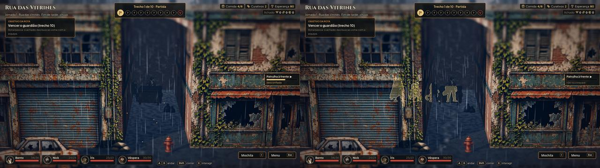
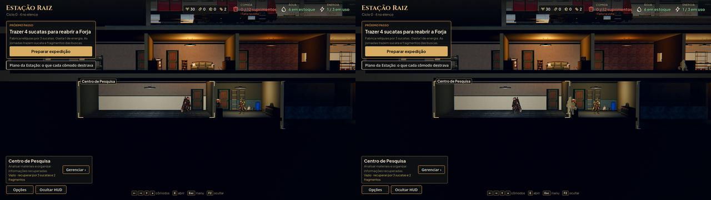

# Silhueta e esmaecimento (#51)

O `AHOcclusion` da Unreal na Godot: quem fica atrás de alguma coisa aparece em silhueta, e o objeto entre a câmera e um
personagem esmaece.

```
"$GODOT" --path . --resolution 1920x1080 -s res://tools/capture_occlusion.gd -- --out=<pasta> [--only=street|scenario|station] [--phase=fase_3]
```

## Como funciona

- **Silhueta:** toda placa de personagem marca o stencil. O segundo passe (`shaders/character_silhouette.gdshader`) só
  desenha onde a placa está atrás de alguma coisa (o teste de profundidade invertido) e nunca por cima de outro
  personagem. Tem preenchimento fraco e contorno.
  - **Cores:** creme na equipe; nos inimigos, a cor de perigo da interface, que muda com o daltonismo, inclusive no
    meio da luta.
  - **Quem tem:** a equipe sempre, os inimigos só na luta, os heróis na Estação.
  - **O pé:** a borda do piso da frente da zona (até 60 cm, no mínimo 12 cm) fica sem silhueta, senão a sola aparecia
    em silhueta nos Dutos e no Depósito.
  - **Efeitos:** os efeitos misturados não marcam o stencil.
- **Esmaecimento (`scripts/world/occlusion.gd`):** o objeto registrado que fica entre a câmera e um personagem
  acompanhado vai a 60% de transparência em cerca de 0,15 s e volta quando sai da frente. Com "Reduzir efeitos", troca
  na hora.
  - **O teste:** a caixa de cada objeto contra os segmentos da câmera até três pontos do corpo, só na faixa de X entre a
    câmera e os personagens (busca binária).
  - **Fora:** o chão, as peças com mais de 12 m, os blocos juntados, as caixas de depuração, os brilhos, os fachos de luz
    e a fogueira.
- **Chegada na ponta da zona:** a fila não sai mais da área de andar. Perto da ponta ela se aperta e abre quando o
  líder anda. O líder fica onde foi posto, porque mais à frente ele caía no alcance da primeira patrulha.

## Provas (sem o efeito à esquerda, com ele à direita)

Na rua, a equipe no beco atrás da fachada:



Na Estação, o herói atrás do batente:



Nos cenários, nenhum objeto real fica na frente da faixa de andar (só planos grandes e a borda do piso), então lá só a
silhueta conta: atrás das paredes e dos batentes, na chegada e nas portas.

## Custo

Medido nesta máquina (llvmpipe, sem GPU), no Baixo; o tempo de quadro só variou dentro do ruído.

| Lugar | Chamadas de desenho | Teste do esmaecimento |
|---|---|---|
| Rua | +3 a +4 (um passe por personagem com silhueta) | 29 a 50 µs por quadro |
| Cenários | +4 | 13 a 34 µs por quadro |
| Estação | +4 | 110 a 160 µs por quadro (228 objetos) |
| Luta | +6 a +26 | - |

Fica ligado em todas as qualidades. Não foi medido na web nem com placa de vídeo.

## Limites conhecidos

- O esmaecimento usa a caixa de cada objeto: a área transparente de um card também conta. A cerca do Portão de Triagem
  esmaece sem ninguém visivelmente atrás dela.
- A caixa é medida uma vez: o painel da passagem secreta e as portas do vagão da Estação se movem e ficam com a caixa
  antiga.
- Na chegada à ponta de uma zona, a equipe fica apertada por cerca de 1 s de caminhada, e o último da fila, rente à
  parede, mostra uma tira de silhueta na capa (ele está mesmo atrás do batente).
