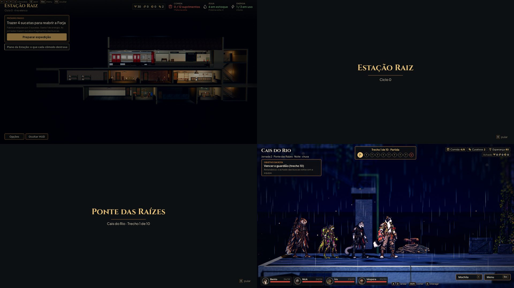
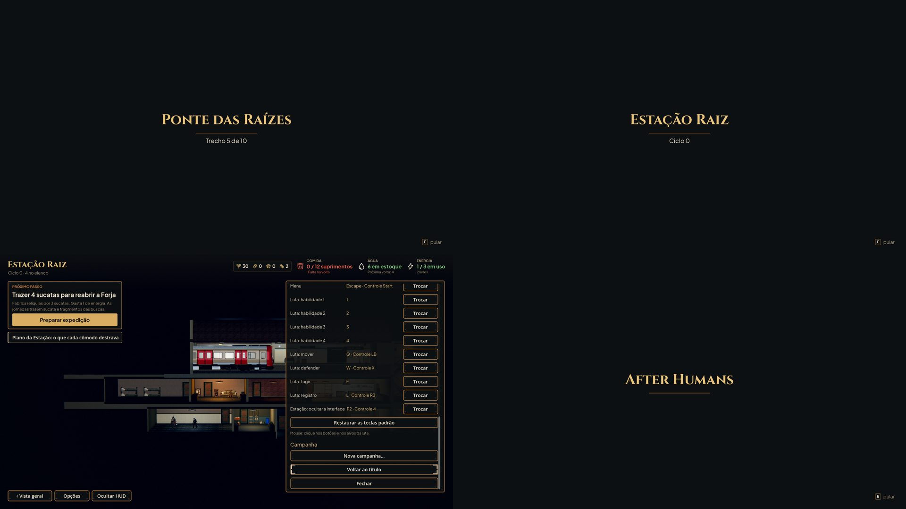
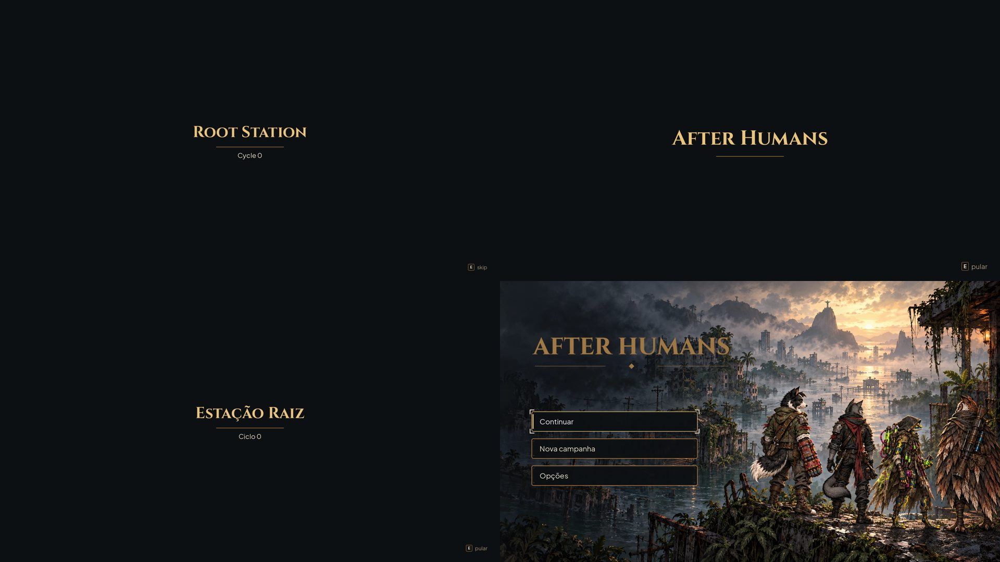

# Passagens: fade com título como tela de carregamento (#74)

Fotos de `tools/capture_passage.gd` (1920x1080, gl_compatibility). A arte do cartão (moldura e tipografia) vem da issue
do Codex (#79); até lá, o cartão usa o estilo do `AHUiStyle` (Cinzel dourado, filete de cobre, texto claro).

Em cima à esquerda, o antes: toda troca de cena era o fade preto de 0,25 s de `GameFlow.change_to`, sem título. Depois:
`GameFlow.travel` fecha o fade, tira a cena de antes, mostra o cartão enquanto a cena seguinte carrega em segundo plano
(`ResourceLoader.load_threaded_request`) e abre o fade na cena nova. Título → Estação (o nome e o ciclo, como no HUD da
Estação) e Estação → rua (a fase, o lugar do trecho e o trecho), com a rua já aberta embaixo à direita.

Rua → rua (o fim do mapa de passagem leva ao mapa da fase; o lugar repete o nome da fase, então fica só o trecho), rua →
Estação (a volta, e a campanha nova depois de uma derrota), as Opções da Estação com o **Voltar ao título** novo e a
passagem para o título.

Em inglês (`tr()`), com o texto Maior das Opções e com "Reduzir efeitos" (o primeiro quadro já com o título parado: sem
o título subindo e sem a cena de fundo); embaixo à direita, o título aberto pela passagem.

## Como funciona

- **Pular:** Interagir (E, Enter, A do controle), Esc/Start, Voltar (Backspace, B), clique ou toque. Só depois de a
  cena seguinte estar carregada e montada: até lá, o canto mostra "Carregando…" e as teclas não fazem nada; depois, a
  tecla de Interagir (ou "Toque para pular" no toque, e a dica troca se o jogador trocar de entrada). Sem pular, o cartão
  fica `GameFlow.CARD_SECONDS` (1,8 s).
- **Nada pela metade:** a cena de antes sai já no preto; a nova carrega em segundo plano e monta por baixo do cartão
  (o `_ready` pesado da Estação e da rua roda com o título na tela), parada (sem processar nem receber tecla) até o
  cartão sair. Depois do cartão não sobra preto travado. Nenhuma tecla passa para trás do cartão, e outra troca pedida
  durante a passagem é recusada, como já era com o `busy`.
- **Som:** entre a cena que sai e a que monta, a música e o ambiente da anterior continuam (antes caíam no silêncio).
- **Cena de fundo:** o cartão aceita `card.backdrop` (um Node3D com a própria câmera, desenhado num SubViewport com mundo
  próprio, ou um Control). Fica para a partida no vagão (#75) e a chegada na Estação (#76).
- **Os títulos** só citam a fase da expedição em andamento (já liberada) ou a Estação Raiz: nenhuma fase bloqueada
  aparece. "After Humans" (o nome do jogo) na volta ao título.
- `change_to` continua para os testes, o roteiro de desempenho e os redirecionamentos (a Estação aberta no meio de uma
  expedição etc.).

## Testes

`tests/test_passage.gd`: os cartões de cada cena (e em inglês), a passagem que termina sozinha na cena inteira depois do
tempo do cartão, nenhuma cena andando por trás do cartão (a nova só monta parada, e só dá para pular com ela montada),
nenhum preto travado depois do cartão, a troca recusada no meio, o pular só com a cena pronta (Interagir, Esc, clique e
toque), o pular que encurta a passagem, "Reduzir efeitos", o Voltar ao título das Opções da Estação (a campanha salva
igual à da memória e o Continuar de volta à Estação) e o save do jogador intacto. `tests/test_title.gd` espera a
passagem acabar antes de contar os quadros.
