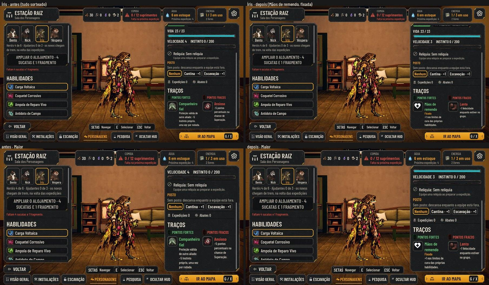

# As peculiaridades (#264)

A definição aprovada pelo Orquestrador em nome do Lucas (02/11) está na #264. Este é o PR 1: o catálogo, os limites, a
fixada no save e a ficha. Ganhar e perder na volta vêm no PR 2, e fixar no Bar no PR 3. A regra fica em
`scripts/flow/perk_rules.gd` (`AHPerks`), e os dados em `data/perks.json` e `data/initial-heroes.json` (`FixedPerk`).

As fotos saem de `tools/capture_264.gd` (e `--text-size=2` para o Maior).

## O catálogo: as 8 de antes e as 8 novas

| id | Nome | + / − | Efeito | Onde vale |
| --- | --- | --- | --- | --- |
| `steady` | Pé firme | + | +10 pp de resistência a deslocamento | `AHCombatEngine.hero_resist` |
| `stumbling` | Pé pesado | − | −10 pp de resistência a deslocamento | idem (entre 0 e o teto) |
| `light-sleeper` | Sono leve | + | −5 Instinto na noite do acampamento | `AHCampSkills.night` |
| `heavy-sleeper` | Sono pesado | − | +5 Instinto na noite; a vigia dele não conta, e a habilidade que só vigia fica indisponível | `night`, `quote` e `use` |
| `mender` | Mãos de remendo | + | +1 nos limites de cura | o motor, a faixa da luta, a Ampola no mapa e a Sala |
| `shaky` | Mãos trêmulas | − | −1 nos limites de cura (nunca abaixo de 0) | idem |
| `scavenger` | Faro de busca | + | +1 sucata na busca que traz sucata | `apply_search_outcome` |
| `short-fuse` | Pavio curto | − | +3 Instinto ao sofrer um crítico, 1× por rodada | o crítico inimigo |

- **As de cura** (`NeedsHeal`) só são sorteadas para quem tem cura entre as 7 habilidades do papel.
- **Nenhuma mexe em Vida ou em dano direto.**
- **A vigia da noite na Estação** (`watch_hero_id`) não muda: a decisão fala da noite do acampamento.
- **A ficha** mostra o deslocamento com Pé firme e Pé pesado, como na luta.
- **Os ícones das novas são provisórios**, tirados do kit (`PROVISIONAL_TRAIT_ICONS`), até a arte chegar do design.

## Os limites e a fixada

- **Limite:** até 3 positivas e 3 negativas, sem repetir e sem incompatíveis (`AHPerks.fits` e `add`).
- **Sorteio:** continua dando 1 positiva, 1 negativa e, às vezes, uma terceira.
- **A fixada** (`fixed_perks`) não sai (`AHPerks.remove` recusa). A ficha e a Sala mostram o selo "Fixada".
- **Os fundadores, nas campanhas novas**, chegam com a positiva fixa e sorteiam o resto:
  - Bento: Companheiro fiel;
  - Nick: Ágil;
  - Íris: Mãos de remendo;
  - Véspera: Sono leve.

  **Isso fica marcado para o Lucas revisar**, porque mexe na identidade dos fundadores. As negativas continuam
  sorteadas.
- **Saves de antes:** abrem sem fixada e sem ganhar nem perder nada. O `migrate` limpa os saves editados.

## Testes

`tests/test_perks.gd`:
- o catálogo e as incompatíveis;
- o limite de 3 + 3 e as de cura só para quem cura;
- o sorteio em 200 sementes;
- os fundadores;
- Pé firme e Pé pesado na resistência;
- as Mãos na faixa de cura;
- o Pavio curto uma vez por rodada;
- o Sono na noite e na vigia;
- o Faro na busca;
- o save (o de antes, o editado e o JSON);
- a ficha com a fixada.

A paridade 48/48 não muda.
