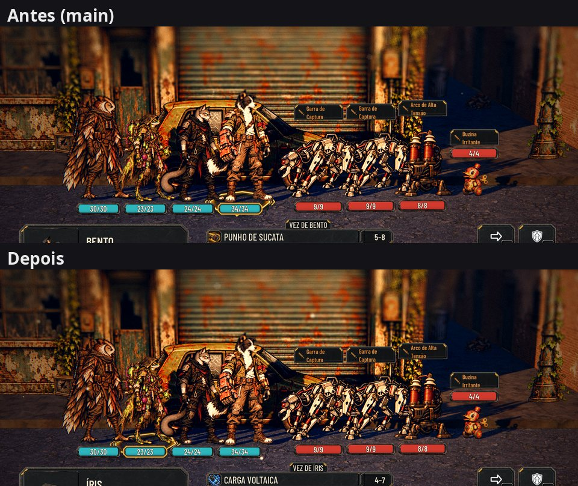
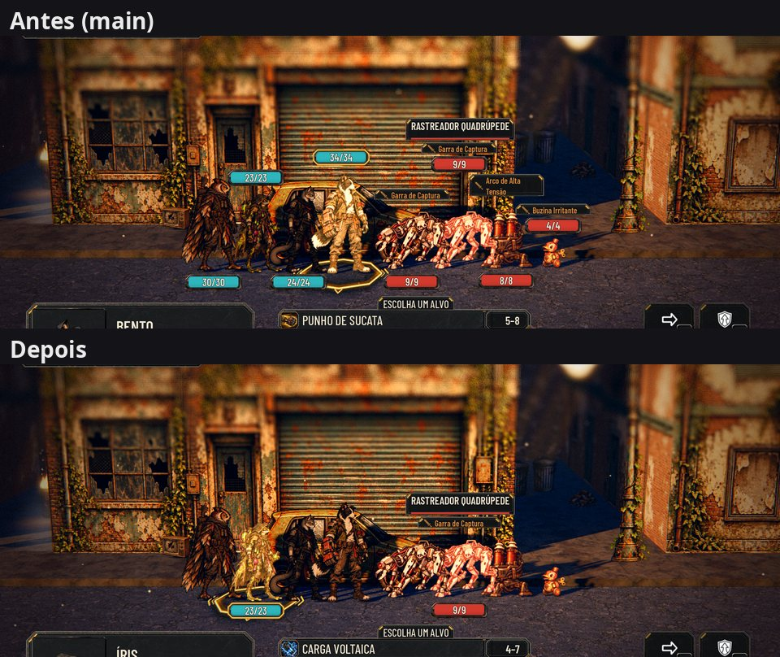

# As placas no aperto, sem em cima e embaixo (#72)

A decisão do Lucas (28/10, no PR #228): "acho que fica muito diferente e incoerente visualmente essas placas em cima e
embaixo, preferia que fosse mostrado apenas por personagem da vez ou quando selecionado no ataque mas apenas para
lugares apertados, a ideia é nem ter espaços apertados. Sempre terem posicionamentos ok para isso não acontecer."

## O espaço (o normal do jogo)

No lugar mais apertado que a luta aceita (os espaços no mínimo, `MIN_GAP_SCALE` 0,6), o enquadramento do começo da luta
já deixa os pés dos vizinhos a 161–249 px (a placa mínima pede 148), na rua, na loja, no chefe, com dois Porteiros e no
cenário, no texto Normal e no Maior. Nenhuma placa some, e antes e depois ficam iguais:

O `test_plates_crowd` agora é a garantia disso: se o vão cair abaixo da placa mínima, ele falha.

## O aperto que sobra (a câmera longe: o zoom do Admin ou um caso extremo)

Sai o escalonamento (`_plate_stagger`). No aperto, a placa e a intenção de quem tem o vizinho perto demais somem, menos:
- a de quem age, desde o começo da vez (`start_turn`, também a do herói atordoado);
- a do alvo: o apontado na mira e, depois de confirmado, o atingido durante o golpe, até a próxima vez começar;
- quando quem age e o alvo são vizinhos do mesmo lado (a cura no do lado), só a do alvo.

As fotos saem de `tools/capture_72.gd` (`tight-*`, `tight-mira-*`, `reframed-*`). Quem tem a vez muda entre as duas
execuções (o Bento na `main`, a Íris na branch).

## QA

1. **Reprovado:** a aproximação da câmera não mudava nada (o enquadramento de sempre já dava o espaço) e, no aperto,
   a placa de quem age cobria a do aliado vizinho na mira. A aproximação saiu; o teste virou a garantia; o vizinho na
   mira fica sozinho; o alvo confirmado ganhou a placa no golpe.
2. **Reprovado:** a placa do alvo ainda sumia no golpe (o motor passa a vez antes da animação) e o `refresh()` do golpe
   fazia as placas escondidas piscarem um quadro. A vez do aperto passou a vir do começo dela, e o `refresh()` aplica a
   regra.
3. **Reprovado:** a vez do herói atordoado não passa pelo `ask_command` e mostrava as placas de quem agiu antes. O
   começo de cada vez ficou num lugar só (`start_turn`).
4. **Aprovado:** suíte 98/98 (paridade 48/48); golpes reais contados por quadro desenhado (0 placas fora da regra em
   743 quadros; o alvo à mostra em todos os quadros do golpe), com e sem heróis atordoados, na rua e no chefe.

Fica, baixo: depois do `open()`, as placas do aperto podem piscar um quadro, só se a luta já começar no aperto (o que,
pelas medidas, só acontece com o zoom do Admin). No zoom 0,6 do Admin os pés ficam abaixo do painel, como na `main`.
