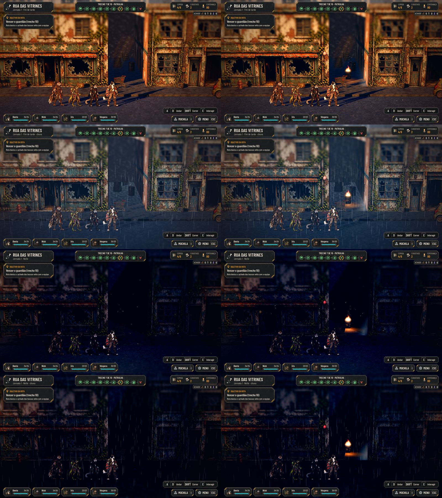
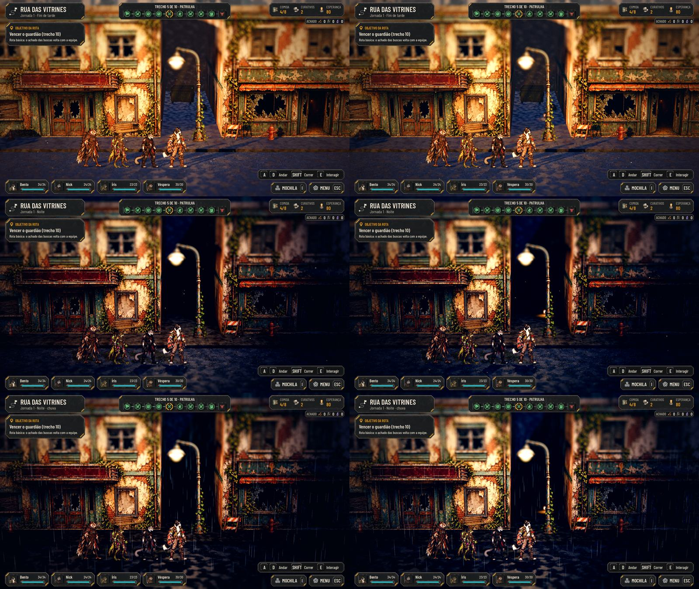
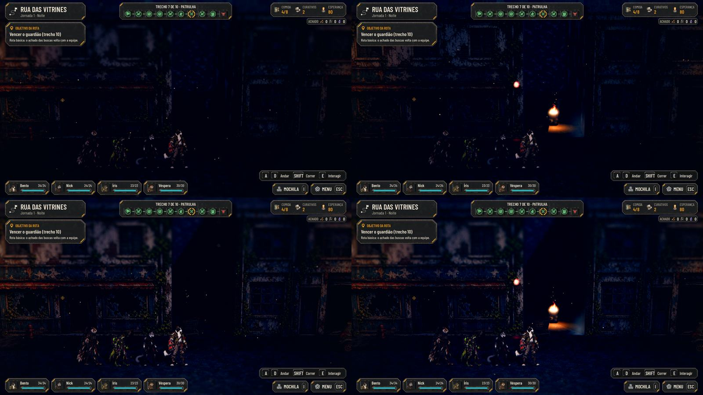
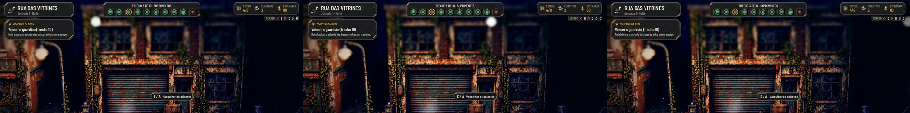

# A luz prática na Rua das Vitrines (#154)

Fase 2 do plano de ambientação ([docs/design/ambience.md](../design/ambience.md)), com a Rua das Vitrines de piloto,
seguindo a revisão do Lucas de 27/10 (na #154 e no PR #156): poucas fontes por cena, um ponto de luz principal, o
contraste quente contra frio e a luz ajustada dentro do mapa. **A prova de verdade é no Forward+**, numa máquina com
placa de vídeo, e o Lucas valida na captura do jogo antes de aprovar. As capturas desta página são do Compatibility em
software (a nuvem não tem placa de vídeo), que é também o que o jogador da web vê.

## O que muda

- **Só o kit que ficou** (`T_LP03` e o fogo em quatro quadros, `T_LP02`, `T_LP06`, os halos e `T_LP_Pool`). A arte que
  o Lucas tirou (a gambiarra, o letreiro, o drone pintado, o robô e o sensor) não entra.
- **`AHPracticalLight`** (`scripts/world/practical_light.gd`): cada fonte é o card aceso, o halo somado (o dobro do
  card, `shaders/glow_texture.gdshader`), a poça no chão na cor da luz e a luz da cena. As medidas são as da tabela de
  `docs/design/luz-pratica.md`.
  - **O tambor com fogo** (o ponto de luz principal, quente): o fogo em quatro quadros em ciclo, a força entre 80 e
    110%, as fagulhas subindo e a sombra pelo `lamp_shadows`.
  - **O lampião** (quente, pequeno): o sinal de um sobrevivente escondido, no fundo de outro beco.
  - **A luz de emergência** (vermelha, na quina da parede): pulsa, 0,6 s acesa e 0,4 s a 25%; a poça dela chega fraca
    ao chão.
  - **O drone** (o frio das máquinas): sem arte, é só o farol. Passa de noite, alto, na frente das fachadas, com o cone
    para baixo varrendo a rua. No Forward+, a névoa volumétrica pega o cone; no Compatibility, fica o ponto de luz.
- **Onde, na Rua** (o perfil `ShopfrontStreet`, campo `lights` de `data/presentation/ambience.json`):
  - o tambor e a emergência juntos no beco de x 49 a 52;
  - o lampião no beco de x 37 a 40.
  Com os três postes e as luzes das portas que a Rua já tinha, são poucas fontes em cada quadro. A rua anda pelos
  becos: o tambor e o lampião têm colisão.
- **De noite, as fontes são a luz principal**; no fim de tarde ficam mais fracas (45%). A chuva não apaga o tambor.
- **A qualidade manda:**
  - a luz da cena só no Forward+ e da Média para cima, com a sombra pelo `lamp_shadows`;
  - no Baixo e no Compatibility, só o halo e a poça desenhados, mais fortes. No Compatibility o chão da rua já recebe
    as 8 luzes que cada malha pega, e uma luz a mais sumiria e voltaria conforme a câmera anda;
  - "Reduzir efeitos": nada tremula, pulsa ou passa; as fontes ficam acesas e paradas.
- **Num interior**, as fontes da rua somem.

## As capturas

| | |
|---|---|
| O lampião no fundo do beco, no fim de tarde, de noite e na noite com chuva (antes e depois)  | O tambor de noite no Baixo e no Alto (antes e depois)  |

O drone passando de noite, da esquerda para a direita, acima das fachadas:

## Testes

- `tests/test_practical_light.gd` (novo, 29 verificações):
  - poucas fontes, só as do kit que ficou, e a arte de cada uma existe;
  - cada fonte com o card, o halo, a poça e a luz; as de chão no beco, com colisão; a de parede no alto;
  - no Baixo, a luz da cena apagada e a poça mais forte; com a luz da cena, a poça enfraquece; a luz só no Forward+;
  - o fim de tarde mais fraco que a noite; o drone só de noite; "Reduzir efeitos" sem fagulhas; o interior apaga.
- `tests/run_all.gd` inteiro, com a paridade 48/48.
- O modo de captura da rua, com o teste de colisão (08 e 09).
- `tools/capture_154.gd` (roda também na main de antes): o tambor e o lampião no fim de tarde, de noite, na chuva e na
  noite com chuva no Ultra; o tambor no Baixo e no Alto; e o drone passando de noite.

## Desempenho

O `--perf` (`--perf-only=street,combat`, no Baixo e no Ultra) na nuvem, no Compatibility em software, deu as mesmas
chamadas e primitivas da #153: as fontes ficam nos becos de x 37 a 52, fora do quadro da parada de rua do roteiro, e a
luz da cena delas não liga no Compatibility. O custo de verdade (as 3 luzes e o farol, com a sombra do tambor e a névoa
volumétrica) só aparece no Forward+: a medição no beco do tambor fica para o PC do Orquestrador (seção da #154 em
`docs/perf.md`).

## Para o Lucas e o Orquestrador

- **A captura no Forward+** (com a luz da cena, a névoa com os raios e o reflexo no chão molhado):
  `"$GODOT" --rendering-method forward_plus --path . --resolution 1920x1080 -s res://tools/capture_154.gd -- --out=<pasta>`.
- **A afinação no mapa:** as posições e as forças estão no perfil da Rua e em `AHPracticalLight.KINDS`.
- **A arte:** o tambor, a emergência e o lampião são o ponto de partida; o pedido para refazer no estilo pintado das
  fachadas, sem contorno, está na #170 (Awesomic 1).
