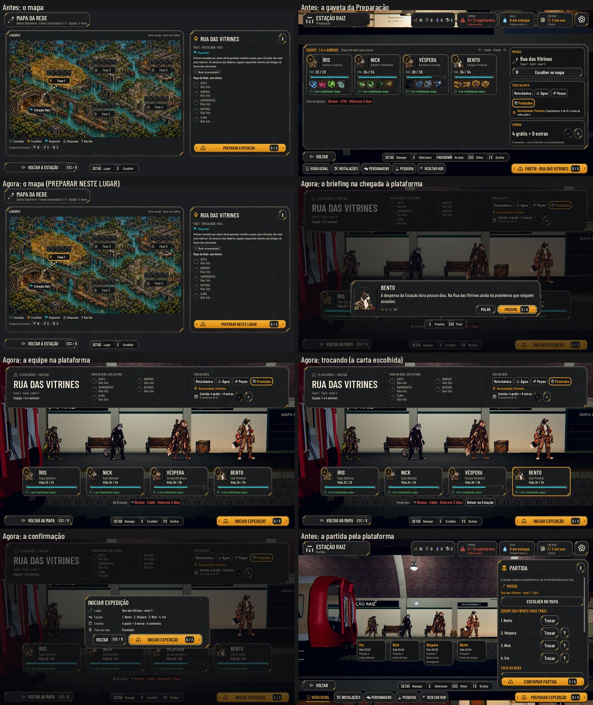

# A saída em três passos: Estação, Mapa, plataforma (#123)

O pedido do Lucas (26/10): "A preparação está muito direta. Quero um botãozinho para entrar no mapa. Só depois a gente
escolhe o local, e quando escolher o local no mapa, vê os personagens como na chegada da missão. [...] Então vai ter uma
confirmação lá para iniciar a expedição."

No Maior e no daltonismo: [screens.jpg](preparation/screens.jpg). As fotos saem de `tools/capture_123.gd`
(`--text-size=2`, `--colorblind`). O antes é o mesmo roteiro no código de antes desta entrega (o mapa e a gaveta).

## Os três passos

1. **Estação → Mapa:** o botão principal da Estação (G / X) agora é **IR AO MAPA** e abre o Mapa da Rede (#87). O
   Próximo passo e o cômodo da Preparação também levam ao mapa. Com a noite ou o trem pendentes, o botão segue travado
   com o motivo, como antes.
2. **Mapa → lugar:** escolhido o lugar, **PREPARAR NESTE LUGAR** (G / X) sobe a equipe para a plataforma.
3. **Plataforma 1:**
   - A câmera sobe pela passagem até a Plataforma 1, com a câmera do relatório da volta: cada herói de pé sobre a sua
     carta, a posição 1 (a frente) à direita.
   - **A faixa do alto:** o lugar escolhido, a fase e o tamanho da equipe; o que o radar leu (o mesmo do mapa); o Foco da
     rota, com o recomendado; e a Comida, com − e +. O aviso "ninguém cura" fica embaixo do lugar.
   - **As cartas:** clicar em duas troca a ordem. Com uma escolhida, quem está na Estação entra no lugar dela, ou
     "Deixar na Estação" parte com um a menos. Cada carta diz se o herói tem ataque daquela posição.
   - **Na Estação:** a lista de quem fica, com a vida. Quem não pode ir aparece com o motivo e não entra: o caído
     ("Caído · Volta em 3 dias") e quem ainda não tem arte de luta. Quando a lista não cabe acima dos botões (muitos na
     Estação, o texto Maior), ela vira uma linha só, com o nome e o motivo curto ("Caído"), que rola para os lados.
   - **O briefing (#88)** abre quando a equipe chega na plataforma, antes da confirmação, uma vez por lugar escolhido.
     A última fala segue com "Continuar".
   - **INICIAR EXPEDIÇÃO** (G / X) abre a confirmação, com o lugar, a equipe na ordem, a comida e o foco. Ali, INICIAR
     EXPEDIÇÃO parte para o vagão (#75). Travado (a equipe de tamanho errado, um caído no rascunho), o botão diz o
     motivo dentro.
- **Voltar em cada passo:**
  - na confirmação, volta para a plataforma;
  - na plataforma (VOLTAR AO MAPA, Esc), volta ao mapa no mesmo lugar, com a equipe, o foco e a comida guardados;
  - no mapa, volta à vista geral, e a câmera desce da plataforma.
- **Sai** a gaveta da Preparação.

## O save no meio

- O rascunho (o lugar, a equipe, o foco e a comida) fica só na tela: o save no mapa ou na plataforma não tem expedição e
  não gasta sementes.
- Reaberto, o jogo volta à vista geral da Estação, e o radar lê a mesma rota (a semente fixada na leitura do mapa).

## Testes

- **`test_preparation_flow` (novo):**
  - IR AO MAPA na Estação, no Próximo passo e no cômodo da Preparação; a gaveta saiu;
  - Voltar no mapa, na plataforma (com a escolha guardada) e na confirmação;
  - as cartas na ordem da cena, a fila acompanhando as trocas, a troca de ordem, Deixar na Estação e a vaga preenchida;
  - o caído e o Risco (sem arte) não entram, e o caído no rascunho trava INICIAR com o motivo;
  - o save no meio, no mapa e na plataforma, e a reabertura;
  - a confirmação com o resumo e a partida no vagão, com a comida extra paga só na partida.
- **`test_full_journey`:** o caminho novo pelos botões: IR AO MAPA, a fase 1, PREPARAR NESTE LUGAR, o briefing na
  plataforma, VOLTAR AO MAPA e de volta, sem repetir o briefing, e INICIAR EXPEDIÇÃO na confirmação.
- **`test_briefing`:** o briefing espera a equipe chegar, Voltar nele fica na plataforma, e o mesmo lugar não repete.
- **`test_keyboard_navigation`:** só com o teclado: o foco começa na carta da frente, o + da comida nunca parte, G abre a
  confirmação e Voltar desfaz um passo de cada vez.
- **`test_small_teams`, `test_character_sheet`, `test_station_screens`, `test_station_scene` e `test_departure`:**
  ajustados para a plataforma.

## Rodadas da QA

### Rodada 1: REPROVADO

**Alta, corrigida:** F2 durante a subida da câmera escondia a interface, e o briefing abria escondido: nada mais
respondia. O briefing agora espera a interface à vista.

**Médias, corrigidas:**
- **Esc logo depois de INICIAR EXPEDIÇÃO dava erro de script** e tirava a fila no meio do fade. Na partida, Voltar não
  faz nada.
- **O briefing abria junto com a dica da primeira vez, e G na subida abria a confirmação antes do briefing.** O briefing
  espera a dica fechar, e a confirmação espera a chegada e o briefing do lugar.
- **Na lista compacta, o motivo do caído só aparecia na dica do mouse.** Agora o botão diz "Caído" (ou "sem arte"), e o
  motivo inteiro continua na dica.
- **Faltavam capturas:** o mapa, o briefing e a confirmação entram nas montagens dos três perfis.

**Baixas, corrigidas:**
- Escolher a vaga vazia e depois um herói não fazia nada. Agora o herói vai para a última posição ocupada.
- Os botões da confirmação ganharam a tecla (Esc / B e G / X).

**Ficam:**
- No Maior, com o aviso "ninguém cura", a faixa do alto encosta nas orelhas dos mais altos.
- "Derrubar um herói" pela barra de Admin com a plataforma aberta deixa o caído de pé na fila. INICIAR EXPEDIÇÃO trava
  com o motivo certo.

O `test_preparation_flow` confere F2 na subida, a dica com o briefing, G antes da chegada, Esc no fade, a vaga vazia e a
lista compacta.

### Rodada 2: APROVADO

A QA refez os casos da rodada 1 no Normal e no Maior, com 12 no elenco, caídos, equipe de 2 e as dicas ligadas:
- F2 na subida;
- a dica antes do briefing;
- G e o clique antes da chegada;
- G, Esc e VOLTAR AO MAPA no fade;
- a lista compacta com "Caído";
- a vaga vazia.

**Baixas, corrigidas depois:** o clique em INICIAR EXPEDIÇÃO antes da chegada agora toca o som de negado, como o G. Os
títulos das montagens saíam sem os acentos.
