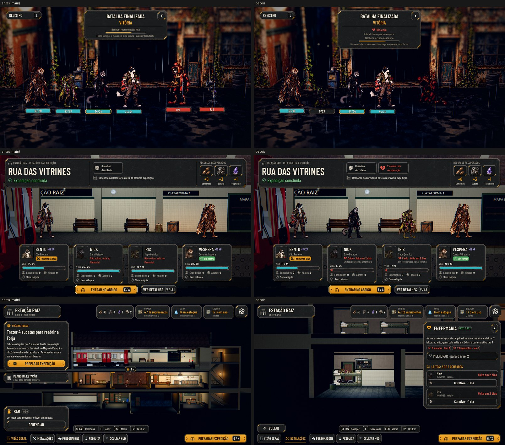

# Ninguém morre e a Enfermaria (#118, #121)

O pedido do Lucas (26/10): ninguém morre. Quem cai volta à Estação em recuperação, com aviso claro na luta e no
relatório. Os caídos ficam numa Enfermaria nova, com "Volta em N dias" (um dia é um ciclo da Estação).

As telas no Normal e no Maior: [screens.jpg](recovery/screens.jpg); no daltonismo: [colorblind.jpg](recovery/colorblind.jpg). As fotos saem de
`tools/capture_118.gd` (`--text-size=2`, `--colorblind`). O antes é a `main` com a mesma volta (`tools/capture_return.gd`
e `tools/capture_109.gd`).

## Ninguém morre

- **Na luta, quem chega a 0 cai como antes:**
  - o Último Fôlego e a saída da luta não mudam;
  - o herói fica fora do resto da expedição.
- **Na volta, quem caiu chega Caído:**
  - vivo, com 1 de vida;
  - em recuperação por alguns dias (`AHStationRules.admit_fallen`).
  - Ele desce do trem no passo de ferido e não entra na noite: não vigia nem come.
- **A derrota da equipe inteira** devolve todos Caídos, sem o achado (como antes). Não há fim de jogo.
- **O memorial acabou:**
  - ninguém mais entra nele;
  - os saves antigos voltam com quem estava lá, Caído e em recuperação (`_migrate_fallen`), e o memorial fica vazio;
  - quem caiu numa expedição em andamento volta Caído no fim dela;
  - quem estava no memorial e não está mais no elenco volta com o nome e a classe de antes.
- **Em recuperação,** o herói:
  - não entra na equipe: na Preparação, ele fica fora da equipe com "Volta em 2 dias", e a partida e a equipe recusam com o motivo;
  - não passeia: fica deitado no leito, na pose de dormir.
- **Recuperado,** volta ao Alojamento com a vida cheia.

## A Enfermaria

- **O cômodo novo** fica embaixo do Dormitório, na ponta do segundo andar, onde antes era rocha: 6 m, do tamanho do
  Depósito.
  - Ele segue o contrato dos outros: o casco, a porta, a luz e o mobiliário que some no nível 0.
  - Até a arte do design (#124), o mobiliário é provisório:
    - os beliches do Dormitório viram os leitos (um beliche no nível 1, dois no nível 2);
    - a estante de amostras da Pesquisa vira a de remédios;
    - o armário com a frente da Cantina completa a sala.
- **Na história:** é o antigo posto de primeiros socorros da estação, e as macas viraram leitos.
  - Por recuperar: "Sala de primeiros socorros da estação, com as macas tombadas."
  - O registro está em `docs/narrative/review.md`.
- **Os dias:**
  - Um dia é um ciclo da Estação: cada volta de expedição.
  - **Sem leito,** no Dormitório: 3 dias.
  - **Num leito da Enfermaria:** 2 dias.
  - **Os leitos são o limite:** 2 no nível 1 e 4 no nível 2. Quem não cabe se recupera no Dormitório, e o leito que vaga
    vai para quem espera.
  - **Um curativo** usado no leito tira um dia: um por dia em cada herói.
  - **Recuperar a Enfermaria** com caídos esperando leva-os na hora para os leitos.
  - **O posto (#119)** vai tirar mais um dia; o número já está em `data/`, e a regra entra com a #119.
- **O painel da Enfermaria:**
  - os leitos ocupados;
  - cada caído com o rosto, a vida, onde está (no leito ou no Dormitório) e "Volta em N dias";
  - o botão do curativo, que fica apagado com o motivo quando não vale.
- **Esperar um dia:** com a equipe toda caída, ninguém pode partir, e antes o jogo travava aí.
  - Agora o Próximo passo leva à Enfermaria, com "Esperar um dia".
  - O dia passa como uma volta (a Estação gasta e produz), e cada caído fica um dia mais perto.
  - Só vale quando ninguém pode partir.

## Os avisos

- **Popup do fim da luta:** "Íris caiu", em vermelho, com o ícone, e "Volta à Estação para se recuperar." Com mais de um,
  "Íris e Nick caíram".
- **Relatório da volta:**
  - o chip "Íris caiu: em recuperação";
  - a carta com o retrato apagado, "Caído · Volta em 2 dias" e "Em recuperação na Enfermaria" (ou "no Dormitório");
  - nos detalhes, a coluna Recuperação: quem foi para onde e quem voltou ao Alojamento.
- **Fim da expedição (na rua):** "Voltaram caídos, em recuperação: Íris", no lugar de "No memorial: N".
- **Sala dos Personagens:**
  - a aba com o retrato apagado, o ícone e os dias;
  - no painel PERSONAGEM, "Caído · Volta em 2 dias", com o botão Ver a Enfermaria;
  - o Memorial saiu de Recrutar.
- **Próximo passo:** "Íris volta amanhã", na lista do que espera.
- **Tela de campanhas:** "3 de 4 prontos", no lugar de "vivos".

## Na barra de Admin (#130)

Na aba Heróis, "Trazer de volta quem morreu" deu lugar a três ações:
- **Derrubar um herói (volta Caído):** o primeiro pronto do elenco vai para a recuperação, sem precisar de luta.
- **Passar um dia na Estação:** um ciclo, e a recuperação anda.
- **Recuperar os caídos agora:** todos voltam ao Alojamento com a vida cheia.

"Perder a luta" agora diz "quem lutou volta Caído".

## Os números (propostas para o Lucas)

Ficam em `data/recovery.json`:

| Regra | Valor |
|---|---|
| Vida de quem cai | 1 |
| Recuperação sem leito | 3 dias |
| Recuperação no leito | 2 dias |
| Leitos | 2 no nível 1, 4 no nível 2 |
| Curativo | −1 dia, 1 curativo |
| Posto (#119) | −1 dia |
| Recuperar a Enfermaria | 4 sucatas e 1 fragmento |
| Melhorar a Enfermaria | 6 sucatas e 2 fragmentos |

## Testes

- **`test_recovery` (novo, 77 verificações):**
  - cair não mata nem põe no memorial;
  - a volta Caído com a vida e os dias do JSON;
  - quem caiu fica fora da noite;
  - os leitos limitam, e os dias contam a cada volta;
  - o leito vago passa adiante;
  - quem se recupera volta com a vida cheia;
  - em recuperação, o herói não parte;
  - o curativo: só no leito, um por dia, gasta e pode encerrar a recuperação;
  - a derrota devolve todos;
  - esperar um dia: só sem ninguém pronto, e destrava a equipe;
  - a migração: o memorial, o herói fora do elenco, o meio da expedição, idempotente e pelo arquivo;
  - o custo e os leitos da Enfermaria.
- **`test_small_teams`:** a derrota devolve só quem foi, Caído.
- **`test_return`:** a equipe toda caída desce do trem, no passo de ferido.

## Para o Lucas decidir

- **"Caído" para as heroínas:** a carta diz "Caído" também para a Íris e a Véspera. O nome do estado é o da issue; se
  preferir, dá para usar "Caída" pelo herói, ou um estado neutro ("Em recuperação").
- **Quem cuida da Enfermaria:** a #121 pede uma linha curta sobre quem cuida dela. A origem dos leitos está no texto (as
  macas do antigo posto de primeiros socorros); quem cuida, não inventei. Fica a pergunta na issue.

## Rodadas da QA

### Rodada 1: REPROVADO

**Médias, corrigidas:**
- **Recuperar a Enfermaria não levava os caídos que já esperavam para os leitos** (só no dia seguinte ou ao abrir o save
  de novo): `upgrade_room` agora enche os leitos, e o teste recupera a Enfermaria pela regra, não à mão.
- **A foto do popup dizia "Íris caiu" com a Íris de pé e vida cheia:** a captura agora derruba a Íris e as máquinas de
  verdade (a pose de queda e as vidas em 0) antes do popup.

**Baixas, corrigidas:**
- **A foto Normal da Preparação** era de antes do "Posição vazia" centrado; refeita.
- **Os textos do curativo** ("−1 dia", "Gasta 1 curativo", "um curativo tira um dia") seguem o `data/recovery.json`.
- **A Enfermaria por recuperar** dizia que o caído volta para ela; agora diz que vai para o Dormitório.
- **A partida pela formação salva** (o atalho da barra de Admin) levava quem se recupera; agora fica na Estação.
- **"Ir para a Estação"** da barra, no meio da expedição, deixava o caído invisível; agora ele volta Caído.
- **"Voltaram caídos: Íris"** com um nome só: agora "Volta em recuperação: Íris".
- **Os caídos sem beliche** no Dormitório (elenco grande) ficavam um por cima do outro; agora cada um tem o seu ponto.

**Ficam:**
- **Na Visão geral, a coluna da esquerda cobre boa parte da Enfermaria.** A câmera da Estação é da #131, que vem a seguir.
- **"Ver a Enfermaria", aberto da Sala:** o Esc volta à Visão geral, não à Sala, como os outros cômodos.
- **"Caído" e quem cuida da Enfermaria:** ver "Para o Lucas decidir".

### Rodada 2: APROVADO

A QA conferiu:
- **os leitos da Enfermaria recuperada**, pelas regras e pelo botão Melhorar do painel: o terceiro caído deita no leito do
  segundo beliche, e o cabeçalho diz "Leitos: 3 de 4 ocupados";
- **a foto do popup**, com a Íris no chão;
- **o atalho da barra**, que deixa o caído na Estação;
- **o ciclo inteiro pela HUD:** a equipe toda caída, três vezes "Esperar um dia" e a partida liberada.

**Baixa, corrigida:** os rótulos e as fotos do quadro do daltonismo (`colorblind.jpg`), refeitos com os textos novos, com a Preparação.
