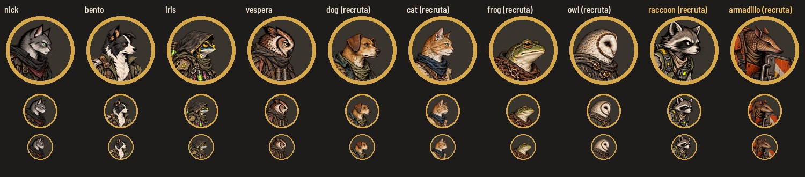
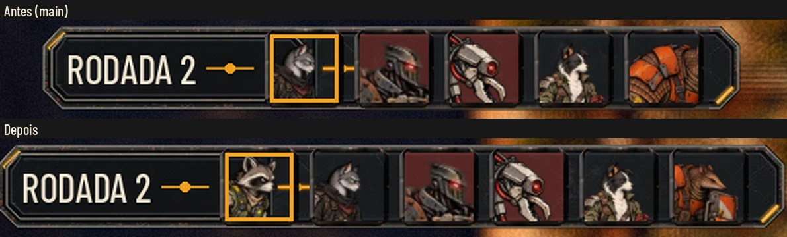

# Os retratos do Guaxinim e do Tatu

A `main` ficou vermelha no `test_faces` depois de dois PRs juntados em sequência: o #196 (#187) trouxe o
`raccoon_recruit_01` e o `armadillo_recruit_01`, e o #198 (#193) passou a exigir retrato de todo herói e recruta. Os
dois recrutas não tinham retrato, e o ícone deles saía do recorte automático.

## O que muda

- **`art/ui/portraits/raccoon_recruit_01.png` e `armadillo_recruit_01.png`:** recortados do parado de cada um, no
  padrão da entrega #26 (`docs/design/portraits.md`). São PNG RGBA de 256×256, transparentes, com o olho em (144, 104)
  e o rosto virado para a direita. Nada foi redesenhado.

  | Retrato | Fonte | Recorte na fonte | Olho no PNG256 |
  |---|---|---|---|
  | raccoon_recruit_01.png | `art/combat/recruits/raccoon_recruit_01/idle.webp` | 261, 80, 517, 336 | (144.0, 104.0) |
  | armadillo_recruit_01.png | `art/combat/recruits/armadillo_recruit_01/idle.webp` | 302, 109, 522, 329 | (144.3, 103.6) |

  O Tatu tem a cabeça menor, então o recorte dele é mais fechado: 220 px, contra 256 do Guaxinim. Mesmo assim, o casco
  e o escudo entram no quadro. No aro redondo, a ponta da orelha do Guaxinim toca a borda, o que o padrão da #26
  permite. O olho e o focinho ficam dentro.
- **`data/presentation/combat_art.json`:** o campo `portrait` dos dois, onde o `with_portrait` do
  `tools/sync_combat_art.py` o grava quando o PNG existe. A ferramenta não rodou, e a próxima vez que rodar dá o mesmo
  campo.
- **`tools/crop_recruit_portraits.py`:** refaz os dois recortes (`python3 tools/crop_recruit_portraits.py . art/ui/portraits`).

## Testes

- `test_faces` volta a passar, e o `test_recruit_art` continua verde.
- `tests/run_all.gd` inteiro.

## QA

Rodada 1, APROVADO.
- A QA refez os recortes pelo script, byte a byte, e conferiu o JSON contra o `with_portrait`.
- O `face_texture` devolve o PNG certo para os 10 parados e para o `hero_rato` e o `hero_tatu` sem variação.
- Ela capturou a Sala dos Personagens com o Guaxinim e o Tatu acolhidos.

Baixas:
- A orelha no aro: abri o recorte de 240 para 256 px. A ponta ainda encosta, como a #26 permite.
- O antes e o depois da luta não são o mesmo momento, porque a vez é de outro. Mesmo assim, o Tatu mostra a troca: só
  o casco antes, o rosto depois.
- O `docs/design/portraits.md` ainda lista os oito da #26. Ele é do Codex, e os dois novos estão aqui.

## Para o Codex e o Lucas

Os recortes seguem o padrão da #26, mas não passaram pela QA de design. Se o Codex quiser um recorte próprio, basta
trocar os dois PNG pelos mesmos nomes.
