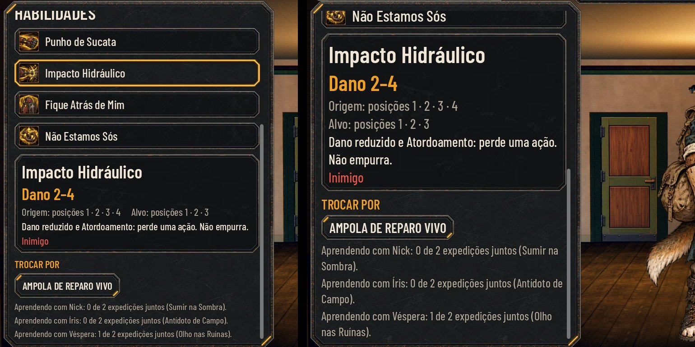
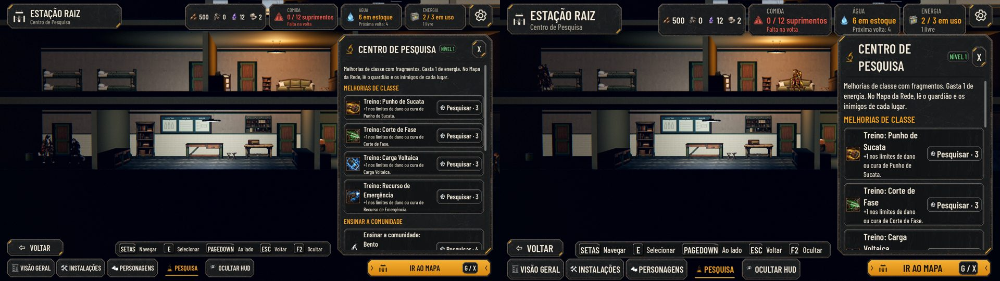

# Os recrutas flexíveis (#189)

As decisões do Lucas na issue (27/10):

- só os recrutas são flexíveis. Os fundadores ficam com o kit da história;
- o recruta aprende com um fundador de outra classe depois de algumas expedições juntos, ou pela Pesquisa;
- as habilidades se trocam livremente na Estação.

As camadas de aparência (a arte do #211) entram num PR separado.

As fotos saem de `tools/capture_189.gd`. A Faísca, uma recruta de cão, já aprendeu a Ampola de Reparo Vivo com a Íris
e tem 1 de 2 expedições com a Véspera. Na Sala, ela troca Impacto Hidráulico pela Ampola.

## O que muda

- **Os dados:** `data/recruit-skills.json`.
  - A linha `rules` tem `MentorExpeditions` (quantas expedições juntos ensinam uma habilidade) e `MaxForeign` (quantas
    habilidades de fora o recruta leva).
  - Cada classe tem uma linha com:
    - `Fixed`: as 2 do corpo, que o recruta sempre leva;
    - `Mentor`: o fundador da classe;
    - `Teaches`: as que esse fundador ensina, em ordem.
  - O rato e o tatu não têm fundador, então não ensinam.
- **As regras:** ficam num lugar só, o `AHRecruitSkills` (`scripts/flow/recruit_skills.gd`).
  - O recruta leva 4 habilidades: as 2 fixas e 2 escolhidas, na ordem da classe. Cada escolha ocupa o lugar de uma que
    não é fixa.
  - As escolhas vêm das outras da classe ou das de fora que ele sabe. Ele leva no máximo `MaxForeign` de fora.
  - A Sala só oferece as trocas que valem: com uma de fora já escolhida, a outra de fora só entra no lugar dela.
  - Sem escolha, ele luta com o kit da classe, e o recruta de antes não muda.
  - A troca é na Estação, fora da expedição e sem custo. Um fundador não troca.
- **O mentor:** na volta (`S.finish_return`), em qualquer resultado:
  - cada recruta conta mais 1 expedição com cada fundador de outra classe que estava na equipe;
  - ao chegar em `MentorExpeditions`, aprende a próxima habilidade que esse fundador ensina, e a conta recomeça;
  - quem caiu na expedição também conta, o mentor e o recruta: eles foram juntos;
  - o relatório da volta mostra "Faísca aprendeu com Véspera: Olho nas Ruínas".
- **A Pesquisa:** o ramo novo **Ensinar a comunidade** tem 4 nós (`res_teach_<classe>`, 4 fragmentos cada).
  - Cada nó ensina a todos os recrutas de outras classes as habilidades daquele fundador.
  - O relatório da Pesquisa da classe e a ficha do herói (as passivas) deixam esse ramo de fora: ele não é treino da
    classe.
- **A luta:** a unidade leva as habilidades dela (`Unit.ability_ids`), e o motor usa `abilities_of(unit)` no lugar do
  kit da classe para:
  - o uso por encontro;
  - a validação;
  - o turno automático.
  - A habilidade de fora usa o efeito e o som do fundador que a ensinou.
  - A validação da partida e o alcance pela posição (`attacks_from_rank`) também usam as habilidades do herói.
- **A Sala dos Personagens:** na lista, a habilidade de fora aparece como "Ampola de Reparo Vivo · de Íris".
  - Ao escolher uma que não é fixa, aparece **Trocar por** com as opções e, embaixo, quanto falta com cada mentor.
  - A habilidade fixa diz "Fixa da classe: Faísca sempre leva esta."
- **O save:** cada herói ganha 3 campos:
  - `loadout`: as 2 escolhidas; `[]` quer dizer as da classe;
  - `learned`: as de fora que ele sabe;
  - `mentor`: `{id do fundador: expedições juntos}`.
  - A migração (`AHRecruitSkills.migrate`) põe os 3 vazios nos saves antigos, e ninguém perde nada.
  - Nenhum id muda, e nenhum número de balanceamento das habilidades muda.

## Os números (proposta para o Lucas)

| O quê | Proposta | Por quê |
| --- | --- | --- |
| `MentorExpeditions` | 2 | Uma ida e volta juntos ainda é pouco. Com 2, o recruta aprende no meio da campanha. |
| `MaxForeign` | 1 | O recruta continua sendo da classe dele: 3 da classe e 1 de fora. |
| `Fixed` | as 2 que fazem o papel da classe | Ex.: o cão sempre tem Punho de Sucata e Fique Atrás de Mim. |
| `Teaches` | 2 por fundador | O golpe principal de cada fundador (o primeiro da classe) fica só com ele. |
| A volta conta em qualquer resultado, com quem caiu | sim | Vitória, retirada ou derrota: eles saíram juntos, e o mentor ensina pelo caminho. |
| `CostFragments` dos nós | 4 | Um a mais que o Treino (3), porque ensina 2 habilidades a todos os recrutas de outras classes. |

O que cada fundador ensina:

| Fundador | Ensina |
| --- | --- |
| Bento | Fique Atrás de Mim, Não Estamos Sós |
| Nick | Sumir na Sombra, Caçada Precisa |
| Íris | Ampola de Reparo Vivo, Antídoto de Campo |
| Véspera | Olho nas Ruínas, Granada de Fumaça |

A frase do relatório também é proposta. A issue deixou para o Lucas a fala "Na volta, a Íris mostrou como misturar a
ampola. Agora ele sabe.". Por enquanto o chip segue o esboço da tela da issue, em uma linha: "Faísca aprendeu com Íris:
Ampola de Reparo Vivo". Se o Lucas preferir a fala, ela entra como texto de cada habilidade.

## Como testar

- `tests/test_recruit_skills.gd` (55 checagens) cobre:
  - as regras;
  - a migração e o save;
  - o mentor na volta, de ponta a ponta (`finish_return` e o chip do relatório), com quem caiu;
  - a Pesquisa;
  - a luta com a habilidade de fora;
  - a Sala, com a troca que passaria do limite fora das opções;
  - a ficha, sem o nó de ensinar como treino.
- `tests/run_all.gd` inteiro passa, com a paridade 48/48.
- Para jogar: na Sala dos Personagens, escolha um recruta e clique numa habilidade que não é fixa. Para ter uma de fora,
  use a Pesquisa (Ensinar a comunidade) ou leve o recruta 2 vezes com um fundador de outra classe.
