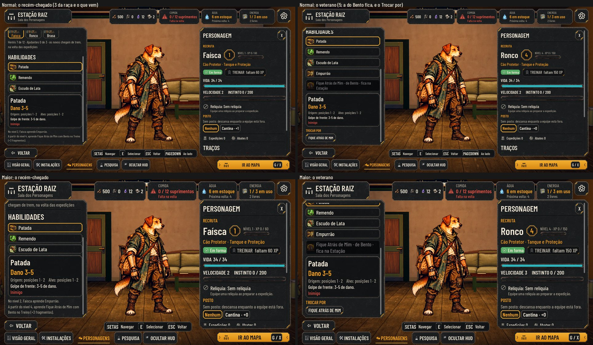
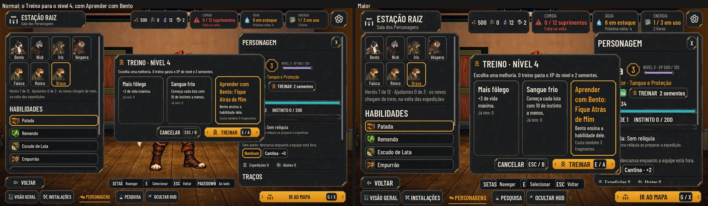

# As habilidades dos recrutas (#189 e #215)

As decisões do Lucas de 28/10, na #189 e no PR #215:
- os fundadores ficam com o kit da história, mais fortes;
- o recruta tem habilidades **próprias e mais básicas**;
- o recruta chega com 3, ganha a 4ª evoluindo e aprende uma do fundador da espécie **no Treino**, pagando por ela.

A aparência em camadas fica para outra entrega. O Guaxinim e o Tatu redesenhados (#229) ficam com o Orquestrador PC.

As fotos saem de `tools/capture_189.gd`:
- a Faísca, recém-chegada;
- o Ronco, no nível 4, já com a habilidade do Bento;
- a Brasa, no Treino para o nível 4.

## Quando cada uma abre
| Quando | O que ganha |
| --- | --- |
| Nível 1, a chegada | 3 habilidades da raça: o golpe, o Remendo (cura 2 a 3 em si, 2 usos por luta) e o toque da raça |
| Nível 2 | a 4ª, que completa o toque. Vem sozinha, ao subir de nível no Treino |
| A partir do nível 4, no Treino | **Aprender com o fundador**, como uma opção a mais. Custa o do nível mais 3 fragmentos |

Depois de aprender, o recruta sabe 5 habilidades e leva 4 para a luta. A troca é na Sala, fora da expedição. A que
fica de fora aparece apagada, com "fica na Estação".

## As habilidades por raça
Os ids estão em `data/abilities.json` (`rec_*`). A tabela de quem ganha o quê está em `data/recruit-skills.json`. As
classes usam os ids de hoje (`rato` é o Guaxinim).

| Raça | Golpe | Toque (nv 1) | 4ª (nv 2) | No Treino (nv 4+) |
| --- | --- | --- | --- | --- |
| Cão | Patada, 3 a 5, da frente | Escudo de Lata: 1 de bloqueio num aliado | Empurrão: 1 a 3 e empurra | Bento: Fique Atrás de Mim |
| Gato | Arranhão, 3 a 5 | Marcar Presa: marca | Bote: 4 a 6, só no marcado | Nick: Sumir na Sombra |
| Sapo | Cuspe Ácido, 2 a 4, de trás | Frasco de Reparo: cura 2 a 4 | Gás Irritante: 1 a 2 e Corrosão | Íris: Antídoto de Campo |
| Coruja | Estilingue, 2 a 4, de trás | Bicada: 3 a 5, da frente | Vigia: marca | Véspera: Granada de Fumaça |
| Guaxinim | Chave Torta, 2 a 4 | Fio Desencapado: 1 a 2 e Corrosão | Afrouxar Parafuso: Vulnerável | o ofício: Cabo de Fuga |
| Tatu | Cabeçada, 3 a 5 | Enrolar: 1 de bloqueio em si | Escorar: 1 de bloqueio num aliado | o ofício: Marreta de Emergência |

Notas:
- O nome de quem ensina vem do `GameData` (`initial-heroes`).
- O Guaxinim e o Tatu não têm fundador da espécie: "A oficina da Estação ensina o ofício.".
- **A arte:** cada `rec_*` usa a arte de uma habilidade parecida (`ArtOf`): o ícone, as poses do recruta, o efeito e o
  som. O `sync_combat_art.py` não muda. O Remendo usa a da Ampola.
- **As melhorias de habilidade do Treino** ("habilidade_gato", "habilidade_coruja") reforçam uma habilidade do
  fundador. Por isso, só aparecem para quem a tem.

## O que sai do PR anterior
- O mentor de outra classe.
- O ramo "Ensinar a comunidade" da Pesquisa.
- As 2 fixas e as 2 escolhidas.
- O limite de 1 de fora.

## O save
- O herói ganha `loadout` (as que leva; `[]` quer dizer as primeiras) e `learned` (as aprendidas no Treino).
- O recruta de antes abre com as habilidades da raça do nível em que está.
- Uma escolha que não vale (um save editado ou um fundador) volta ao padrão.
- Os fundadores não mudam, e a paridade continua 48/48.

## O equilíbrio
O `test_recruit_skills` confere, nos dados:
- o dano médio de cada habilidade do recruta fica abaixo do melhor golpe do kit da classe (o do cão, 4 contra 6,5);
- a cura fica abaixo da Ampola;
- nenhuma atordoa.

## Como testar
- `tests/test_recruit_skills.gd`, com 178 checagens, cobre:
  - os dados e o equilíbrio;
  - os níveis;
  - o Treino: a opção, os fragmentos e o ofício;
  - a escolha das 4;
  - a luta e o save;
  - a Sala.
- `tests/run_all.gd` passa inteiro, com a paridade 48/48.
- **Para jogar:** na Sala dos Personagens, abra um recruta. Treine-o até o nível 3 com a Barra de Admin, e o Treino
  para o 4 mostra "Aprender com Bento".
