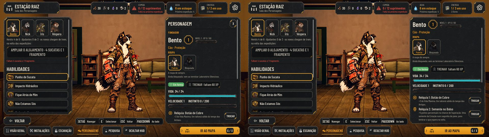
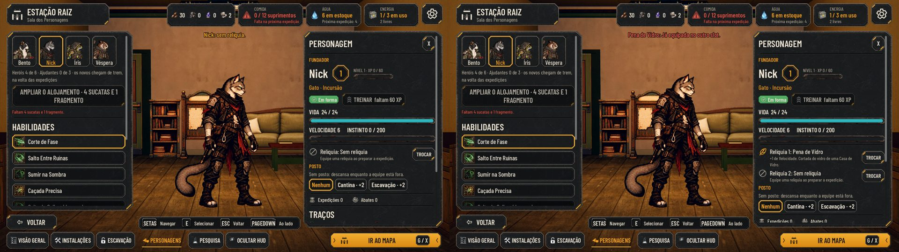
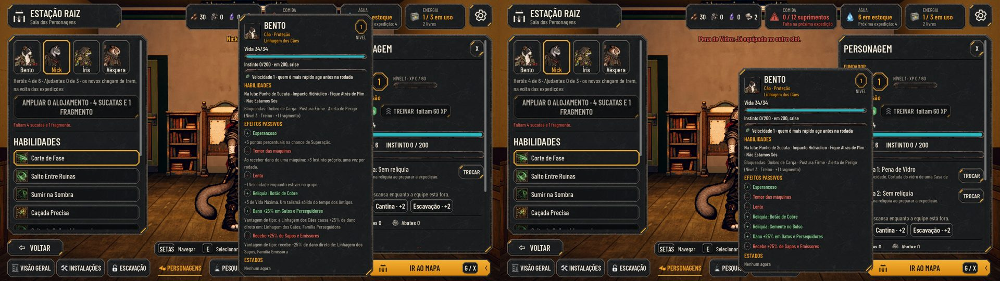
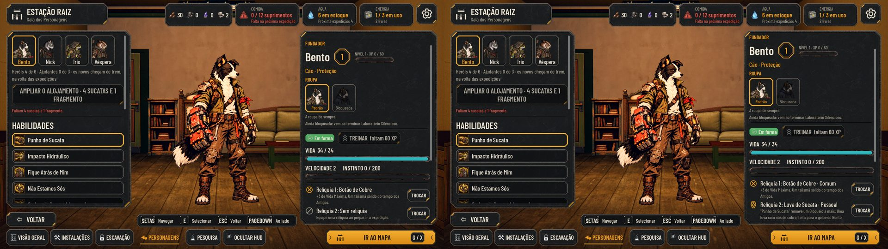
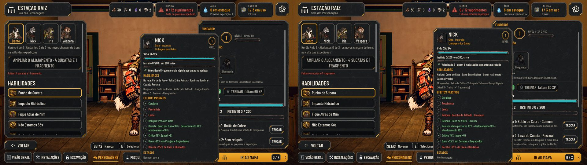
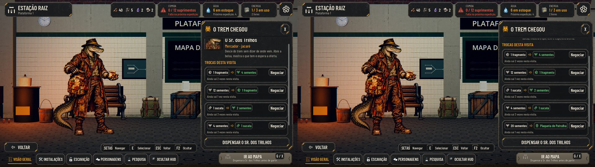
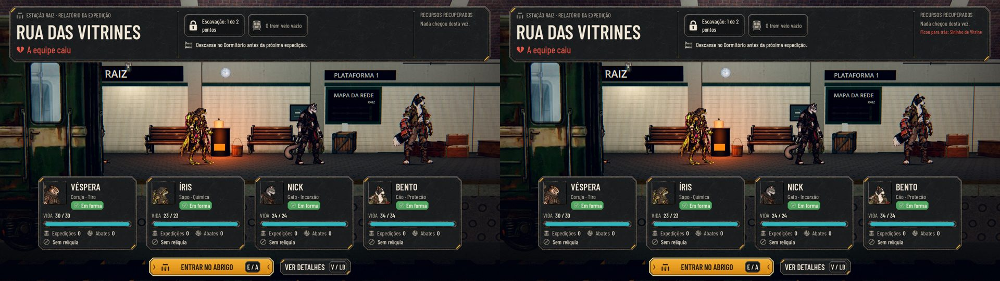

# Relíquias: dois slots por herói (#263, parte 1)

O desenho aprovado está na #263 (a proposta do Orquestrador e o aceite de 01/11). Esta é a primeira parte: os dois
slots, os campos novos dos dados e os sorteios presos à origem e à raridade. As origens especiais, os gatilhos novos, a
perda na derrota e o Colar de Circuito ficam para a parte 2.

As capturas são do jogo, pela cena de verdade (`tools/capture_263.gd`, o mesmo roteiro no código de antes e no de
agora), em 1920x1080, por software (xvfb). À esquerda o antes, à direita o agora.

## A Sala dos Personagens

- **Antes:** um slot ("Relíquia: Botão de Cobre") e um botão de trocar.
- **Agora:** "Relíquia 1" e "Relíquia 2", cada uma com o ícone, o que faz e o seu botão TROCAR. O Bento leva o Botão de
  Cobre e a Semente no Bolso.

## O bloqueio explicado

O Nick tem a Pena de Vidro no slot 1, e a única do estoque é outra Pena. No slot 2, o TROCAR passa só pelas opções que
o slot aceita; sem nenhuma, o aviso diz o motivo: "Pena de Vidro: Já equipada no outro slot.". Os outros motivos são
"Só para %s." (o papel) e "Só %s usa." (o fundador). Antes, o mesmo toque desequipava a Pena.

## A ficha

Uma linha por relíquia equipada nos efeitos passivos. O relatório da volta mostra os dois ícones lado a lado, com os
nomes juntos.

## As regras

- **O save:** o `relic_id` antigo vira o slot 1 no load (`AHStationRules.migrate`), a chave sai e o estoque fica igual.
  Rodar de novo não muda nada.
- **Os slots:** a mesma relíquia não entra nos dois slots do mesmo herói; cópias em heróis diferentes valem. Trocar
  devolve a que saiu ao estoque.
- **Os bônus:** cada relíquia conta uma vez. A Velocidade vinda delas tem teto de +2; a que tira não tem piso.
- **Os dados** (`data/relics.json`): `Rarity`, `Only` (`role:<classe>` ou `hero:<id>`), `Sources` e `Phase`.
- **As origens:**
  - a carga só sorteia as de `cargo`, e a de `Phase` só na fase dela;
  - a escavação, as de `dig`;
  - a missão solo, as de `cargo` sem fase;
  - a Forja fabrica só as comuns de `forge`.
  - Nenhum sorteio escolhe rara, pessoal ou lembrança.
- **As três novas** usam efeitos que já existem:
  - Semente no Bolso, comum, da Forja: +5 pp de Superação;
  - Sininho de Vitrine, incomum, da carga da fase 1: +1 Vel. e −2 Vida máx.;
  - Raiz Trançada, incomum, da carga da fase 2: +4 Vida máx. e −1 Vel.
- **Os ícones** das novas são o genérico (`relic-generic`) até a arte do ciclo de design.

## Como testar

- `tests/test_relics.gd`: a migração, os slots, a troca sem perda, o teto, as restrições, os sorteios, a Forja e o
  bônus na luta.
- **Em Play:**
  - fabrique a Semente no Bolso na Forja (a Coleira não aparece mais lá);
  - na Sala, equipe as duas Penas no mesmo herói: o slot 2 recusa, com o motivo;
  - abra a ficha na Preparação: as duas relíquias aparecem.

# Parte 2: as relíquias novas, os gatilhos e as origens especiais

A segunda parte entra com as 13 relíquias que faltavam do catálogo aprovado, os gatilhos novos na luta, as origens
especiais (o guardião, a missão solo, o Mercador e o evento) e a perda na derrota. As capturas são do jogo
(`tools/capture_263_p2.gd`, o mesmo roteiro no código de antes e no de agora), em 1920x1080, por software (xvfb). À
esquerda o antes, à direita o agora.

## A Sala: a raridade e o efeito

- **Antes:** a Luva de Sucata não existia; o slot dela aparecia vazio.
- **Agora:** cada slot diz o nome com a raridade ("Luva de Sucata · Pessoal") e o que a relíquia faz.

## A ficha

O Nick com o Gancho de Telhado e a Pena de Vidro: cada linha tem a raridade, e a que tem custo (o Gancho tira 2 de
Vida Máxima) fica no tom de custo.

## O Mercador

A quinta troca é a Incomum da visita (hoje, a Plaqueta de Patrulha, a única de origem `merchant`), por 20 sementes,
uma por visita.

## A derrota

A equipe achou o Sininho de Vitrine na expedição e caiu inteira: o relatório diz "Ficou para trás: Sininho de
Vitrine", logo abaixo dos recursos (e na coluna do que chegou, nos detalhes). Antes, a relíquia achada ficava.

## As regras

- **As 13 novas** (`data/relics.json`):
  - de papel, todas Incomuns: a Plaqueta de Patrulha (`cao`, da escavação e do Mercador), o Gancho de Telhado (`gato`),
    a Rolha de Cisterna (`sapo`), a Mira de Torre (`coruja`) e a Placa Laranja Extra (`tatu`), da carga, e a Pilha
    Remendada (`rato`), da escavação;
  - as Pessoais, da missão solo: a Luva de Sucata (Bento), a Fivela da Mochila (Nick), o Caderno de Medidas (Íris) e a
    Luneta da Torre (Véspera);
  - a Rara: o Cartão da Eclusa, do Porteiro;
  - as Lembranças: a Coleira com Nome e o Colar de Circuito.
- **Os gatilhos da luta** (campos novos da tabela, lidos por `AHRelics.totals`):
  - no início da luta: `StartBlock` e `StartDodge`, na montagem da unidade (somam com o Preparado e o acampamento);
  - na primeira rodada: `FirstTurnSpeed`, só na iniciativa dela, dentro do teto de +2;
  - quando um aliado cai no Último Fôlego: `AllyDownInstinct`, junto com o +8 de sempre;
  - contra a família mecânica (#227): `MachineDamageBonus`, em pontos percentuais do dano direto;
  - o "+N" numa habilidade (`Ability`): as cargas e os usos (`AbilityUses`, também na Ampola fora da luta), o dano, o
    Bloqueio, os Bloqueios tirados, a duração da Marca e o Instinto do próprio usuário.
  - Sem relíquia, nada muda: nenhum sorteio novo e a mesma ordem do RNG. A paridade continua 48/48.
- **As origens:**
  - **o sorteio comum** (a carga, a escavação, a missão solo comum) continua só com comuns e incomuns, cada uma na
    origem dela;
  - **o guardião:** a rara com `Guardian` igual a um inimigo da luta do guardião sai na vitória, uma vez por campanha
    (`campaign.relic_given`). O popup do fim da luta mostra o nome;
  - **a missão solo:** a primeira que um fundador cumpre dá a Pessoal dele, uma vez; o relatório da volta diz;
  - **o Mercador:** uma Incomum de origem `merchant` por visita, sorteada à parte pela expedição da visita, pelo preço
    de `data/merchant.json` (proposta);
  - **a história:** a escolha "Levar a coleira com o nome" do Caixote de Coleiras dá a Coleira com Nome no lugar do
    Fragmento. Com ela na equipe, a escolha some, porque ela é única.
- **O recuo e a derrota:** o que entra no estoque na expedição (a carga, o evento, o guardião) fica anotado no achado
  dela (`expedition.found_relics`, que vai no save). Na derrota total e na fuga (que já "larga o que carregava" e não
  entrega nada), essas cópias saem, menos a Lembrança; a rara e a pessoal perdidas voltam a poder sair. No recuo, a
  equipe fica com tudo. As de antes e as equipadas antes ficam sempre.
- **A luta mostra as relíquias:** a carta e a dica somam o dano a mais (a Pilha: 3–5), contam as cargas e os usos a
  mais (a Rolha: 4 usos por expedição; o Caderno: 3) e a previsão "pode cair" conta o +25% do Cartão contra máquinas.
- **Os ícones** das novas são o genérico (`relic-generic`) até a arte do ciclo de design.

## O que ficou de fora

- **A origem do Colar de Circuito:** o evento fixo da fase 3 (A Porta que Ainda Espera) não tem texto que mostre o
  pingente, e ligar o colar a ele pede um texto novo de história. O colar está na tabela, com o efeito pronto, fora de
  qualquer sorteio; o código já oferece de novo o evento fixo enquanto a Lembrança dele não estiver com a equipe. Fica
  para o Lucas.

## Como testar

- `tests/test_relics.gd`: o catálogo, as restrições das reais, o sorteio comum sem as especiais, cada gatilho da luta
  (com e sem a relíquia, na mesma semente), o guardião uma vez, a missão solo, o Mercador, a coleira pelo evento, a
  derrota, a fuga e o recuo (também com o save gravado e relido no meio) e a carta e a dica da luta com as relíquias.
- **Em Play:**
  - vença o Porteiro na fase 5: o popup mostra o Cartão da Eclusa; na segunda vitória, nada;
  - na Sala Esquecida, abra o Caixote de Coleiras e leve a coleira: a Coleira com Nome entra no estoque, e numa próxima
    vez a escolha não aparece;
  - com o Mercador na plataforma, compre a Plaqueta de Patrulha;
  - caia com a equipe inteira depois de pegar uma relíquia na carga: o relatório diz o que ficou para trás (também ao fugir de uma luta).
