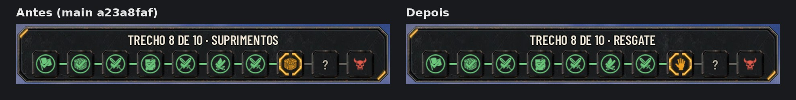
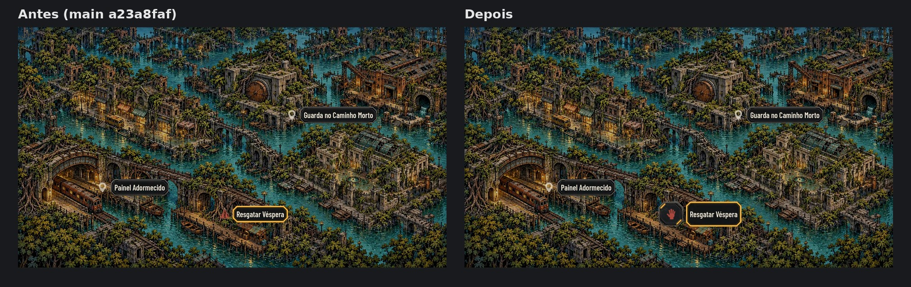
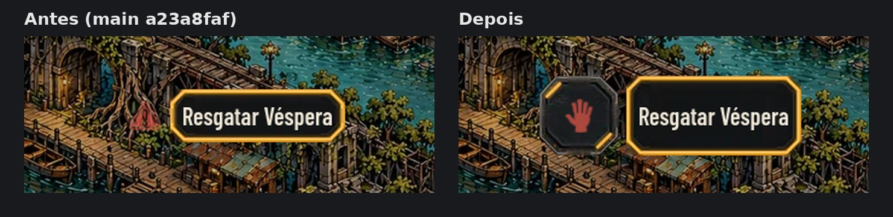

# Ícone de resgate no jogo (#295, #188)

O glyph `node-rescue` do Codex (#316, a mão erguida) entra no jogo em dois lugares: no trecho do preso, na barra de
trechos, e no pino do resgate, no Mapa da Rede. O arquivo é o WebP do jogo da tag `codex-pr316-originals`, idêntico byte a
byte (SHA256 `01be2032…264a`), em `art/ui/kit/station/icons/node-rescue.webp`.

As capturas saem do jogo, pela cena de verdade (`tools/capture_295.gd`). O roteiro é o mesmo nos dois lados: na main
`a23a8faf`, que é o antes, e nesta branch, que é o depois. O cenário é o da prancha do Codex: semente 23, a Véspera
capturada na fase 2 e expedição 4242. Tudo em 1920x1080, por software (xvfb).

## A barra de trechos

- **Antes:** o trecho do preso mostrava o ícone de suprimentos e o título "Suprimentos".
- **Agora:** a mão erguida, na cor de sempre, que é âmbar no trecho de agora, verde no resolvido e clara à frente. O
  título passa a dizer "Resgate".
- **O que não muda:** o trecho ainda não alcançado continua com "?", pelas regras de sempre, e os outros trechos de
  suprimentos seguem com o ícone deles.

## O pino do resgate no Mapa da Rede

O Lucas pediu destaque, porque o farol se perdia na pintura do mapa. Agora o farol tem:
- **a placa escura do kit:** a mesma do botão de ícone, como o X dos painéis, e não uma cor ou um contorno novos;
- **o ícone maior:** 34 px em vez dos 30 dos outros pinos.

A cor continua a de alerta, e só o ícone pisca; a placa fica parada. Os outros pinos não mudam.

## Testes

- O `tests/test_route_bar.gd` ganhou verificações do trecho do preso:
  - o ícone de resgate e a cor;
  - o outro trecho de suprimentos e o "?" do não alcançado;
  - uma rota sem resgate e um trecho igual de outra rota.

  Ganhou também as verificações do pino com a placa e dos outros pinos sem ela.
- `tests/run_all.gd` passa inteiro.
