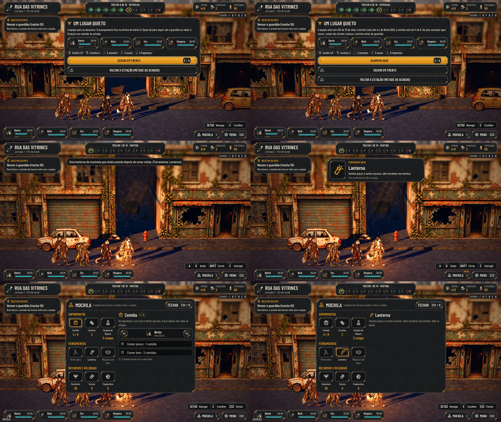
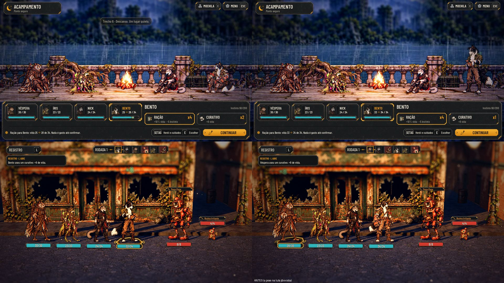

# A ferramenta à vista, a pose de cuidar e a parada que vira acampamento (#143)

## O que muda

- **A ferramenta ganha, à vista:**
  - ao chegar (a busca, o evento), um aviso do kit no alto com o ícone grande, FERRAMENTA NOVA, o nome, o que ela faz
    ("Ilumina poços e cantos escuros: abre escolhas nos eventos.") e onde ela fica; some em 5 s ou com uma tecla;
  - o botão MOCHILA ganha o selo NOVO até ela abrir; lá dentro, a ferramenta nova abre escolhida, com o selo e a
    descrição de cada ferramenta (`AHInventoryPanel.TOOL_TEXTS`);
  - nos eventos, a opção que pede a ferramenta já mostrava o ícone dela (#116): conferido.
- **A pose de cuidar:**
  - na luta, o curativo e a comida já mostravam a pose de usar item (`reactions.item`); o teste novo agora a protege;
  - no acampamento ela tinha sumido desde a #109: comer e curar mostram a pose por 1,2 s, e o herói volta a sentar.
- **A parada de descanso é o acampamento opcional:**
  - a pergunta tem três escolhas: Acampar aqui, Seguir em frente e Voltar à Estação (metade do achado);
  - o texto diz a vida da equipe, o instinto mais alto (e de quem) e a comida;
  - Acampar aqui acende a fogueira onde a equipe parou (na rua e nos cenários, que não têm casa), com a mesma cena e
    o mesmo HUD do acampamento; o jogo reaberto no meio volta à fogueira;
  - se a casa do acampamento fica na mesma parada, as duas viram uma só: Acampar aqui entra nela;
  - um acampamento por fase: depois de acampar na parada, a casa não acampa de novo, e vice-versa;
  - a fogueira e o ponto de levantar ficam antes da próxima patrulha (`STOP_CAMP_MARGIN`) e fora dos obstáculos do
    cenário; nos trechos curtos (o Abrigo, a Triagem, o Depósito), a fileira recua para os trechos já vencidos, e a
    fila recomeça à esquerda da fogueira quando não cabe à direita; a patrulha de pé que fica perto da fileira some
    enquanto a fogueira está acesa.

## Testes

- `tests/run_all.gd`: 64 de 64, com a paridade 48/48.
- `tests/test_rest_stop.gd` (novo, 123 verificações): o aviso e o selo NOVO; a Mochila com a ferramenta nova; a pose
  no curativo da luta e do acampamento; a parada com as três escolhas e o estado da equipe na Rua das Vitrines e no
  Cais; acampar ali, a câmera com a equipe toda, o jogo reaberto no meio, levantar e não acampar de novo; Voltar pelo
  Menu com o acampamento aberto; o Abrigo, a Triagem e o Depósito chegando no começo do descanso (a fileira antes da
  patrulha, levantar sem luta nem troca de mapa); a ferramenta perdida antes da Mochila.
- `tests/test_full_journey.gd` passa (ele segue em frente na parada).
- `tools/capture_143.gd`: as capturas, também na main de antes.

## QA

| Rodada | Veredito | O que a QA achou | Como ficou |
|---|---|---|---|
| 1 | REPROVADO | **Altas:** Voltar à Estação pelo Menu durante o acampamento da parada travava a tela; nos cenários de trechos curtos, a fogueira caía no trecho da patrulha e levantar começava a luta (ou trocava de mapa) sozinho. **Média:** o pé de cabra dizia "Não se gasta" e "aí ele quebra". **Baixas:** a ferramenta perdida antes da Mochila seguia nova; o painel da patrulha no acampamento; o selo NOVO sobre o ícone no Maior; a tecla no aviso no toque e o aviso sem fechar com o clique; esta página fora do commit | Todas corrigidas, com os casos novos no teste |
| 2 | REPROVADO | **Alta:** no Abrigo (e por pouco no Depósito), a fileira não cabe antes da patrulha e o guarda ficava no meio do acampamento; o teste deixava passar. **Baixa:** ao levantar, a fila pode recomeçar no trecho anterior | As patrulhas a menos de 1,5 m da fileira somem enquanto a fogueira está acesa e voltam ao apagar; o teste confere em sete sementes, sem a exceção. Recomeçar no trecho anterior (já vencido) fica |
