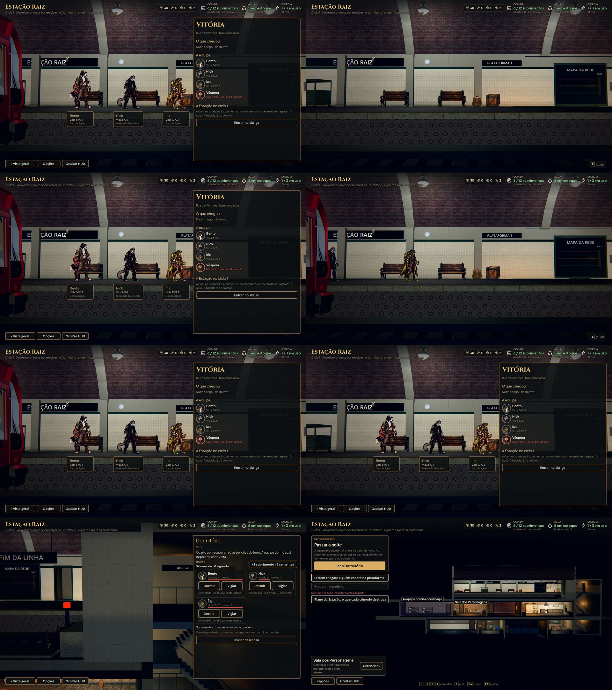

# Volta à Estação: a equipe chega de trem, relatório e o descanso antes de partir (#76)

Fotos de `tools/capture_return.gd` (1920x1080, gl_compatibility). A cena é a volta de uma vitória na Rua das Vitrines
com a Véspera caída e o Nick ferido. À esquerda, a versão anterior (o commit 29a09d7). À direita, a nova.

**Antes:** a Estação abria direto no relatório, com a equipe já parada na plataforma. "Entrar no abrigo" abria o painel
do Dormitório.

**Depois:**
1. **O trem chega:** a câmera fica na plataforma, de onde o relatório é visto. O trem chega do túnel com a buzina e o
   freio da chegada dos candidatos (#61), e o canto mostra a tecla de pular.
2. **A equipe desce:** as portas abrem e os vivos descem um por um pela porta do lado da plataforma. Aparecem saindo
   de trás do vagão, como o candidato (#61), e cada um anda até o seu lugar na fila do relatório.
   - Desce primeiro quem vai para o lugar mais longe da porta, e quem vem atrás nunca passa de quem vai na frente.
     Ninguém atravessa ninguém.
   - O Nick, ferido, anda mais devagar.
   - A Véspera, caída, não desce.
3. **O relatório:** com todos no lugar, o relatório abre e o trem fecha as portas e vai embora.
4. **A vista geral:** "Entrar no abrigo" leva a câmera de volta à vista geral da Estação, com o descanso pendente:
   - o Próximo passo diz que a equipe precisa dormir antes de partir de novo;
   - o Dormitório fica em destaque, com a luz violeta, os cantos cheios e a etiqueta "A equipe precisa dormir aqui";
   - Preparar expedição continua na lista, apagado, com o motivo embaixo ("Conclua a noite no Dormitório antes de
     partir.").

   Passada a noite, a Preparação libera.

## Como funciona

- **A cena:** a chegada (`AHStation.play_team_arrival`) usa o mesmo trem da chegada dos candidatos, com a parte comum
  separada (`_tick_slide_in`). O HUD fica no modo `arrival`, sem painel nem menu.
- **Quando começa:** a chegada, com o sino e o som do trem, só começa quando o cartão da passagem sai da tela. Um pular
  apertado ainda sob o cartão vale.
- **A vista geral:** a câmera enquadra a Estação à direita do menu da esquerda, medido a cada quadro (ele cresce com o
  texto Maior e o inglês). Antes, o Dormitório da ponta ficava embaixo do menu.
- **A etiqueta do Dormitório:** fica acima do cômodo e nunca por cima do menu.
- **Dica aberta:** com uma dica da primeira vez aberta por cima da chegada (a `boss_down` vem da rua), o clique, o toque,
  Interagir e Enter fecham a dica sem pular a chegada. Esc e Voltar não fazem nada: não derrubam a chegada nem escondem
  ninguém.
- **Reaberto com a noite pendente:** o jogo reaberto com o relatório já visto mostra a mesma vista geral com o destaque
  e o bloqueio, em vez de abrir o painel do Dormitório.
- **O candidato do trem:** se for chamado logo depois da volta, chega quando o trem da volta sai de vista.
- **Pular:** Interagir, Esc/Start, Voltar/B, um clique ou um toque levam direto ao relatório, com todos na fila e o trem
  já fora. Nenhuma tecla abre o menu ou um cômodo por trás.
- **Pular duas vezes:** nos primeiros 0,5 s do relatório aberto pela chegada, pular e voltar não valem. O segundo toque
  de quem pula a cena não conclui nem fecha o relatório.
- **Sem sobreviventes:** o trem chega, as portas abrem, ninguém desce e o relatório abre do mesmo jeito.
- **Save e load no meio:** a chegada é só a cena. O save continua com o relatório por ver, e a Estação reaberta no meio
  começa a chegada de novo, sem travar.
- **O trem de volta indo embora:** ele não conta como cena ocupada. Se o candidato do trem chegar logo depois (a noite
  passada depressa), a chegada dele começa normalmente.
- **Fotos de depois:** sem GPU, o trem anda bem mais devagar que o relógio, então as fotos de depois esperam cada
  estado da cena. As de antes são pelo relógio.

## Testes

`tests/test_return.gd` confere:
- só os vivos descem, o ferido anda mais devagar e ninguém atravessa quem já está na fila;
- Interagir, Enter ou Esc duas vezes pulam a chegada e deixam o relatório aberto, por ver;
- com uma dica aberta, Esc e Voltar não derrubam a chegada, Interagir fecha a dica e o relatório abre sem ninguém
  sumir dos cômodos;
- reaberto com a noite pendente, a vista geral com o bloqueio;
- pela passagem de verdade, a chegada não começa embaixo do cartão;
- Interagir, Esc, clique e toque pulam para o relatório completo;
- com todos caídos, o trem vazio leva ao relatório;
- o save do meio tem o relatório por ver, e a Estação reaberta no meio volta a chegar e chega ao relatório;
- concluído o relatório, a vista geral com Preparar expedição bloqueado e o motivo, e o Próximo passo de dormir;
- o Dormitório inteiro à direita do menu e a etiqueta fora dele, com o texto Normal e o Maior;
- passada a noite, a Preparação libera.

O `tests/test_full_journey.gd` cobre a volta nova na jornada inteira: chegada, fila, relatório, vista geral com o
destaque e o bloqueio, a noite e o trem. O `tests/test_keyboard_navigation.gd` pula a chegada pelo teclado e chega ao
Dormitório pelo Próximo passo.
