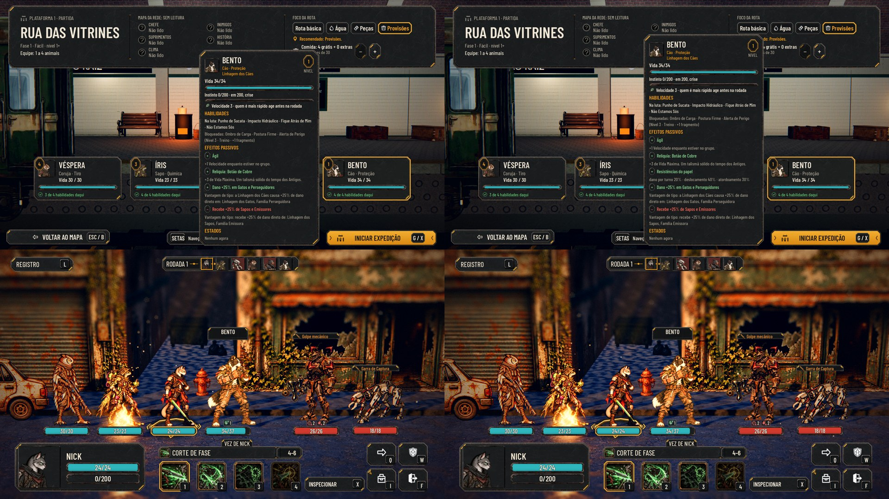

# As resistências e o crítico por papel (#189 PR 2, #258)

Segue a matriz da seção 5 da proposta da #189, aprovada pelo Orquestrador em nome do Lucas. Vale também para a #258.

## O que entra

- **As colunas novas em `data/classes.json`:**

  | Papel | Dano por turno | Deslocamento | Atordoamento | Crítico |
  |---|---|---|---|---|
  | Proteção | 20% | 40% | 30% | 10% |
  | Incursão | 10% | 10% | 10% | 15% |
  | Química | 40% | 10% | 10% | 10% |
  | Tiro | 10% | 20% | 20% | 13% |
  | Sabotagem | 30% | 20% | 10% | 12% |
  | Resgate | 30% | 60% | 40% | 10% |

- **O motor** lê o papel do herói em quatro pontos:
  - o dano por turno (sangramento e contaminação);
  - o empurrão, tanto o da ação do inimigo quanto o de uma habilidade;
  - o atordoamento;
  - a chance de crítico, que passa a ser 10% mais o crítico do papel.
- **A paridade:** os padrões são os de antes. Hoje todo herói já resistia 20% ao dano por turno e ao empurrão (o motor
  usava 0,2 fixo), não resistia ao atordoamento e tinha 10% de crítico. Os kits históricos da paridade não têm as
  colunas, então lutam e sorteiam igual, com 48 de 48.
- **O atordoamento** só sorteia com resistência acima de 0, e não acrescenta sorteio a quem não tem.
- **A ficha fora da luta**, na partida, ganha a linha "Resistências do papel". No Incursão, no Tiro e na Sabotagem,
  ganha também "Olho para o ponto fraco", com a chance de crítico. A inspeção na luta não muda: ela tem altura fixa, e
  com uma linha a mais as explicações dos passivos sumiam.

## Para o Lucas

- **Muda o equilíbrio.** O Incursão e o Tiro passam a resistir menos ao dano por turno (10% contra os 20% de antes), e a
  Química e o Resgate passam a resistir mais. O Resgate quase não é empurrado (60%), e o Incursão quase sempre é (10%).
- **Hoje nenhum inimigo atordoa herói.** Só os heróis atordoam (o Impacto Hidráulico, a Poeira e a Investida), então a
  resistência a atordoamento fica pronta para quando houver um inimigo que atordoe.

## Testes

- `tests/test_role_attributes.gd`:
  - a matriz como foi aprovada, e os padrões no kit histórico;
  - o motor com o sorteio fixo: o dano por turno, o empurrão, o atordoamento (sem sorteio quando a resistência é 0) e o
    crítico do Incursão;
  - a ficha.
- `test_combat_parity`: 48 de 48.
- `tests/run_all.gd` inteiro.
- As fotos acima saem de `tools/capture_sheet.gd`, no PR 1 e nesta branch.
