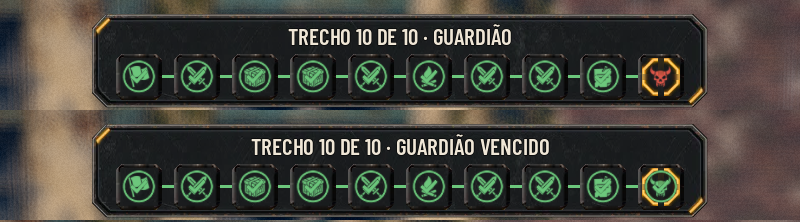

# A casa do guardião concluída na barra de trechos (#180)

## O que muda

- **A casa do guardião** fica em alerta (vermelha) só até ele ser vencido. Vencido, ela fica como as outras resolvidas:
  o ícone verde e o check, mesmo sendo o trecho de agora. O guardião é o último trecho, então segue "agora" para sempre.
  O check vem por cima da moldura âmbar de agora.
- **O título do alto** diz "Trecho 10 de 10 · Guardião vencido" depois da vitória, com o texto que já existia no
  objetivo, já traduzido no `en.po`. O título do Menu da expedição diz o mesmo.
- **Retirada e fuga:** o guardião não vencido continua em alerta, sem o check, com o título "Guardião".
- **Os outros trechos não mudam:** o resolvido de antes tem o check, e o resolvido de agora fica só com a moldura.

## Testes

- `tests/test_route_bar.gd` (novo, 8 verificações):
  - o guardião por vencer fica em alerta e sem o check;
  - vencido, fica verde, com o check por cima da moldura de agora e o título "Guardião vencido";
  - um trecho comum resolvido segue como antes.
- `tools/capture_180.gd`: a Rua no trecho do guardião antes e depois da vitória; também roda na `main` de antes.

## QA

- **Rodada 1: APROVADO.** Conferido na vitória real da fase 1 (barra, título, "Concluir jornada" e Menu), no estado
  vencido carregado do save nas fases 2 a 5, na retirada no trecho 9 e na fuga, com o texto Maior, as cores para
  daltonismo, o toque e o inglês. Três observações baixas, corrigidas: o teste procura o check pela textura (dentro da
  casa ele estica e fica centrado sobre o ícone, então o tamanho e a posição de canto eram código morto e saíram); a
  imagem perdeu a faixa da ordem de turnos; e o `capture_180.gd.uid` entrou no Git.
