# Revisão visual das lutas e da exploração nos cenários (#52)

Revisão de uma luta por zona de cada mapa (a Rua das Vitrines, os seis cenários e uma loja), com a fila inteira dos
dois lados, e da equipe andando em cada zona. As fotos saem do jogo de verdade (a cena da rua, a luta começada pelo
corredor como no jogo), na vez do jogador, em 1920 × 1080:

```
"$GODOT" --path . --resolution 1920x1080 -s res://tools/capture_fights.gd -- --out=<pasta> [--maps=Street,House,FloodedDepot,...]
"$GODOT" --path . --resolution 1920x1080 -s res://tools/capture_scenarios.gd -- --out=<pasta>
```

`capture_fights.gd` confere cada unidade: o pé dentro da zona (com a folga de 0,4 m da borda, a mesma do corredor),
fora das caixas de obstáculo do cenário e dentro da tela; uma linha PASS/FAIL por luta. O teste
`tests/test_combat_room.gd` faz a mesma conta sem janela para **todos** os trechos de luta de cada mapa (não só o
primeiro de cada zona) e entra no `run_all`.

## O que estava errado

A luta começava no ponto da patrulha e punha a fila com o espaçamento fixo (1,2 m entre os heróis, 1,35 m entre os inimigos, 1 m de cada lado do centro) sem
olhar o lugar. Onde a patrulha espera perto da ponta da zona, a ponta da fila saía da zona:

| Luta | Antes | Depois |
|---|---|---|
| SealedShelter, zona 1 | Íris e Véspera atrás da parede da esquerda | todos dentro (espaços a 95%) |
| SealedShelter, zona 4 | Nick, Íris e Véspera fora da sala | todos dentro (espaços a 95%) |
| SealedShelter, zona 7 | Nick, Íris e Véspera fora da sala | todos dentro (espaços a 95%) |
| FloodedDepot, zona 1 (a da escada) | Véspera em cima da escada, quase fora do cenário | todos dentro |
| Rua, RiverDock, RootBridge, TriageGate, SewerDucts, loja | dentro | iguais |

O teste sem janela também acusava, pela regra antiga, trechos de TriageGate e da rua com alguém fora (trechos que não
são o primeiro da zona e por isso não estão nas fotos). A QA achou mais dois casos que as fotos não mostravam, porque
a posição passa do número de quem luta:

- **o chefe da fase 5** (o porteiro ocupa as posições 1 e 2 e os condutores ficam na 3 e na 4): o Condutor Beta ia
  para x = 60,15, dentro da parede do fim do SewerDucts;
- **o herói que recua para a posição vazia** (numa equipe de 2 ou 3, o Mover oferece a posição seguinte): a Íris ia
  para trás da parede do SealedShelter.

## A regra (combat_arena.gd e street.gd)

- `street.combat_room(x)` diz onde a luta pode ficar: os limites da zona (ou da sala da loja, ou da rua, de -2 a 79 m)
  e os obstáculos sólidos do cenário que cruzam a faixa da luta, com 0,3 m de folga. Hoje nenhum cenário tem obstáculo
  na faixa da luta (a escada do FloodedDepot fica fora da zona): quem segura a fila é o limite da zona. A parte dos
  obstáculos fica pronta para um mapa que tiver.
- `AHCombatArena.fit` reserva as quatro posições dos dois lados (não só as ocupadas: o Mover, o Recuar e o chefe de
  duas posições chegam à 4). Entre os vãos onde a fila cabe, fica no que deixa o centro mais perto da patrulha,
  deslocando-o só o que precisa; se não cabe em nenhum, encolhe os espaços até 60% no maior. A luta continua onde a
  patrulha está sempre que cabe.
- Os pés baixos e a luz das pontas vêm da #48: o chão da luta sobe o que a frente do cenário esconderia e uma luz de
  preenchimento só dos personagens alcança a fila inteira.

Não foi preciso uma área de luta por zona nos `data/scenarios`: os limites que já existem bastam. As três salas do
SealedShelter (10 m cada) são as únicas zonas onde a fila de 4 + 4 encolhe, para 95%.

## Pranchas (antes à esquerda, depois à direita)

As lutas do chefe de cada fase entraram depois da QA (a fila dele vai até a posição 4) e só têm a foto de depois. As
18 lutas da captura passam a conferência por unidade.

### Rua das Vitrines

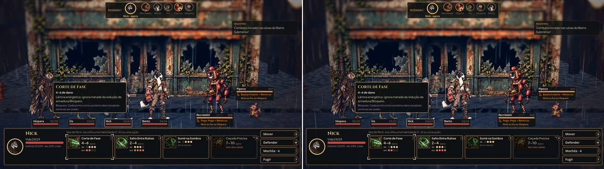
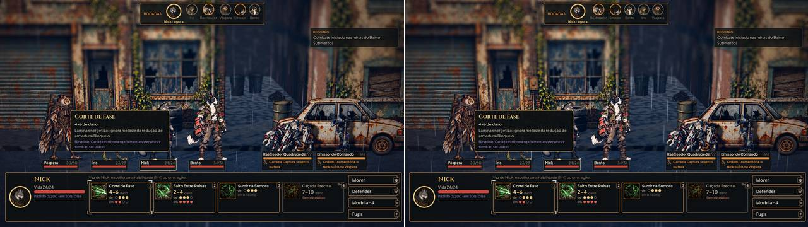
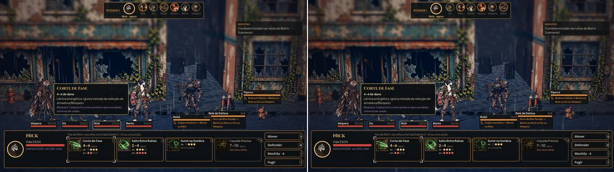
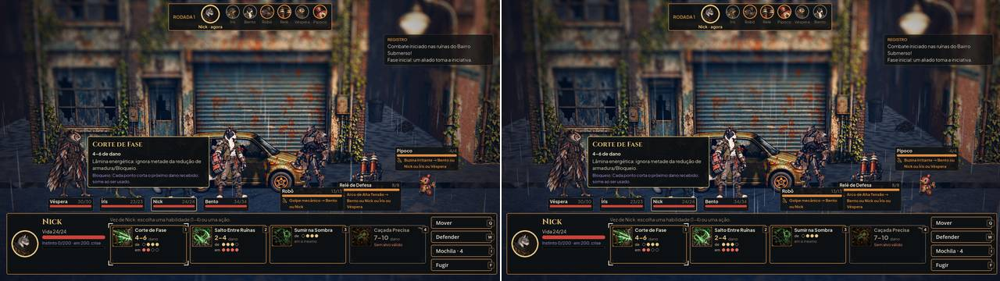
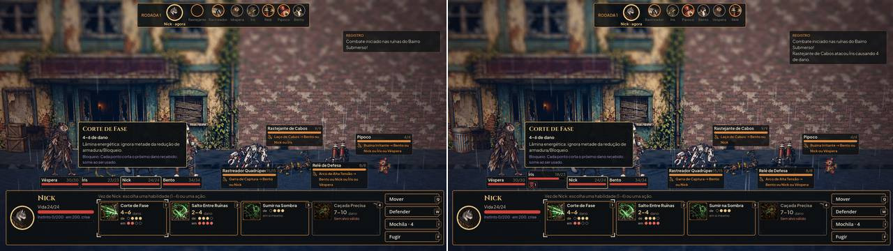

### Loja (interior)

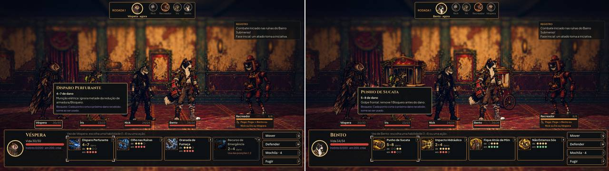

### RiverDock e RootBridge (fase 2)

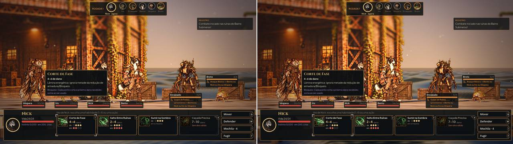
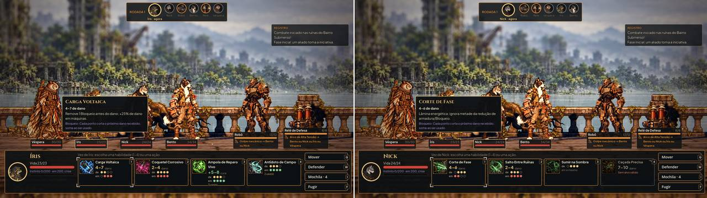
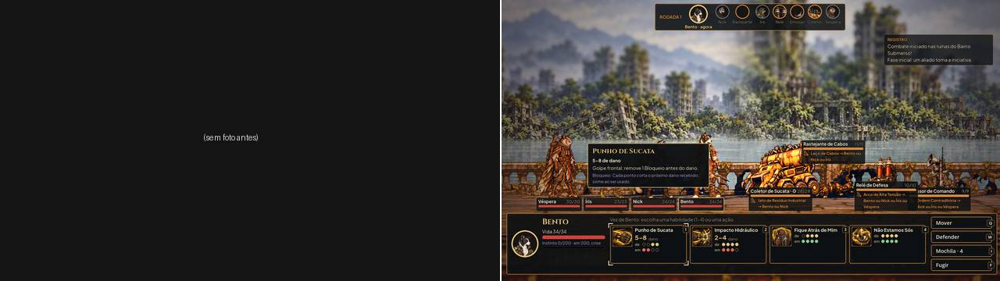

### SealedShelter (fase 3)

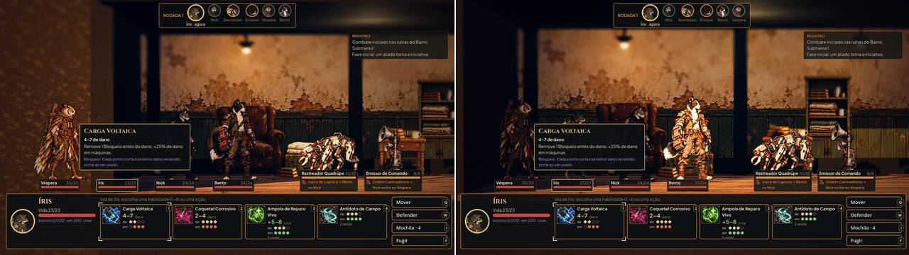
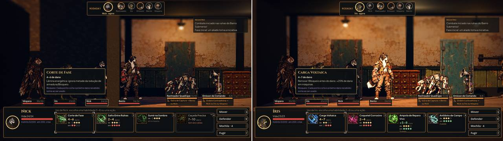
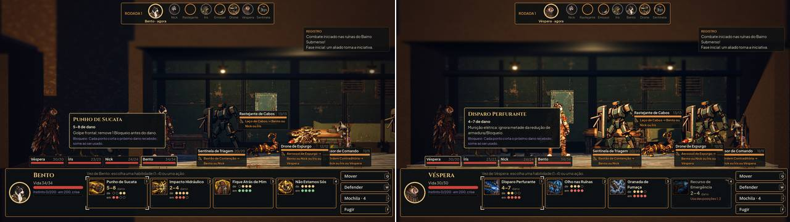
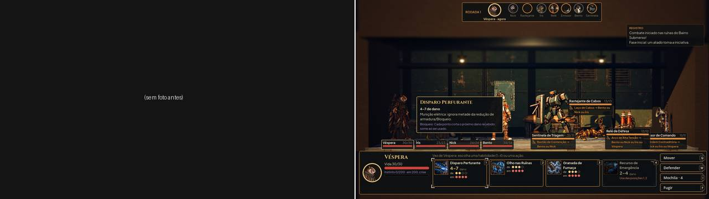

### TriageGate (fase 4)

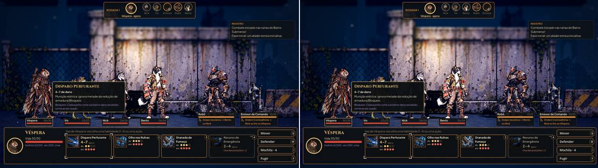
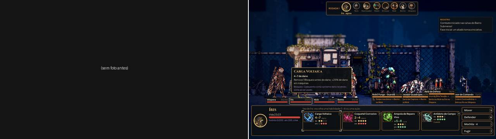

### FloodedDepot e SewerDucts (fase 5)

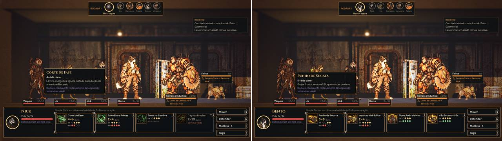
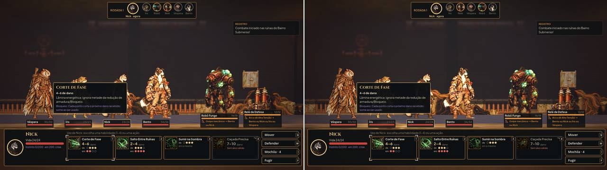
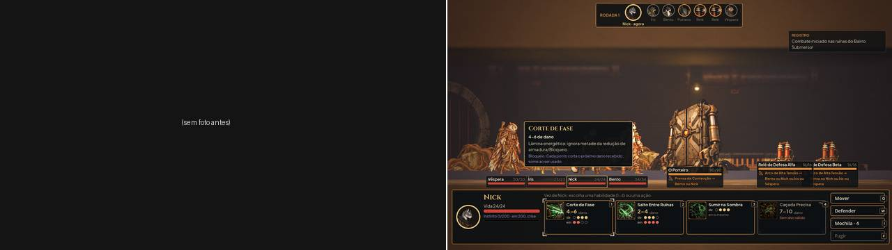

## Conferência por foto

- **Ninguém fora da área pintada, em cima da escada ou atrás de parede:** conferido por unidade em todas as lutas
  (`fights.txt`) e pelo teste em todos os trechos.
- **Distância entre as filas:** a mesma de antes (2 m entre as frentes) onde cabe; só as salas do SealedShelter
  encolhem, para 95%.
- **Câmera:** todas as unidades dentro da tela em todas as fotos.
- **Frente do cenário:** os pés aparecem (a #48).
- **Luz nas pontas:** as pontas aparecem iluminadas nas fotos depois.

## Exploração

`capture_scenarios.gd` fotografa cada zona de cada cenário, de dia e de noite com chuva, e confere a equipe e as
patrulhas no piso da zona e o líder preso à faixa ao andar contra a ponta (ninguém flutuando, fora da faixa ou
atravessando parede). Resultado nesta rodada: as 13 zonas dos seis cenários, nos dois climas, 26 conferências e
nenhuma falha (a #52 não mexeu na exploração; a revisão confirma que ela já estava certa).

## Para o Lucas

- Na vez do jogador, a dica da habilidade com o foco abre sozinha e pode cobrir a parte de baixo dos dois últimos da
  fila (Íris e Véspera), como nas fotos. Não mudei: é uma decisão de interface (abrir a dica só com o mouse ou com a
  navegação pelo teclado).
