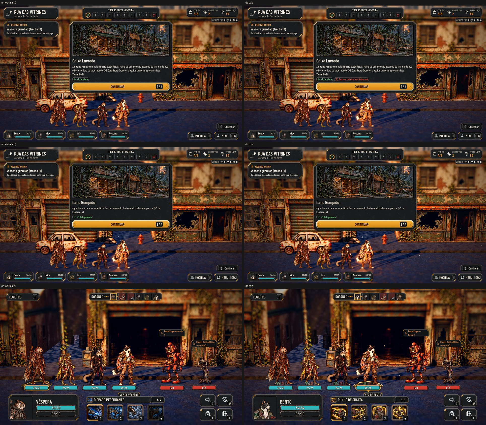

# Os eventos de busca de cada mapa e os efeitos de fase na luta (#78)

Os 20 eventos de busca aprovados pelo Lucas (26/10), 4 por fase, e a decisão (A): a luta aplica os efeitos de fase que
os eventos dão (`corridor.effects`). Os textos estão no comentário da #78; o "+2 Fragmento" do Relatório Partido ao Meio
foi para o plural.

Um evento novo de cada fase, o cartão e o resultado com os chips: [new_events.jpg](search-events/new_events.jpg).

As fotos saem de `tools/capture_78.gd` (o antes, rodando a mesma ferramenta numa cópia da `main`: lá os eventos novos não
existem e ficam sem foto).

## Os eventos

- **Os 20 de busca** entram em `data/events.json`, cada um com o lugar (`Places`) e o tipo de objeto (`Objects`) que
  existe nos mapas da fase. Os 10 de antes continuam com os mesmos ids e números.
- **A cobertura** (`tests/test_event_coverage.gd`, novo): cada fase tem 4 eventos só dela, todos alcançáveis por um objeto
  dos mapas da fase (a rua: os pontos das casas; as outras: os props da travessia e do mapa da fase), e cada mapa tem
  objeto que abre evento da fase. Por mapa, hoje:

  | Fase | Mapa | Eventos próprios que os objetos do mapa abrem |
  |---|---|---|
  | 1 | Rua das Vitrines | Gaveta do Caixa, Latas Estufadas, Gerador das Galerias, Armário dos Funcionários (e o Cano Rompido, de antes) |
  | 2 | Cais do Rio | Carga com Etiqueta Acesa, Armário de Salvamento, Rádio de Bordo |
  | 2 | Ponte das Raízes | Bolsa Tomada pelas Raízes, Carga com Etiqueta Acesa |
  | 3 | Abrigo Lacrado (Sala Esquecida) | os 4 (o fichário e o caixote de baterias) |
  | 4 | Portão de Triagem | os 4 (o cesto e o armário de apreensões) |
  | 5 | Depósito Inundado | os 4 |
  | 5 | Dutos de Esgoto | Embalagem Aberta, Prancheta de Manutenção |

- **O inglês:** os 175 textos novos (os eventos e os chips) no `en.po`.

## Os resultados com os chips do #116

O resultado do evento já mostrava a vida, a Esperança, os recursos e o instinto em chips. Agora também mostra:
- **a ferramenta** ganha ou perdida, com o ícone dela ("+ Máscara com filtro");
- **o efeito de fase**, com o ícone do marcador que ele dá na luta: Exposto (Vulnerável) e Cansado na cor de alerta,
  Preparado (Bloqueio) na cor de bom.

## Os efeitos de fase na luta (decisão A)

`AHJourneyRules.PHASE_EFFECTS` diz o que cada um faz:

| Efeito | Na luta | Quanto dura |
|---|---|---|
| Exposto | cada herói começa Vulnerável (1) | só a próxima luta: sai da lista quando ela começa |
| Cansado | −1 de velocidade em cada herói (antes da iniciativa) | até o fim da fase |
| Preparado | cada herói começa com 1 Bloqueio | até o fim da fase |

- A luta (`AHCombatSession.create`) recebe os efeitos da expedição; o registro da luta diz cada um no começo.
- Os inimigos não mudam. Uma expedição nova começa sem efeitos.
- `tests/test_phase_effects.gd` (novo) confere os três, o gasto do Exposto, os chips e que todo efeito dos dados tem
  regra. O `test_full_journey` confere na rua de verdade: a primeira luta começa com Exposto e Preparado, e só o
  Preparado fica.

## A medição de equilíbrio (antes e depois)

`tools/measure_balance.gd -- --seeds=40 --gear=typical --levels=typical [--effects=...]`, a política automática.

- **Antes:** sem efeito, que é o jogo de hoje (a `main` mede igual).
- **Luta a luta:** cada luta começa com o efeito, que é o pior caso do Exposto (no jogo, ele vale só numa luta).
- **Jornada:** como no jogo, o Exposto vale só na primeira luta e os outros até o fim.

Vitórias do guardião (luta a luta) e jornada com cuidados (termina):

| Fase | Antes | Exposto | Cansado | Preparado | Preparado + Cansado (a Barricada) | Exposto + Cansado |
|---|---|---|---|---|---|---|
| 1 | 100% · 100% | 100% · 100% | 100% · 100% | 100% · 100% | 100% · 100% | 100% · 100% |
| 2 | 100% · 98% | 100% · 98% | 100% · 88% | 100% · 98% | 100% · 95% | 98% · 95% |
| 3 | 100% · 58% | 98% · 60% | 100% · 52% | 100% · 78% | 98% · 78% | 95% · 50% |
| 4 | 100% · 58% | 98% · 58% | 100% · 50% | 100% · 65% | 100% · 75% | 100% · 55% |
| 5 | 45% · 0% | **22%** · 0% | 38% · 0% | **80%** · 12% | **88%** · 18% | 25% · 2% |

As patrulhas quase não mudam (99 a 100% em todos). Com 40 sementes, a diferença de até uns 8 pontos é sorteio.

### Para o Lucas decidir: o que pesa demais

- **Exposto antes do guardião da fase 5:** as vitórias caem de 45% para 22%. Isso só acontece se a última busca antes do
  guardião der o Exposto (a Caixa Lacrada, a Barricada arrombada ou a falha na Sala de Esporos).
- **Preparado** (o "Escudo de placas" da Barricada): melhora muito.
  - O guardião da fase 5 sobe de 45% para 80 a 88% de vitórias.
  - A jornada da fase 3 vai de 58% para 78%; a da fase 4, de 58% para 65 a 75%.
  - O Cansado que vem junto não compensa.
- **Cansado sozinho:** pesa pouco. A jornada perde de 6 a 10 pontos nas fases 2 a 4.

Se for demais, as saídas que não mexem nos números dos eventos:
- o Preparado só na próxima luta (como o Exposto);
- o Exposto que não vale contra o guardião.

Os dois são uma linha em `PHASE_EFFECTS`. Até a decisão, ficou como o texto dos eventos promete.

## Rodadas da QA

### Rodada 1: APROVADO

A QA conferiu:
- **o save:** os efeitos voltam do save, e um save antigo sem a lista abre normal;
- **os chips:** também nos caminhos de falha dos eventos, e um efeito repetido não entra duas vezes na lista;
- **as fotos:** com o texto Maior e daltonismo, e com o texto Maior em inglês;
- **a medição:** a opção `--effects` funciona, e um efeito que não existe dá um erro claro.

**As observações baixas que entraram:**
- o Registro da luta dizia "Exposto: próxima luta Vulnerável" dentro da própria luta; agora diz "Exposto: a equipe começa Vulnerável" (e o mesmo para os outros dois);
- dois comentários do código tinham mudado de dono e voltaram para o lugar;
- um erro de digitação na ajuda do `measure_balance.gd`.

**As que ficam:**
- **A ferramenta que a equipe já tem não ganha chip,** porque nada mudou. O efeito de fase repetido ganha chip, porque o texto do resultado o promete de novo.
- **O Cansado não tem ícone na luta,** só a linha no Registro. Fica para o Lucas, junto com a medição.
- **O Exposto se gasta mesmo quando a equipe foge,** como diz "próxima luta".
- **Os 4 avisos "Lambda capture … was freed" do `test_train`** também aparecem na `main`: não vêm desta entrega.
