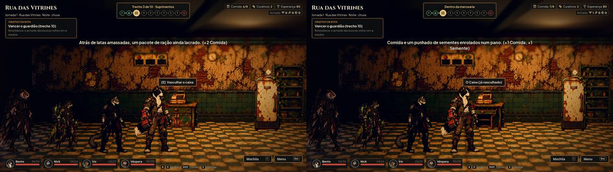
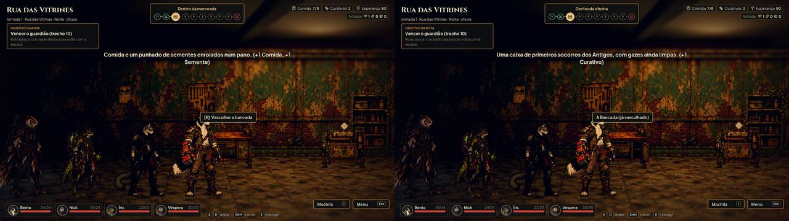
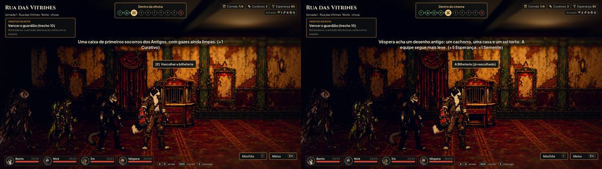
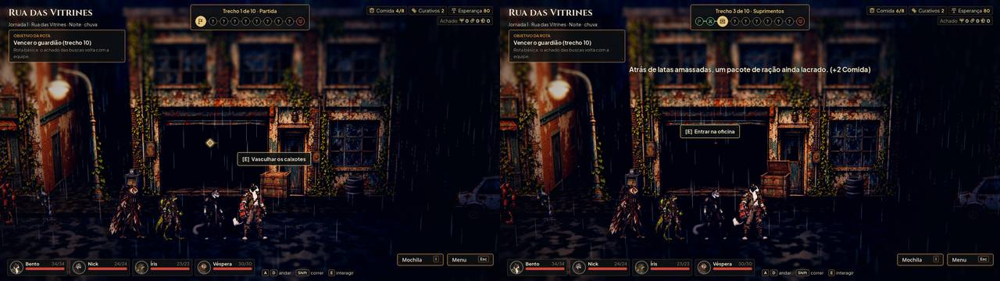

# Pontos de busca com o objeto à vista (#50)

Cada ponto de busca da Rua das Vitrines mostra o objeto: fechado até a equipe vasculhar, aberto depois, e continua
aberto depois de salvar e carregar. A arte é a do Codex (#49, PR #53), convertida por `tools/convert_search_props.py`
para WebP de 512 px, com a âncora no pé no mesmo ponto nos dois estados.

```
"$GODOT" --path . --resolution 1920x1080 -s res://tools/capture_search_props.gd -- --out=<pasta>
```

## Lojas

Três objetos por loja, nos pontos de sempre (36%, 56% e 74% da sala), com a frente um pouco atrás de onde a equipe anda.
A colisão vai da frente do objeto até a parede do fundo: a equipe vasculha pela frente e não passa por trás dele. O aviso
e o losango ficam sobre o topo do objeto fechado; depois da busca, o losango some.

| Loja | Pontos |
|---|---|
| Mercearia | o caixa, a geladeira, as prateleiras |
| Oficina | a bancada, o motor, o armário de peças |
| Cinema | a bilheteria, o carrinho de pipoca, a escada |

Antes e depois de vasculhar o primeiro ponto:





## Rua

Os caixotes, a lixeira e a caixa de correio se alternam pelos trechos de busca, na calçada, com colisão (a tecla C
mostra a caixa). O objeto fica no ponto do trecho ou no lugar livre mais perto dele, a 1,6 m de qualquer porta de loja
e longe dos objetos pintados da calçada. Antes o card dos caixotes só escurecia depois da busca.



## Testes

`tests/test_search_props.gd` confere:

- a arte: os dois estados na mesma tela, o pé na âncora e a faixa do chão igual;
- a rua: um objeto por trecho de busca, a alternância, a colisão (também na lista da tecla C), longe das portas e dos
  pintados, e o losango sobre o topo;
- as lojas: o objeto de cada ponto nas três lojas, ninguém passa por trás, e a busca abre o objeto;
- o save: salvar e carregar mantêm abertos os vasculhados da rua e da loja.
