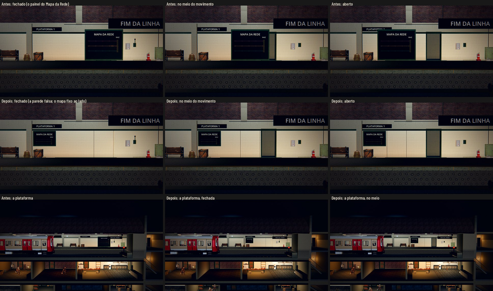
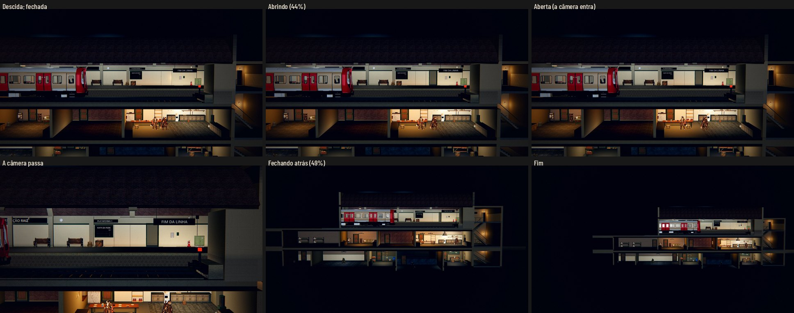

# A parede secreta da plataforma (#203)

O pedido do Lucas (28/10): "Ainda não gosto daquela porta secreta que abre no lobby na animação de descer a escada, o
mapa da Estação. Preferia que fosse outra coisa, nem que seja uma parede secreta ou algo assim. Que se mova do mesmo
jeito do mapa."

As fotos saem de `tools/capture_203.gd`: de perto e na vista da plataforma, com a peça fechada, no meio do movimento e
aberta. O antes é a `main`.

## O que muda

- **A peça que desliza** é um pedaço da própria parede da plataforma, com o mesmo azulejo até 2,2 m e o mesmo concreto
  acima, numa chapa rente à parede (`_secret_passage` em `scripts/station/station_build.gd`, com 1,6 m de largura,
  cobrindo a porta e o batente).
  - Fechada, ela quase some: as pistas são a fresta de luz na borda direita, a alavanca ao lado, o trilho no chão e
    uma junta suja de rejunte nas bordas.
  - A arte é só a que a Estação já usa. Não foi preciso pedir nada à Awesomic 1.
- **O movimento é o mesmo:** o pivô, o `PANEL_SLIDE` de 3 m, o tempo, a alavanca, a fresta e o som. Só mudou o que
  desliza.
- **O azulejo anda com a peça.** As superfícies da Estação projetam a textura pelo mundo, então uma peça que se mexe
  ficaria com os azulejos parados por cima dela. O `station_surface.gdshader` ganhou o `slide_offset`, e o
  `_apply_panel` o atualiza nos materiais da parede falsa (cópias dos da parede, os mesmos parâmetros).
- **O Mapa da Rede (a proposta para o Lucas):** ele fica **fixo na parede ao lado**, sob a placa PLATAFORMA 1, entre a
  pilastra e o caminho da parede falsa. É a mesma chapa, com as três linhas, as estações e a Raiz no fim, um pouco
  menor (1,76 × 1,2 m) para caber ali. O radar do #87 chama o Mapa da Rede de "o terminal antigo da plataforma", por
  isso ele não sai da Estação. A outra saída seria tirá-lo da parede: o Lucas escolhe pela captura.
- **A narrativa:** a Estação é Remendadora (`lore.md` §17). Uma parede falsa de azulejo e concreto, montada pela
  comunidade sobre a porta de manutenção para esconder o caminho, faz sentido (§14 do `narrative-design.md`). Nenhum
  texto muda.

## Testes

- **`test_secret_wall` (novo):**
  - a peça é a parede: o azulejo da plataforma, sem letreiro, e cobrindo a porta e o batente;
  - fechada fica no lugar, com a fresta;
  - aberta andou `PANEL_SLIDE`, a fresta some, e a textura anda junto;
  - fechada de novo, volta;
  - na descida de verdade, ela abre inteira, a alavanca gira, e no fim volta ao lugar;
  - o save não muda;
  - o Mapa da Rede continua na plataforma, fixo, entre a pilastra e o caminho da peça.
- `tests/run_all.gd` inteiro.

## A descida de verdade

As fotos são da QA, com a câmera passando. A parede abre, a câmera entra pela porta, e a parede fecha atrás dela.

## Rodadas da QA

### Rodada 1: APROVADO

A QA conferiu e capturou:
- a grade do azulejo, a tinta, a escala e a umidade, iguais às da parede, sem degrau nos dois lados;
- nenhum z-fighting, e o batente sem atravessar a peça;
- o azulejo andando com a peça a 25, 50 e 100%;
- as folgas do mapa: 7 cm até a pilastra e até a peça aberta, mais de 20 cm acima da caixa e 22 cm sob a placa;
- a descida e a subida de verdade, com a parede de volta ao lugar;
- os filtros `secret_wall` e `station`.

**Baixas:**
- Corrigido: os comentários antigos que ainda falavam do painel do mapa, e o cabeçalho da captura, que prometia a descida
  (ela está aqui, nas fotos da QA).
- Fica: as linhas coloridas do Mapa da Rede, escuras como já eram na `main`, quase não aparecem no mapa menor; só "MAPA DA
  REDE" e "RAIZ" se leem. Se o Lucas aprovar o mapa fixo, dá para clarear a tinta.
- Fica: o topo do batente aparece acima da faixa de aço quando a porta abre, como já era antes.

### A revisão do PR

**Baixas, corrigidas:**
- O `test_secret_wall` agora mede a peça (as caixas do pivô) contra o batente e a altura da porta, em vez de comparar
  duas constantes.
- O vão de 12 cm entre o azulejo e o concreto foi fechado. O concreto começa logo acima do azulejo, atrás da faixa de
  aço, que segue inteira.
- As linhas em branco entre as funções voltaram ao padrão.
