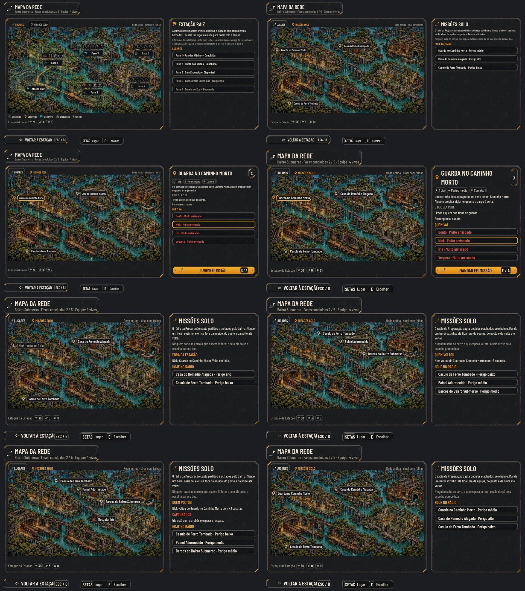

# As missões solo (#183, primeira parte)

## O que entra

- **A Preparação vai ao nível 2** (4 sucatas e 1 fragmento). No nível 2, o Mapa da Rede ganha a aba **Missões solo**;
  antes, a aba aparece apagada, com o motivo.
- **O quadro do dia:** a cada dia da Estação (uma volta ou um dia de espera), o rádio capta de 2 a 4 missões
  (`Board`, pela fase mais alta liberada), sorteadas entre as das fases liberadas e postas em lugares da pintura
  (`Spots`). O sorteio usa a semente das missões e o dia: salvar e voltar não troca o quadro.
- **Mandar:** a missão leva comida (1 suprimento por dia), tira o herói do posto e o tira da Estação até a volta. No
  máximo 2 em curso. Quem está fora não parte na equipe (a Preparação diz por quê), não pega posto, não passa a noite
  (a noite conta só quem voltou na equipe) e não passeia na Estação. Com todos fora ou caídos, dá para esperar um dia.
- **A chance** (escondida; a tela mostra só o selo *Boa escolha*, *Arriscado* ou *Muito arriscado*):
  - a base pelo perigo (50, 40 ou 30);
  - a aptidão da classe em cada coisa que a missão pede (+20 forte, +10 parcial);
  - o nível do herói contra o da fase da missão (+3 por nível acima, até +15; −8 por nível abaixo);
  - a vida que falta (até −30), os traços (`Perks`), o trauma (−10) e a crise (−10);
  - sempre entre 5 e 95.
- **A volta** (no dia marcado), contra a chance:
  - **deu certo:** a recompensa do tipo da missão, na faixa da carga recuperada da fase mais alta liberada, a relíquia
    (1 em 14) nas missões que a têm e 10 de XP;
  - **com ferimentos:** a faixa de 25 pontos acima da chance; volta com 35% da vida e metade da recompensa, sem a
    relíquia;
  - **com os robôs:** o herói ficaria fora até o resgate, com um pino de resgate no mapa. **A captura fica desligada
    (`CaptureEnabled: false`) até o resgate na rota (#188)**: sem ele, o capturado ficava fora para sempre e, com todos
    fora, o jogo travava. Enquanto isso, esse resultado volta com ferimentos e de mãos vazias. O código da captura e o
    pino estão prontos e testados com a chave ligada.
- **O relatório:** a coluna "Missões solo" no retorno da expedição e "Quem voltou" na aba (só os do dia).
- **Ninguém para partir:** com todos fora ou caídos, "Esperar um dia" aparece na aba e na Enfermaria.
- **O teclado e o controle:** PgUp / PgDn (LB / RB) trocam a aba; ↑ ↓ andam pelos pinos e pelo painel (os heróis,
  MANDAR, esperar um dia), → vai do mapa ao painel e ← volta ao pino; Interagir escolhe e manda.

## Para o Lucas

- **O nível pesa:** uma missão da fase 3 (nível 5) com o time do começo (nível 1) fica *Muito arriscado* (cerca de
  8%). No nível típico de quem chega à fase 3 (4, `measure_balance`), a mesma missão de perigo médio dá 52% para a
  classe forte (*Arriscado*). O quadro também traz missões das fases de antes.
- **Ficam para as próximas partes:** a volta no trem e o resgate na rota da fase (#188).

## Observação

- No texto Maior, a tecla ESC / B cobre o fim de VOLTAR À ESTAÇÃO no Mapa da Rede. Já era assim na `main`.

## Testes

- `tests/test_side_missions.gd` (271 verificações): a Preparação nível 2 e a aba; o quadro (quantas, só das fases
  liberadas, lugares diferentes, estável, a troca no dia novo); a chance em cada parte e nos limites, e o selo; mandar
  (a comida, o posto, a volta marcada, fora do quadro, o máximo de 2, sem comida); quem está fora (não parte, não pega
  posto, deixa esperar um dia); a volta em 40 campanhas (os três resultados, o XP, a recompensa, os 35% da vida, o
  capturado fora) e o save de antes.
- `tools/capture_183.gd`: a aba apagada, o quadro, a missão com o herói, em curso, a volta e o capturado, nos textos
  Normal e Maior.
- `tests/run_all.gd` inteiro.

## QA

- **Rodada 1: REPROVADO.** Dois altos e quatro médios:
  - alto: com todos fora ou capturados, não havia "Esperar um dia" (só na Enfermaria, com caídos) e o jogo travava;
  - alto: a aba e o envio não se usavam pelo teclado nem pelo controle;
  - médio: voltar ferido curava quem saiu com menos de 35% da vida;
  - médio: a semente das missões nascia no primeiro uso, e recarregar sem salvar trocava o quadro;
  - médio: o pino de uma missão caía no lugar de quem está fora ou capturado;
  - médio: a captura prometia um resgate que ainda não existe (§14.4).

  Correção:
  - "Esperar um dia" na aba e na Enfermaria sempre que ninguém pode partir;
  - a aba e o envio pelo teclado e pelo controle, como descrito acima;
  - o ferimento nunca sobe a vida;
  - a semente nasce com a campanha (e na migração);
  - os lugares ocupados ficam fora do sorteio;
  - a captura fica desligada até a #188.

  Das baixas:
  - o relatório diz "voltou da missão …";
  - "Quem voltou" mostra só o dia;
  - mandar respeita a noite pendente;
  - o `test_narrative_terms` lê as missões.

  Testes novos em `tests/test_side_missions.gd` (686 verificações):
  - os dois modos da captura, o ferido que não sara e o relatório do dia;
  - a semente ao recarregar, os pinos livres e a noite;
  - a tela: a aba por PgDn, a cadeia do teclado até MANDAR e "Esperar um dia" com todos fora.

- **Rodada 2: APROVADO.** O `run_all` deu 101/101, com a paridade 48/48. A QA conferiu os 6 problemas da rodada 1:
  - o envio e o "Esperar um dia" só com o teclado (PgDn, setas e E), com o save gravado;
  - o ferido que não sara, em 300 campanhas;
  - a semente estável na campanha nova, no save antigo e no save sem o campo;
  - os pinos livres em 200 dias;
  - a captura desligada: 0 em 300 envios.

  Das baixas, o texto do "Esperar um dia" agora muda com ninguém em missão (só caídos). Ficam como estavam:
  - a dica do rodapé, que não cita PgUp/PgDn;
  - o "Equipe: N vivos" do cabeçalho;
  - a mensagem da noite pendente ao mandar ("antes de partir"), que a tela não alcança.
