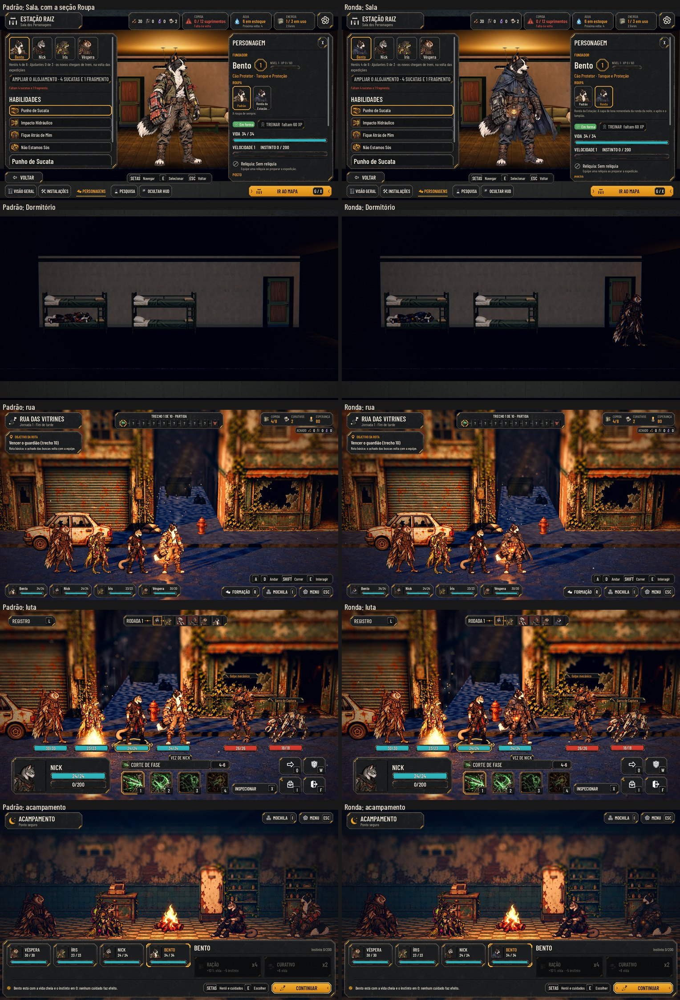

# As skins completas (#138)

O pedido do Lucas (26/10): "Só skins completas. Podemos iniciar com o Bento." A primeira skin é a **Ronda da Estação**
(`bento_watch`), com a arte da #137, que o Codex entregou no #204.

As fotos saem de `tools/capture_138.gd --skin=<id>`: rodada com `default` e com `bento_watch`, dá a mesma cena nas duas
roupas.

## O que muda

- **Os dados:** `data/skins.json`, com o id, o herói, o nome, o texto, a pasta da arte, como se libera e a ordem.
  - A padrão de cada herói (`default`) é a arte de hoje, sem arquivo novo.
- **A arte:** cada pose da skin é o arquivo de **mesmo nome** da pose padrão na pasta dela (`art/skins/bento/watch/`).
  - O retrato é o `portrait.webp`.
  - O canvas, a âncora e a altura são os da pose padrão. É o contrato da arte (`docs/design/bento-watch.md`: "reutilizar
    o canvas, a âncora e `body_reference_pixels` da pose original").
  - Por isso a skin não precisa de seção no `combat_art.json`, e o `tools/sync_combat_art.py` não muda.
  - A pose que falta usa a padrão, e uma skin parcial não quebra nada. O `test_skins` lista o que falta em cada skin.
  - Uma skin sem o parado na pasta (a arte ainda não chegou) não aparece na Sala e não se veste.
- **Um lugar só decide a arte** (`AHSkins`, em `scripts/flow/skins.gd`):
  - o `AHCombatArena.art_entry` veste o fundador na skin dele. Por ele passam a luta, a rua, a Sala, os rostos do HUD, as
    cartas do relatório, o briefing e a Mochila;
  - o `AHSkins.pose` veste as poses da Estação (sentado, dormindo, no posto), a do vagão da partida e a do acampamento;
  - os efeitos (`vfx`) e os sons são os mesmos em qualquer skin.
- **O save:**
  - `hero.skin_id` (`default` nos saves antigos);
  - `unlocked_skins`, as liberadas da campanha;
  - nenhum id muda.
- **Na Sala dos Personagens:** o painel PERSONAGEM ganha a seção **Roupa**, com uma aba por skin (o rosto e o nome),
  como as abas dos heróis.
  - A bloqueada fica apagada, com "Bloqueada" e o motivo.
  - A liberada se veste na hora: a figura do herói e a placa dele na Estação trocam (`station.redress`). É fora da
    expedição e sem custo.
  - Só aparece para o herói que tem skin além da padrão.
- **Como se libera (proposta para o Lucas):**
  - a Ronda já vem liberada (`Unlock: start`), na campanha nova e nos saves antigos, para testar;
  - depois, as outras viram o prêmio dos desafios dos chefes (#95);
  - a barra de Admin tem "Liberar todas as skins".
- **Só visual:** nenhum número muda, e a paridade continua 48/48.

## Testes

- **`test_skins` (novo):**
  - os dados: cada skin de um herói que existe, com nome, texto e pasta, e a lista do que falta;
  - vestir: a pasta troca as poses que tem, e o resto (as habilidades, o retrato) cai na padrão, com as medidas e os
    efeitos da padrão; vestir não mexe no manifesto;
  - as regras: a bloqueada não se veste e diz o motivo; a de outro herói, não; na expedição, não; a liberada e a padrão
    se vestem, e a arte do herói muda e volta;
  - o save: a skin e as liberadas voltam iguais; o save antigo abre com a padrão e com as do começo;
  - a Ronda, quando a arte dela está no projeto: todas as poses, as da Estação, a do acampamento e o retrato;
  - na tela: a Sala mostra as roupas do Bento; a bloqueada não veste; a liberada troca a figura e a placa na Estação.
- Na CI, sem a arte do #204, a skin de teste do `test_skins` (a pasta da arte do Nick, sem aparecer no jogo) cobre a troca e
  o que cai na padrão. Com a arte, a Ronda é conferida inteira.
- `tests/run_all.gd` inteiro.

## Rodadas da QA

### Rodada 1: REPROVADO

A QA conferiu a regra e o save:
- o save antigo;
- a troca na expedição;
- o recruta cão, que nunca veste a Ronda, nem com o `skin_id` adulterado;
- a skin desconhecida.

Conferiu também:
- as 17 poses da Ronda, com os tamanhos da padrão;
- o `redress` com o Bento sentado, no posto, dormindo e caído;
- o teclado nas abas;
- o jogo sem a arte do #204;
- a paridade 48/48.

**Média, corrigida:** o nome "Ronda da Estação" vazava da aba da Roupa e, no Maior, ficava cortado. Agora a aba leva o
nome curto (`ShortName`, "Ronda"), numa linha só, e o nome inteiro vai no texto de baixo e no tooltip. O `test_skins`
confere, no Normal e no Maior, que o nome cabe em cada aba.

**Baixas, corrigidas:**
- Os `.uid` do teste e da captura.
- O `test_skins` limpa o cache de rostos no fim. A skin de teste usa a pasta do Nick e deixava o rosto do Bento na
  chave do parado do Nick.
- Voltar à padrão diz "%s volta à roupa de sempre.", em vez de "veste Padrão".
- O motivo do bloqueio cita os desafios dos chefes só quando a skin vem deles.

### Rodada 2: APROVADO

A QA refez a Sala no Normal e no Maior e mediu as abas, liberadas e bloqueadas. Também refez os scripts da rodada 1 e
rodou os filtros `skins`, `i18n`, `kit_guard`, `screen_fit` e `keyboard`, com a paridade 48/48.

**Fica (baixa):** no Maior, "Bloqueada" deixa 6 px livres na aba. Um nome curto maior que esse não cabe, e o teste
trava esse caso.

## O que vem depois

- **A arte da Ronda** entra com o #204 (o Codex). Sem ela, a Ronda não aparece na Sala e não se veste. Com ela, o
  `test_skins` confere a skin inteira.
- **O #200 (o herói no cômodo da Sala):** quando entrar, a placa do herói no cômodo precisa trocar junto. O
  `show_stage_hero` hoje só refaz quando muda o herói. Faço isso no merge do que entrar por último.
- **A pose de ferido** (#195) entra como mais um arquivo na pasta da skin, sem código novo.
