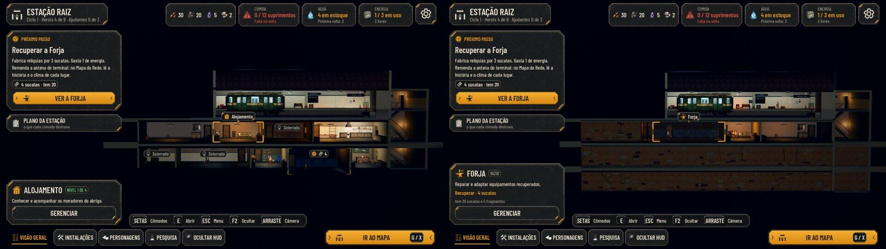
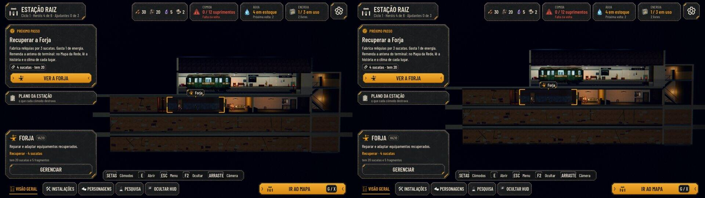
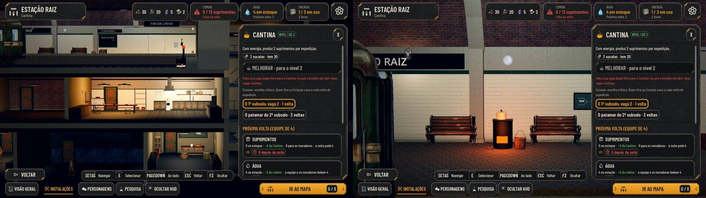
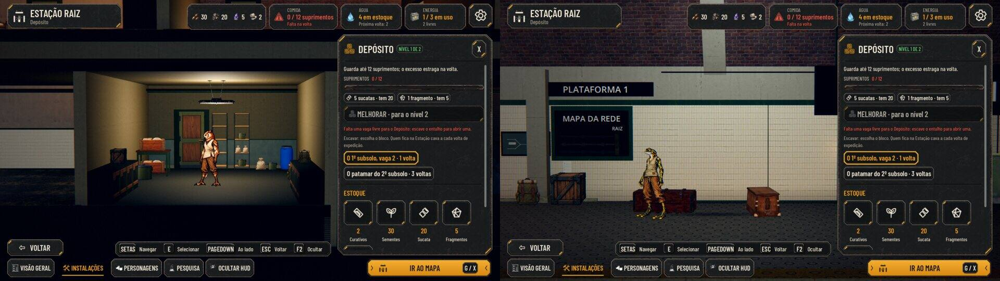
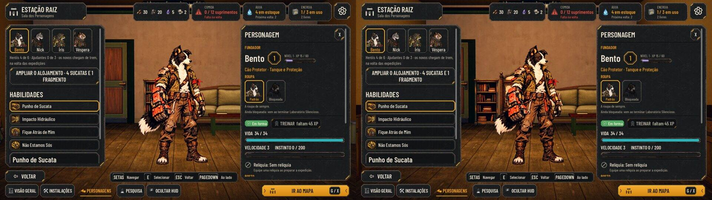
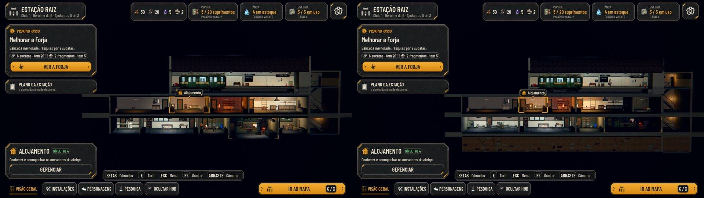
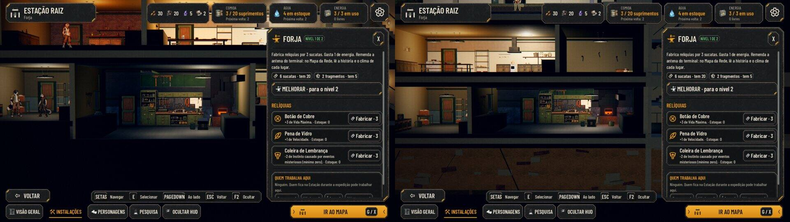
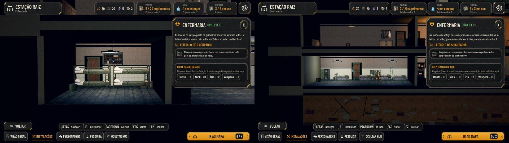

# A Estação em grade, parte 2: a cena (#273)

Parte 2 da #186 (proposta aprovada pelo Lucas), sobre as regras da parte 1 (#272, PR #277). A Estação agora mostra a
grade: 3 subsolos de 7 vagas de 6 m, com 3,2 m de altura. Cada cômodo fica na vaga dele e leva o mobiliário de antes.
A interface completa de escavar e construir é a #274, e a arte dos blocos é a #275. Até lá, a terra, a escavação e a vaga
livre usam arte provisória montada com as superfícies do jogo.

As capturas são do jogo, pela cena de verdade, com o mesmo roteiro no código de antes (#272) e no de agora
(`tools/capture_273_grid.gd`, `--case=new|digging|legacy`). Foram feitas por software, sem placa de vídeo; a luz se
confere no PC do Lucas. Em cada par, o antes fica à esquerda e o depois à direita.

## A campanha nova, depois da primeira volta

- **O 1º subsolo:** duas vagas soterradas à esquerda, a Forja parada (12 m), o Alojamento (6 m) e o Dormitório (12 m),
  encostado na escada.
- **O 2º e o 3º subsolos:** soterrados, com terra, entulho e raízes. O patamar da escada nesses andares também fica
  soterrado.
- **Antes:** os cômodos ficavam no lugar fixo, com os marcadores "Soterrado".

Arrastando a vista geral para baixo (ou escolhendo pelas setas um cômodo do 3º subsolo), a câmera desce até o fundo.
Como a vista geral já enquadra a Estação inteira na largura, o 3º subsolo aparece na parte de baixo desde o começo; a
descida é curta (pergunta abaixo).

## A plataforma improvisada

O fogareiro é a Cantina de nível 1. A Dora trabalha nele, e os dois bancos ao lado são os da Cantina.

- **Os caixotes:** são o Depósito de nível 1, entre o Mapa da Rede e a porta escondida. Cada faixa do estoque acende uma
  pilha (aqui, sem suprimentos, só os caixotes de sempre). O posto do Nick fica neles.
- **A Preparação:** ganhou o diagrama das rotas na parede, ao lado do Mapa, e a prancheta em cima do caixote.
- **O que sai da plataforma:** com a Cantina ou o Depósito construídos numa vaga (o nível 2), o fogareiro ou os caixotes
  saem dali.
- **Com a fila na plataforma:** enquanto o relatório, a partida ou o trem ocupam a plataforma, quem mora nos cantos dela
  sai de cena.

## O Alojamento de 6 m (#181)

O herói escolhido cabe em pé no Alojamento de 6 m: a porta na ponta esquerda, a estante e o mural, o sofá e a mesa baixa.

## A escavação e a vaga livre

- **A vaga 2 do 1º subsolo, livre:** piso limpo, raízes cortadas na parede e restos num canto.
- **A vaga 1, em dois terços:** cavada do lado aberto, com as escoras, a pá, o carrinho e a lâmpada de obra.
- **O patamar do 2º subsolo aberto:** a escada desce até ele, e o do 3º continua soterrado.
- **A obra começada:** continua à vista mesmo quando a frente de escavação muda.

## Um save de antes da grade

- **O 1º subsolo:** o Dormitório, o Alojamento, o Bar, a Cantina e a vaga livre.
- **O 2º subsolo:** a Enfermaria, a Pesquisa, o Depósito (no nível 2) e a Forja.
- **O 3º subsolo:** soterrado.

A Forja ficou 1 m mais baixa. A prateleira alta e os eletrodutos desceram junto, e o resto do mobiliário cabe como
estava.

A Enfermaria de 12 m é a proposta aprovada no #139 (`docs/design/hud-casa.md`), que entra com a grade. Ela tem os
leitos novos, o soro, o armário, o biombo, o lavatório e o carrinho. Quem cai deita nos leitos dela.

## Como funciona

- **`scripts/station/station_layout.gd`:** calcula onde cada cômodo, cada bloco e cada vaga livre ficam, a partir da
  grade da campanha. O mobiliário de cada cômodo continua escrito no molde dele, e a montagem desloca tudo até a vaga.
- **A remontagem:** a grade fica num nó próprio da cena e é remontada quando um cômodo é construído, um bloco abre ou a
  escavação passa de um terço. O mobiliário, as luzes, o estoque, o som e os moradores voltam no lugar novo.
- **O que segue a vaga:** os lugares de dormir, os leitos, o banco da Cantina, as faixas de passeio e os postos de
  trabalho.
- **O civil sem cômodo:** se o cômodo dele ainda está soterrado (a Cora antes da Pesquisa), ele fica no Alojamento.
- **Um cômodo soterrado escolhido:** o "Ver" do Plano leva para a vista geral.

## Testes

- `tests/test_station_layout.gd`, novo. Ele confere:
  - os lugares na campanha nova e na planta herdada;
  - os tamanhos e as portas dentro das vagas;
  - os blocos e os estágios da escavação;
  - a cena remontada ao construir o Bar e a Cantina, os moradores e o banco seguindo a vaga;
  - a Cora no Alojamento, a Dora saindo de cena com a fila e a vista descendo até o 3º subsolo.
- `tests/test_station_view.gd`: os vizinhos, a vista que anda e os cômodos escolhidos passam pela planta herdada, com
  a cena remontada sem sair da Estação.

## As rodadas da QA

- **Rodada 1: REPROVADO.**
  - Quem morava nos cantos da plataforma (a Dora no fogareiro) aparecia atrás da fila do relatório e da partida. Agora
    sai de cena enquanto a plataforma está ocupada.
  - A moradora da Pesquisa soterrada (a Cora) sumia. Agora fica no Alojamento.
  - Os caixotes ficavam mal enquadrados. Agora estão ao lado do Mapa da Rede, com um quadro mínimo.
  - Baixas, também corrigidas: o "Ver" de um cômodo soterrado deixava a câmera no cômodo anterior; a arte das rotas e da
    prancheta ficava sem uso; a obra começada sumia ao trocar de frente.
- **Rodada 2: REPROVADO.** Na decisão do trem, a Dora ainda aparecia atrás de quem desceu. Agora o candidato e o segundo
  da dupla também ocupam a plataforma.
- **Rodada 3: APROVADO.** A suíte inteira passa (100 de 100, com a paridade 48/48). A QA conferiu:
  - remontagens repetidas, sem vazamento de nós;
  - a Sala aberta durante uma construção;
  - a Cantina e o Depósito construídos no 3º subsolo;
  - a noite, os saves antigos e os leitos da Enfermaria;
  - o trem do começo ao fim.

  Observação baixa: enquanto o candidato espera a decisão, a Dora fica fora do fogareiro mesmo com o jogador olhando
  outro cômodo.

## Em aberto

- **A descida da vista geral:** a proposta diz que a vista geral mostra a plataforma e os dois primeiros subsolos, e que
  o 3º aparece arrastando. Como ela enquadra a Estação inteira na largura, o 3º já aparece embaixo. Esconder exigiria
  subir bem a câmera e deixaria os dois primeiros andares colados na barra de baixo. A pergunta ao Lucas está no PR.
- **A luz:** a terra soterrada e a escavação só se conferem no PC com placa de vídeo.
- **A arte final:** os cartões da #275 substituem a terra, a escavação, a vaga livre, o fogareiro e os caixotes.
