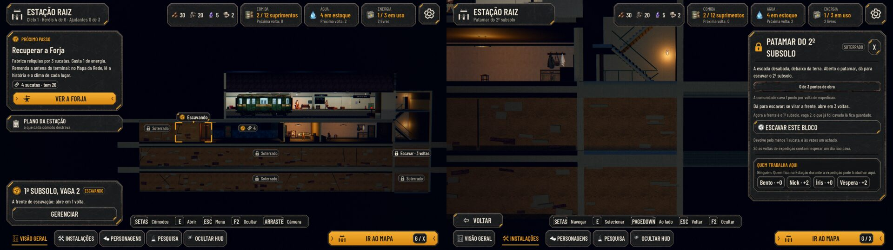
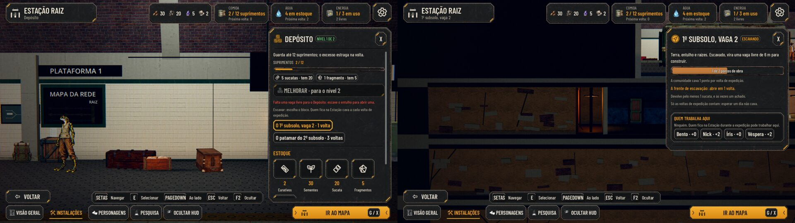
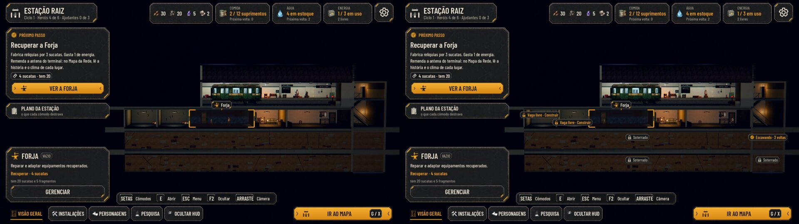
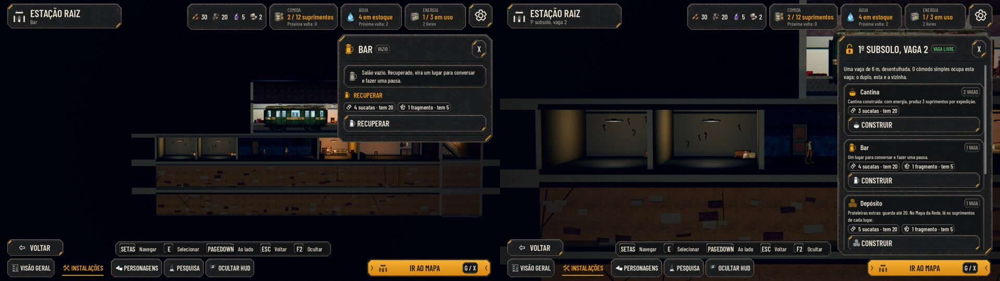
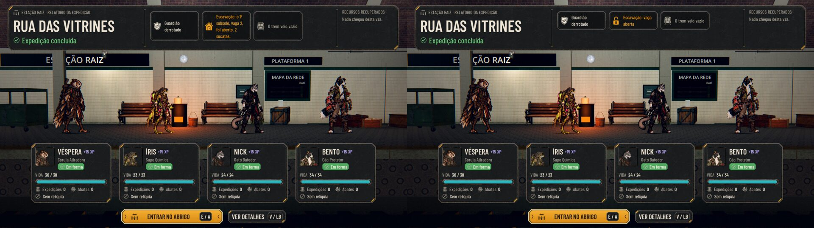
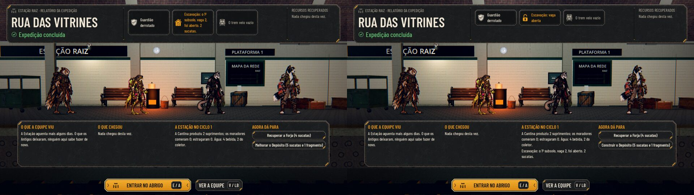
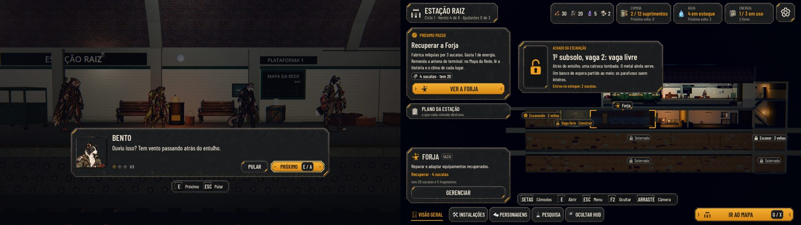
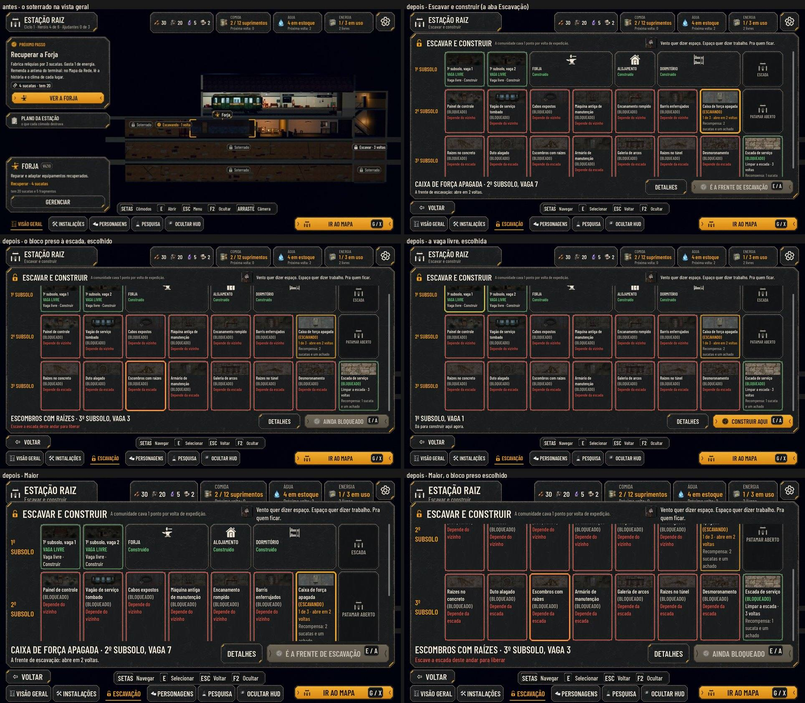
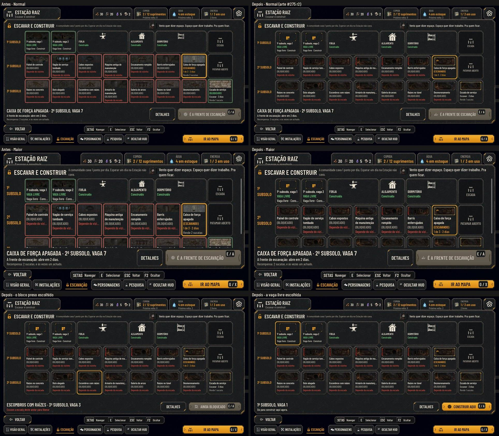
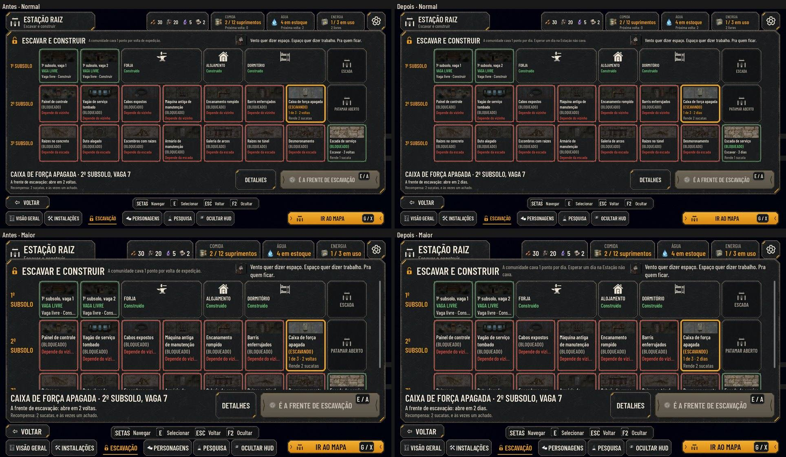

# A Estação em grade, parte 3: a interface (#274)

Parte 3 da #186 (proposta aprovada pelo Lucas), sobre as regras (#272, PR #277) e a cena (#273, PR #279). Os blocos da
grade agora têm marcador, cartão e painel: dá para escolher a frente de escavação, pôr alguém no posto de escavador e
construir numa vaga livre direto pela vista geral. A volta que escava ganha a fala da primeira vez e o aviso do achado.
A arte dos blocos e dos ícones é a #275; até lá, os ícones são os do kit (o cadeado, o cadeado aberto, o Próximo passo).

As capturas são do jogo, pela cena de verdade (`tools/capture_274_dig.gd`, `--case=new|free|return`, o mesmo roteiro no
código de antes e no de agora), por software (sem placa de vídeo). Em cada par, o antes (a `main` `31e77ba`) fica à
esquerda e o depois à direita.

## A vista geral

- **Os marcadores:**
  - "Escavando · N dias" na frente de escavação;
  - "Escavar · N dias" em cada bloco que dá para escavar (aqui, o patamar do 2º subsolo);
  - "Soterrado" uma vez por trecho seguido de blocos que ainda não dá para escavar, para o 2º e o 3º subsolos não ficarem
    cheios de etiquetas.
- **Os vizinhos:** em 6 m não cabem dois marcadores lado a lado; o de baixo desce uma linha dentro do bloco.

- **O bloco apontado:** pelo mouse, pelo toque ou pelas setas, com a moldura, a etiqueta e o cartão (o estado, o resumo e
  GERENCIAR), como os cômodos.
- **O painel do patamar:** a obra numa barra, o ritmo de quem cava, quantos dias faltam, ESCAVAR ESTE BLOCO, o mínimo que
  ele devolve e "Quem trabalha aqui", o posto de escavador. O posto continua também na Sala, no painel dos postos.

## A frente de escavação

- **Antes:** a frente só dava para escolher no painel de um cômodo soterrado (o Depósito).
- **Agora:** cada bloco tem o painel dele. A frente diz que é a frente e em quantos dias abre. O bloco que ainda não dá
  para escavar diz o motivo ("Primeiro é preciso escavar o patamar do 2º subsolo.").

## A vaga livre

- **O painel da vaga:** um cartão por cômodo que ainda não tem lugar, com:
  - o tamanho (1 ou 2 vagas);
  - o que ele faz no nível em que entra;
  - o custo;
  - o que falta;
  - CONSTRUIR.
- **O cômodo duplo:** entra pela vaga da esquerda ou pela da direita, onde couber. Se não couber, o cartão diz "precisa de
  duas vagas livres lado a lado".
- **Depois de construir:** o painel passa para o cômodo novo.
- **"Vaga livre · Construir":** só aparece quando algum cômodo cabe na vaga. A vaga simples isolada, com só os duplos
  sobrando, fica "Vaga livre".

## A volta

- **O chip do relatório:** curto. "Escavação: vaga aberta", "Escavação: patamar aberto" ou "Escavação: 1 de 2 pontos". Antes,
  a linha inteira quebrava em quatro linhas no cartão estreito.
- **A linha inteira:** nos detalhes, com a Estação do ciclo.
- **"Agora dá para":** o Depósito que sai dos caixotes diz "Construir", e não "Melhorar".

- **A fala da primeira volta com escavação:** o Bento e o Nick, com os textos aprovados. Com um deles caído, sai só o
  cartão "Atrás do entulho tem mais estação.". Ela abre depois do relatório, com a fila ainda na plataforma, e fica vista
  só depois de passar (quem fecha o jogo no meio a vê de novo).
- **O aviso do achado:** no padrão do aviso da ferramenta nova (#143), na vista geral, entre a coluna e o painel. Mostra o
  bloco aberto, os textos do que saiu e o que entrou no estoque. Sai sozinho, com qualquer tecla, clique ou toque, e com o
  mapa ou um painel aberto; fica visto só depois de aparecer.

## O teclado e o controle

- **As setas:** andam por cômodos e blocos, também o 3º subsolo e os patamares. Interagir abre, e Esc fecha.
- **PageUp e PageDown:** com um cômodo ou um bloco aberto, vão ao vizinho do mesmo andar, cômodo ou bloco.
- **Os painéis:** o foco vai para o primeiro CONSTRUIR que dá para apertar ou para ESCAVAR ESTE BLOCO.

## Testes

- `tests/test_station_dig_ui.gd`, novo, com 70 verificações. Ele confere:
  - os estados e os textos dos marcadores e o "Soterrado" por trecho;
  - as setas, o clique e PageUp/PageDown chegando aos blocos;
  - o cartão do bloco;
  - o painel do bloco: a frente, ESCAVAR ESTE BLOCO, o posto de escavador e o motivo;
  - o painel da vaga: o que cabe, o que falta, CONSTRUIR e a cobrança;
  - o chip do relatório;
  - a fala: o Bento e o Nick ou o cartão, e uma vez só;
  - o aviso: entre as colunas, sai com uma tecla, uma vez só, e volta se sumiu sem aparecer.
- `test_full_journey`: a jornada inteira passa pela fala da primeira escavação.

## As rodadas da QA

- **Rodada 1: REPROVADO.**
  - **O aviso do achado:** não saía com tecla, clique ou toque, ficava por cima do mapa e, com um item raro ou com o texto
    Maior, entrava no painel da direita. Agora sai com qualquer entrada, some com o mapa ou um painel e quebra as linhas na
    largura entre as colunas.
  - **Os marcadores:** eram recalculados do zero a cada quadro, cerca de 10 ms por quadro. Agora as contas ficam guardadas
    até a grade, o estoque ou o escavador mudarem, e o quadro caiu para 0,2 ms.
  - **As baixas, também corrigidas:**
    - "Construir" numa vaga onde nada cabia;
    - a fala marcada como vista antes de abrir;
    - dois textos;
    - PageUp e PageDown sem os blocos;
    - o clique duplo em CONSTRUIR trocando a mensagem.
  - **E o que as capturas mostraram:** os marcadores vizinhos sobrepostos, o aviso por cima da coluna da esquerda e os
    detalhes do relatório passando da faixa.
- **Rodada 2: APROVADO.** A suíte inteira passa (101 de 101). Ficou uma observação baixa, já corrigida: indo da Sala direto
  ao mapa, o aviso ficava visto sem aparecer. Agora ele só fica visto depois de um quadro na tela.

## Em aberto

- **A arte (#275):** entrou na planta (seção "A arte da #275"). Os marcadores da vista geral e o painel do bloco ainda usam
  o cadeado do kit e a barra de ferrugem.
- **A barra da obra:** o texto em cima do preenchimento laranja fica com pouco contraste. Vale rever com a arte da #275.

## Escavar e construir: a planta em cartões (pedido do Lucas de 01/11)
> "Não gosto desse soterrado, parece que só tem uma imagem na frente, muito simples e sem personalidade." O Lucas pediu a tela de construir da base em XCOM como referência.

- **A aba Escavação** (embaixo, entre Instalações e Personagens) abre a planta dos três subsolos em corte: uma linha de cartões por andar, as sete vagas e o patamar à direita. O botão "Ver a planta", no painel do bloco soterrado, abre a mesma tela com o bloco escolhido.
- **Cada cartão:**
  - a moldura do kit;
  - a imagem do que está ali;
  - o nome em cima, com o estado: "(BLOQUEADO)" ou "(ESCAVANDO)".
- **Os estados:**
  - **dá para escavar:** a moldura clara, a ação ("Escavar · 2 dias") e o que rende no mínimo ("Rende 1 sucata"). Embaixo, no escolhido, a frase inteira: "Recompensa: 1 sucata, e às vezes um achado.", como no painel do bloco;
  - **a frente de escavação:** a moldura âmbar, os pontos e os dias que faltam;
  - **depende do vizinho ou da escada:** a moldura e o aviso em vermelho ("Depende do vizinho", "Depende da escada"). O motivo inteiro aparece embaixo ao escolher;
  - **a vaga livre:** em verde, "Vaga livre · Construir";
  - **o cômodo construído:** o ícone e "Construído", com o cômodo duplo nas duas vagas;
  - **a escada aberta:** só a passagem.
- **Embaixo, o escolhido:** o nome, o lugar e o que falta, com o botão grande, que muda com o escolhido:
  - ESCAVAR ESTE BLOCO, que faz dele a frente;
  - CONSTRUIR AQUI, que abre o painel da vaga;
  - ABRIR O CÔMODO.

  DETALHES abre o painel do bloco, com a barra da obra e o posto de escavador.
- **No alto:** o ritmo da escavação e quem orienta, o Nick, com a fala da primeira volta.
- **As imagens:** até a arte da #275, cada bloco usa um par próprio de peças que já existem em `art/scenarios`, uma peça sobre um fundo: os bancos de espera, a bilheteria, o vagão de serviço, os cabos, as raízes. Nenhum par se repete (`data/station-grid.json`, `block_looks`, que o teste confere). Nenhuma imagem de outro jogo entrou no repositório.
- **Os nomes dos blocos** são proposta e passaram pela §14:
  - são lugares e coisas de uma estação de metrô dos Antigos;
  - combinam com os achados de cada andar (o banco partido no 1º subsolo, o painel de controle no 2º, o armário de ferramentas e as raízes no 3º);
  - não prometem mecânica nova.
- **O teclado e o controle:** as setas e o direcional andam entre os cartões, Interagir escolhe, e Interagir no escolhido aciona o botão grande (a tecla E / A dele). Fechar o painel aberto pela planta (Construir, Detalhes) volta para a planta.
- **No Normal, os três andares cabem inteiros. No Maior, a grade rola.** A arte da #275 (seção abaixo) mudou o cartão.

## A arte da #275 (revisão r2 do #296)
A arte aprovada pelo Lucas, com o ajuste de imagens menos destacadas, entra nos cartões da planta. Os originais estão na
tag `codex-pr296-originals` (`c636b14`, revisão `r2-muted-background`), convertidos pelo `convert_webp.py` dela, que
confere os hashes.

- **As seis pinturas** ficam em `art/station/cards/buried/`. Cada bloco usa a que combina com o nome (`Card` em
  `block_looks`, `data/station-grid.json`):
  - o 1º subsolo e a escada soterrada (L2, logo abaixo da plataforma) mostram os escombros da plataforma;
  - o painel, os cabos e a caixa de força mostram os cabos;
  - o vagão e os barris mostram o vagão;
  - a máquina, o armário e o desmoronamento mostram a máquina;
  - o encanamento e o duto mostram o duto;
  - as raízes, os escombros com raízes, a galeria e a escada de serviço (L3) mostram as raízes.

  **Para o Lucas:** três blocos não têm pintura própria entre as seis: os barris (2:6), o desmoronamento (3:7) e as
  escadas (L2 e L3). Eles usam a pintura mais próxima do lugar. Os caminhos são trocar o nome do bloco para combinar com
  a pintura ou pedir pinturas para eles ao Codex.

  As pinturas já vêm esmaecidas, e o jogo não soma outro véu.
- **As molduras de estado** são peças do kit: `dig_frame_*` e `dig_room_choice_card` em `art/ui/kit/station/assets.json`.
  - liberada (dá para escavar e a frente);
  - depende do vizinho (trilho interrompido, hachura vermelha);
  - bloqueada (depende da escada).

  A moldura entra pelo 9-slice (48 de 600) na escala do cartão, e a pintura é recortada no meio, sem esticar. Assim os
  três subsolos cabem no Normal.
- **A vaga livre** mostra o cartão de escolher cômodo inteiro (proporção fixa, sem esticar a plaqueta), com o ícone da
  planta.
- **A frente** tem a marca da obra no canto, dentro da moldura.
- **Os ícones** (`dig_*`, no manifesto do kit): a marca da obra também vai no botão grande da frente, o de escavar no
  botão de escavar este bloco e o de soterrado no do bloco ainda preso.
- **Os textos continuam da HUD.** O cartão tem três linhas debaixo da pintura: o nome, o estado e o que fazer. O nome
  vai em uma linha no Normal e em até duas no Maior; inteiro, fica na dica e embaixo, no escolhido. A recompensa da frente também fica embaixo.
- **O que não entrou:** o protótipo do Codex projetava os cartões sobre o corte da Estação. A planta do #284, já aprovada
  pelo Lucas, continua no painel.

## Em dias (pedido do Lucas no #284)
A escavação conta em **dias**, não em voltas: "Escavar · 2 dias", "1 de 3 · 2 dias", "abre em 2 dias" e "A comunidade cava 1 ponto por dia". Um dia é o de uma expedição: o "Esperar um dia" na Estação continua sem cavar, como na regra da #186, e a planta diz isso no alto, ao lado do ritmo.

As fotos saem de `tools/capture_274_dig.gd --case=board` (com `--text-size=2` no Maior). O antes é a vista geral desta mesma entrega antes do pedido.
