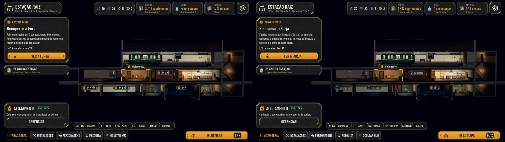
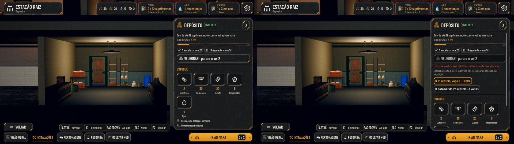
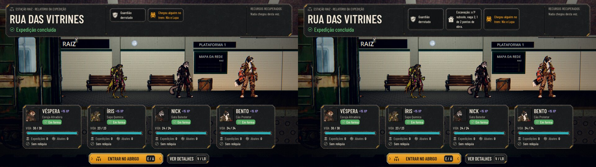

# A Estação em grade, parte 1: as regras (#272)

Parte 1 da #186 (proposta aprovada pelo Lucas): a grade de 3 subsolos de 7 vagas, a escavação, os achados, a
construção numa vaga livre e a planta herdada dos saves de antes. Esta parte é só a regra e o save. A cena da grade
(#273), a interface completa (#274) e a arte (#275) vêm depois; até lá, a Estação continua desenhando os cômodos onde
estavam, e só os marcadores, o painel do cômodo e o relatório mostram a grade.

As capturas são do jogo, pela cena de verdade (`tools/capture_272_grid.gd`, o mesmo roteiro no código de antes e no de
agora), por software (sem placa de vídeo). A campanha é nova (semente 272), depois da primeira volta, com 20 sucatas e
5 fragmentos. Em cada par, o antes (a `main` `0f5e61b`) fica à esquerda e o depois à direita.

## A vista geral

- **Antes:** os cômodos por recuperar mostravam o custo.
- **Agora:** o que ainda está debaixo do entulho mostra "Soterrado", sem custo. Só pede material o que tem vaga aberta
  (aqui, a Forja). O Próximo passo e o foco da rota também só falam de construir com vaga.

## O Depósito

- **Agora:** sem vaga livre do tamanho certo, o painel diz o motivo na tela, em vermelho ("Falta uma vaga livre para o
  Depósito: escave o entulho para abrir uma.").
- Logo abaixo, os blocos que dá para escavar, com quantas voltas faltam. O escolhido vira a frente da escavação.
- O estoque continua no painel, mais abaixo, com a rolagem.

## O relatório da volta

A volta ganha a linha da escavação: "Escavação: o 1º subsolo, vaga 2, 1 de 2 pontos de obra." A comunidade cava 1 ponto
por volta de expedição; o "Esperar um dia" não conta.

## Testes

- `tests/test_station_grid.gd`, novo: a grade, a ordem dos blocos, a frente, os achados pela semente da volta, a
  construção, a planta herdada e o conserto dos saves (nenhum cômodo construído volta a ficar soterrado).
- Os testes que recuperavam um cômodo soterrado abrem a vaga antes.

## As rodadas da QA

- **Rodada 1: REPROVADO.**
  - O motivo do cômodo soterrado só aparecia na dica do mouse; o toque e o controle não viam. Agora ele fica escrito
    no painel, com os blocos para escolher a frente.
  - Aberto o último bloco, o escavador continuava no posto. Agora ele sai.
  - A linha do relatório sem a vírgula do texto aprovado, e os motivos sem o artigo ("para o Depósito").
- **Rodada 2: APROVADO,** com dois ajustes de texto, já feitos: o aviso da frente sem a contração errada ("a frente
  agora é o patamar do 2º subsolo") e a vírgula do aposto no inglês do relatório.

## Em aberto

- **A linha da escavação no relatório** quebra em quatro linhas no cartão estreito. O cartão é provisório; o desenho
  dele entra na interface (#274).
- **O herói da Sala (#181) num Alojamento de 6 m** só dá para conferir com a cena da grade (#273).
