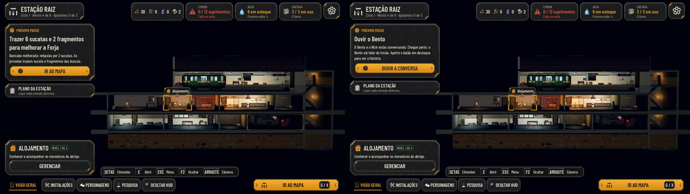
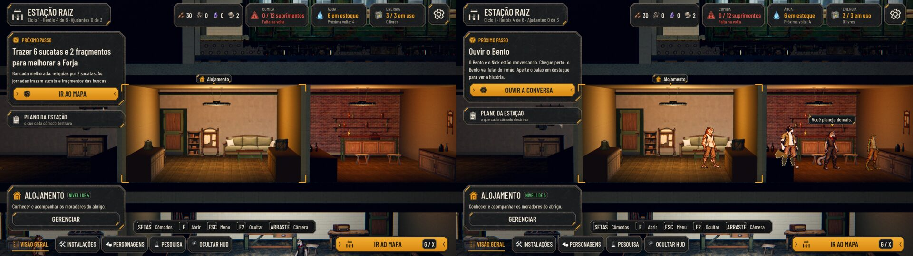
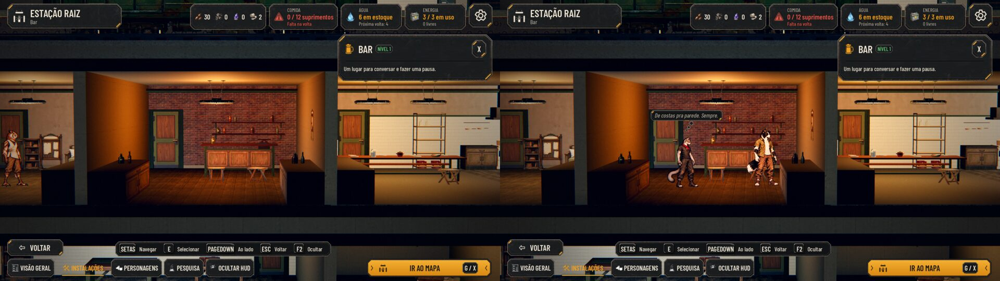
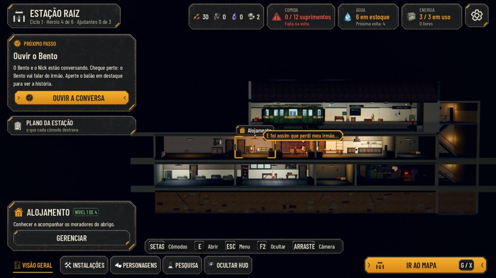
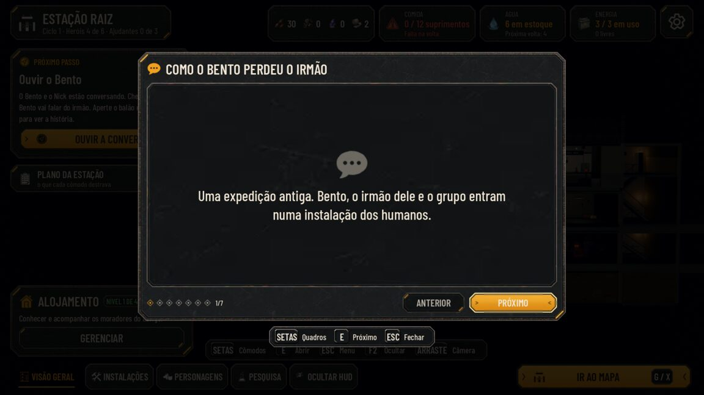
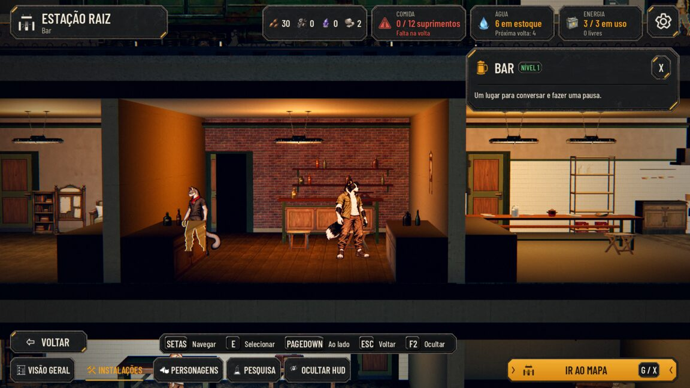
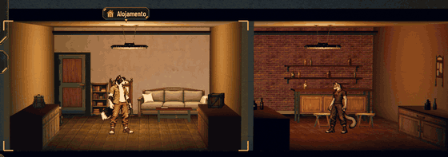

# QA da #207: a Estação viva

A proposta de 28/10, aprovada, e a decisão do Lucas sobre as falas: os moradores falam e pensam em balões do kit, o
balão interativo abre a tirinha de como o Bento perdeu o irmão (e aparece no Próximo passo), e os heróis trocam de
cômodo saindo por uma porta e chegando por outra.

As fotos são de um save com a planta herdada (todos os cômodos recuperados) depois da primeira volta, tiradas com
`tools/capture_207_life.gd` no código de antes (a `main`) e no de agora. Em cada par, à esquerda fica o antes e à
direita o agora.

## A vista geral e o Próximo passo

## A fala e o pensamento

## O balão interativo e a tirinha

## A porta e a troca de cômodo

## O desempenho

As medidas foram feitas numa máquina de nuvem sem placa de vídeo (llvmpipe), dividida com outras tarefas. Ali o tempo
de quadro não serve de medida, mas as chamadas de desenho, as primitivas e os objetos valem para qualquer máquina.

| Estação, Baixo | draws | primitivas | objetos |
|---|---|---|---|
| antes | 370 | 72 075 | 1 372 |
| agora | 370 | 72 075 | 1 372 |

O Ultra não terminou aqui: cada quadro leva quase 2 s nesta máquina, e a medida passou do tempo limite. Como as portas
são as mesmas folhas de antes, e os vãos novos ficam escondidos até abrir, o desenho não muda.

O custo do `AHStationLife` por quadro, medido sem janela:
- 7 µs parado;
- 9 µs com um balão na tela;
- o sorteio de uma fala leva 0,2 ms, uma vez a cada 14 a 28 s.

## As rodadas da QA

**Rodada 1: REPROVADO**
- **Alta:** com "Falas na Estação" desligada, o Próximo passo "Ouvir o Bento" travava.
  - Correção: a conversa do objetivo sai mesmo com as falas desligadas, e o pedido some quando uma tela cobre a Estação.
- **Média:** o balão interativo saía no sorteio antes da primeira volta.
  - Correção: o sorteio pula a tirinha que ainda não foi liberada.
- **Média:** o pensamento não saía em itálico.
  - Correção: a inclinação da fonte estava invertida.
- **Média:** a branch estava atrás da `main` e tinha conflitos.
  - Correção: rebase na `main`, com o PO gerado de novo.
- **Baixas:**
  - quem estava no corredor aparecia por um quadro;
  - a partida e o relatório não traziam de volta quem andava;
  - a visita podia passar de 2 min;
  - o Bento e o Nick ficavam longe um do outro.
  - Tudo corrigido.

**Rodada 2: APROVADO**
- Ficaram duas observações baixas, já corrigidas:
  - um friso âmbar na moldura do pensamento;
  - o Bento e o Nick se afastando no meio da conversa da tirinha. Agora os dois ficam parados lado a lado até ela acabar.
- O que a QA testou:
  - test_station_life, test_i18n, test_kit_guard e test_narrative_terms;
  - o objetivo com as falas desligadas;
  - Esc e E no balão e na tirinha;
  - o texto Maior e o inglês;
  - o sorteio antes da primeira volta (0 em 400);
  - um teste de estresse das trocas de cômodo, com telas abrindo, a Preparação e os moradores refeitos;
  - o vigia da noite;
  - o save, o load e o save antigo.
- A QA não conseguiu testar o clique e o toque no balão sem janela. Fica para o Lucas conferir jogando.

**Rodada 3 (a integração com a `main` nova): APROVADO**
- A `main` recebeu a interface da grade (#274), a #194 e o "Dia" (#305), e a branch foi rebaseada sobre ela.
- O que a QA conferiu:
  - nenhum balão com o quadro da escavação ou com o aviso do achado;
  - os marcadores dos blocos ficam por baixo dos balões;
  - "Ouvir o Bento" vem antes de escavar e construir;
  - a previsão da comida depois do "Dia".
- A suíte inteira passa: 111 de 111.
- As fotos acima são de antes desse rebase. A #274 muda os marcadores da grade na vista geral, mas a Estação viva não
  muda.

**Rodadas 4 a 8 (os conflitos com a `main` de 01 e 02/11)**
- A `main` recebeu o #306 e o #308 (#189: a espécie, os papéis, as resistências e o crítico), o #309 (#261: as
  habilidades de acampamento), o #311 (#265: os serviços dos cômodos), o #314 (#289: o desvio pelo esgoto), o #310
  (#301: o descanso no mapa) e o #312 (#263: as relíquias). Os conflitos foram só no i18n (as listas do `i18n_scan` e do `i18n_ignore` e o `en.po`,
  regenerado sem perder nenhuma tradução).
- Rodada 4, sobre o 1º merge: **APROVADO**, nada perdido dos dois lados. A QA achou um bug anterior ao merge (médio): o
  Bento segurado para a conversa da tirinha voltava ao posto da Forja, e a conversa atrasava de 12 a 26 s. Corrigido
  (quem está segurado não começa trabalho) e aprovado: o balão saiu nas 50 de 50 execuções.
- Rodada 5, sobre o merge do #311: **REPROVADO** (médio). Quem trata uma peculiaridade (#265) está num leito da
  Enfermaria, mas na cena passeava, falava e entrava na tirinha. Corrigido: na cena, o tratamento conta como a
  recuperação (o leito depois dos caídos, calado), e a tirinha espera o tratamento acabar.
- Rodada 6: **REPROVADO** (médio e baixo). Com a Estação aberta, o tratamento que começava no meio da conversa da
  tirinha deixava o Nick falando do leito, e no meio da troca de cômodo o deixava em pé no destino. Corrigido
  (`AHStationLife.release`).
- Rodada 7: **REPROVADO** (médio). A tirinha pendente sem conversa no ar (a câmera a interrompeu) ficava presa e as
  falas comuns sumiam. Corrigido: ela também acaba.
- Rodada 8, com o merge do #314: **APROVADO**. O #310 entrou depois, sem conflito (só mexe na rua).
- Rodada 9, com o merge do #312 (as relíquias): **APROVADO**. O código da Estação viva não usa a API antiga das
  relíquias, e o painel delas fica na Sala, onde os balões já não aparecem.
- A suíte inteira passa: 118 de 118, sobre a `main` com o #312.

## O que é diferente da proposta

- **Só os heróis trocam de cômodo.** Os civis continuam no posto deles.
- **O save guarda uma coisa:** a lista `station.comics_seen`. Assim, a tirinha vista sai do Próximo passo.
- **A tirinha não diz o nome do irmão.** O `test_narrative_terms` proíbe "Théo" nos textos (bento-nick-arc §11), e os
  quadros dizem "o irmão".
