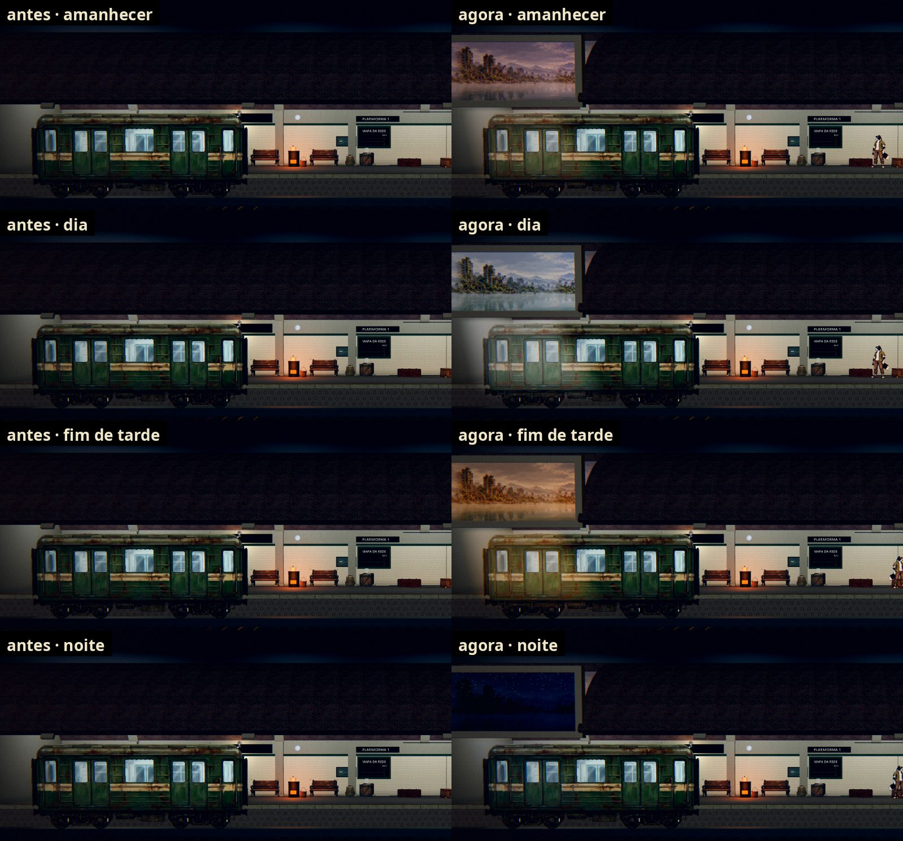
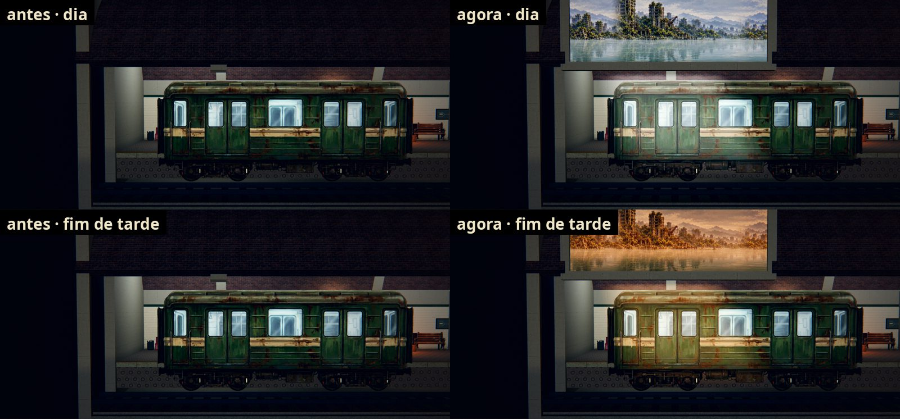
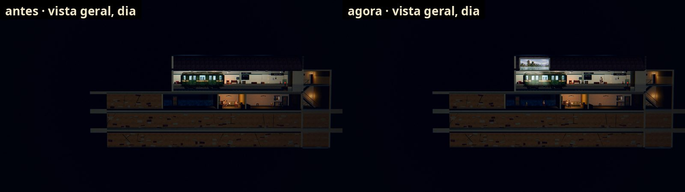

# A vista de fora na saída do trem (#217)

Antes, a Estação era toda fechada e não dava para saber se era dia ou noite. Agora, na saída do trem (a ponta esquerda
da plataforma, sobre a boca do túnel por onde o trem sai), a abóbada se abre para fora: por um vão emoldurado aparece
um pedaço do Bairro Submerso com a cor da hora do dia, e um feixe da luz de fora desce de leve sobre o vagão e a via.
O resto da Estação não muda.

As fotos saem de `tools/capture_217_outside.gd` (roda também no código de antes, com as mesmas câmeras).

## A hora

A campanha não tem relógio. A hora sai do ciclo da Estação que já existe (o dia e a noite do #132):

| Hora | Quando | A vista | A luz que entra |
| --- | --- | --- | --- |
| Fim de tarde | na volta, com a noite a planejar (`night.phase` `planning`) | pêssego, com o brilho no horizonte | o feixe quente |
| Noite | durante a cena da noite (`AHStation.night_scene`) | azul-escura, com estrelas | o feixe frio, quase apagado |
| Amanhecer | no resumo do amanhecer (`night.phase` `dawn`) | rosada, com um resto de estrelas | o feixe rosado e fraco |
| Dia | no resto (e em "Esperar um dia") | clara | o feixe branco, o mais forte |

- **A troca é suave:** 1,5 s de uma hora para a outra quando a fase muda com a Estação aberta. Ao abrir a Estação, a
  hora já está certa, também quando a volta é entregue na própria Estação (o jogo fechou no relatório da rua).
- **A luz:** o feixe é um plano aditivo na frente do vagão, para aparecer em qualquer renderer (no Compatibility, o da
  web, uma luz a mais não aparecia). Uma SpotLight fraca vai junto, para o Forward+.
- **O clima:** a Estação não guarda o tempo da rua (ele só existe dentro da expedição e some na volta), então a vista
  não tem chuva, como a issue prevê ("se o jogo já tiver isso nos dados").
- **O save não muda:** a hora é calculada, nada novo é gravado.

## A arte

A vista usa o panorama da cidade alagada dos cenários (`art/scenarios/T_BridgePanorama.webp`), recortado e tingido
num shader (`shaders/station_outside.gdshader`). A arte própria (o fundo de fora e o acabamento da abertura) está
pedida ao design na #315, como a issue manda quando falta arte.

## Onde fica

- `scripts/station/station_outside.gd` (`AHStationOutside`): a hora (`hour_of`), as cores por hora (`LOOK`), a vista,
  o feixe e a luz. Os shaders: `shaders/station_outside.gdshader` e `shaders/station_outside_beam.gdshader`.
- `scripts/station/station_build.gd`: o vão nos 6 segmentos da frente da abóbada, entre x 0,8 e 7,2 m e até 5,55 m
  (`OUTSIDE_X0`, `OUTSIDE_X1`, `OUTSIDE_SEGMENTS`, `OUTSIDE_TOP`: o alto da abóbada como a câmera da plataforma o vê),
  com o peitoril, o lintel e os montantes.
- `scripts/station/station.gd`: monta a vista e acompanha a hora (`refresh_outside`).
- `tests/test_station_outside.gd`: a hora em cada fase, as quatro vistas e feixes diferentes, a troca acompanhando a
  volta, a cena da noite (pelo caminho do HUD) e o amanhecer, a abertura na câmera da plataforma, a vista dentro da
  moldura e fora do salão, e o save intacto.
