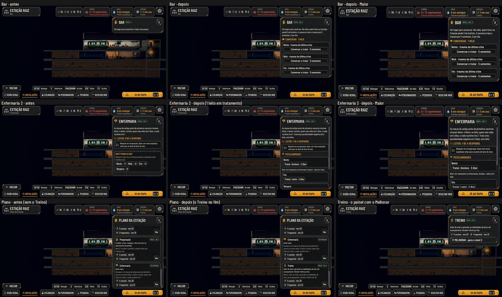
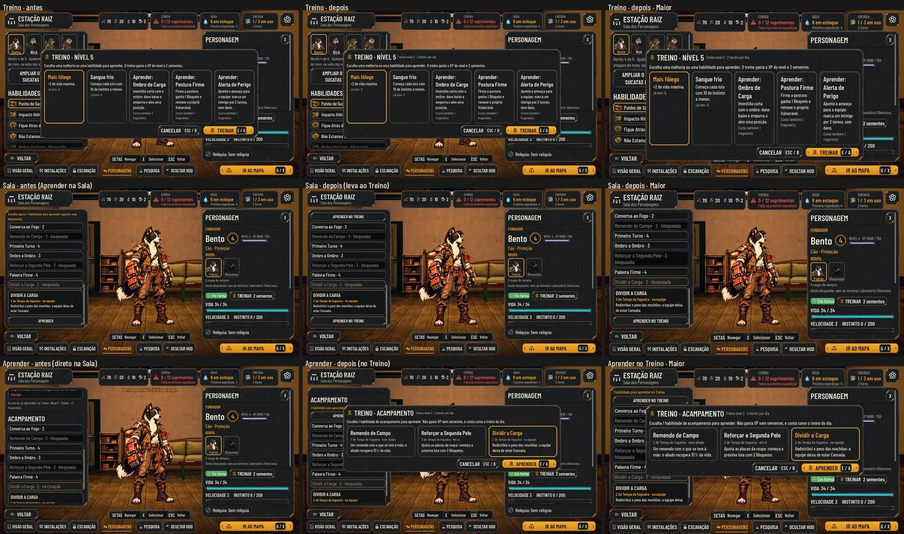

# Os serviços dos cômodos (#265)

As melhorias dos cômodos aprovadas pelo Orquestrador em nome do Lucas (01/11) estão na #265. Os números ficam em
`data/station-services.json`, e a regra em `scripts/flow/station_services.gd` (`AHStationServices`).

As fotos saem de `tools/capture_265.gd`, com `--case=bar|infirmary|training|plan|camp` e, para o Maior, `--text-size=2`. O
script só mexe no estado por dicionários, então roda também na main para as fotos de antes.

## A regra

| Cômodo | O que faz | Os números |
| --- | --- | --- |
| Bar | Na volta, quem ficou na Estação perde Instinto. A conversa trata o trauma (saiu do Alojamento). | −5 de Instinto; 5 sementes; 1 conversa por dia (2 no nível 2) |
| Bar nível 2 | A segunda conversa do dia | 4 sucatas e 1 fragmento |
| Dormitório nível 2 | Os beliches tiram mais Instinto na noite da volta | −3 |
| Enfermaria nível 2 | Trata uma peculiaridade negativa, ocupando um leito, e o herói não parte enquanto isso | 2 dias |
| Treino | Subir de nível e aprender as habilidades de luta e de acampamento | 1 herói por dia (2 no nível 2) |
| Treino nível 2 | O segundo herói do dia | 5 sucatas e 1 fragmento |

- **O dia** é o ciclo da Estação (`station.cycle_number`). Uma expedição ou o Esperar um dia passa para o seguinte.
- **Quem já treinou hoje** continua podendo treinar. O limite conta heróis, não sessões.
- **Aprender as de acampamento** saiu da Sala e foi para o Treino. Não gasta XP nem sementes (a escolha vem do nível par),
  mas conta como o treino do dia. A Sala avisa quantas há para aprender e tem o botão que leva ao Treino. As trocas das
  4 que leva continuam na Sala.
- **O Treino como cômodo:** é básico e já vem construído, como a Preparação: tem nível e melhoria, mas não ocupa uma
  célula própria na grade (`slots: 0`). Ele se abre pelo TREINAR do personagem, na Sala. O Melhorar fica no painel
  dele, aberto pelo Ver no fim do Plano da Estação ou pelo "Melhorar o Treino" no alto do diálogo.
- **Em tratamento na Enfermaria:** o herói ocupa um leito (o contador soma), não parte (a Preparação diz "Em
  tratamento"), não trabalha num posto, e a Sala mostra o que trata e quantos dias faltam.
- **O que o jogador vê:** o relatório da volta diz quem terminou o tratamento e quem o Bar aliviou. O Esperar um dia diz
  quem terminou o tratamento.
- **Save:** no herói, `quirk_treatment` `{perk, days}` enquanto trata. Na Estação, `bar_talks` e `training`
  `{cycle, heroes}`. Saves de antes abrem sem nada disso, e o `migrate` limpa o tratamento inválido.

## Testes

- `tests/test_station_services.gd`: os dados, o alívio do Bar, as conversas por dia, aprender no Treino com o limite,
  os beliches, a peculiaridade (leito, posto e relatório) e o save, incluindo os editados com tipos errados.
- `tests/test_hero_levels.gd`: o limite do Treino por dia e o nível 2.
- `tests/test_camp_skills.gd`: a Sala leva ao Treino, o foco abre no cartão escolhido, o Treino de acampamento ensina e
  conta o dia, e o Treino no Plano compra o nível 2.
