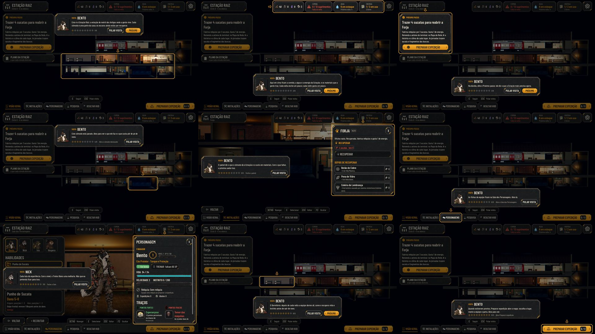

# A visita guiada da Estação (#145)

Na primeira chegada à Estação depois da abertura (#144), o Bento mostra a Estação em nove passos curtos, com o
destaque do kit (`AHTutorialHint`) e a caixa de fala com retrato. Quem pula o tutorial não vê a visita.

## O que muda

- **Os passos** ficam em `data/tutorial.json` (`station_tour`): a visão geral, os recursos, o Próximo passo, o cômodo a
  recuperar (abrir e fechar), a Sala dos Personagens (o Nick explica o nível e o Treino), o Dormitório e Preparar
  expedição, que abre o mapa e encerra a visita.
- **Cada passo espera a ação certa:** o PRÓXIMO (ou Interagir) nos de olhar; abrir o cômodo destacado, abrir a Sala ou
  fechar o painel nos de ação. Interagir faz a ação pedida; Voltar fecha o painel nos passos de fechar e, nos outros,
  pula a visita. As outras teclas não passam para a Estação, e a barra de teclas diz "Seguir · Pular visita".
- **A fala** fica no lugar que menos cobre o destaque; a moldura e o cartão do cômodo da Estação somem durante a visita.
- **O save** guarda o passo (`campaign.tutorial.tour`): fechar o jogo no meio retoma dali (num passo de fechar, volta
  ao de abrir). Pular visita encerra e não volta; no fim, as dicas de primeira vez da Estação contam como vistas.
- **Os textos** em português e inglês (`data/i18n/en.po`).

## Testes

- `tests/run_all.gd`: 66 de 66, com a paridade 48/48.
- `tests/test_station_tour.gd` (novo, 40 verificações): só depois da abertura jogada; cada passo pela tecla ou pela
  ação; o destaque na tela; o save no meio e a retomada num passo de fechar; pular; a Estação responde no fim.
- `tools/capture_station_tour.gd`: os nove passos no Normal, no Maior e no daltonismo, em `docs/qa/station-tour/`.

## QA

| Rodada | Veredito | O que a QA achou | Como ficou |
|---|---|---|---|
| 1 | REPROVADO | **Alta:** retomar num passo de fechar travava o teclado. **Médias:** a fala cobria o painel da Forja e a Sala; o relatório da chegada dizia "Guardião derrotado" (da #144). **Baixas:** a espera da câmera, o destaque duplo, a fala da Sala, o último passo devia abrir Preparar expedição | Todas corrigidas (o relatório, na #144) |
| 2 | APROVADO | Baixas: a moldura do cômodo da Estação junto do destaque; o clique bloqueado sem a fala à vista logo depois da chegada; a barra de teclas falando das setas e do Menu | Corrigidas depois do veredito |

## Para o Lucas

- **As falas** dos nove passos (o Bento e, na Sala, o Nick) esperam a sua aprovação antes do merge.
- Este PR vem por cima do da #144 (que vem por cima do da #147): o merge na ordem 147, 144, 145.
