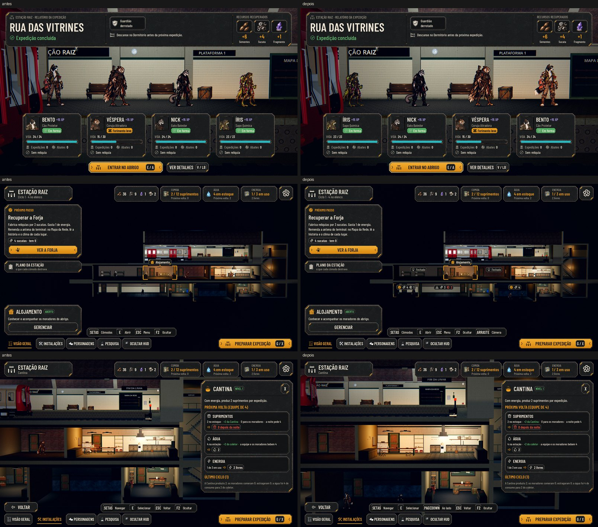

# A Estação depois de jogar: a volta, a Sala, os cômodos e a câmera (#131)

O pedido do Lucas (26/10), depois de jogar:
- a volta com a formação que ele deixou, e a equipe saindo andando em vez de sumir;
- o herói da Sala que ficava por cima da tela seguinte;
- os cômodos bloqueados à vista, como no XCOM 2;
- a câmera que anda para os lados, aproxima do cômodo e troca para o vizinho direto.

A saída andando e a câmera andada: [moves.jpg](station-view/moves.jpg). No Maior e no daltonismo: [screens.jpg](station-view/screens.jpg). As fotos saem de `tools/capture_131.gd`
(`--text-size=2`, `--colorblind`). O antes é o mesmo roteiro no código de antes desta entrega.

## A volta

- **A fila na ordem da formação:** a fila da plataforma e as cartas do relatório seguem a equipe da expedição, com a
  posição 1 (a frente) à direita e a 4 à esquerda, como na Preparação e na luta. Antes, a 1 ficava à esquerda.
- **A saída andando:**
  - Concluído o relatório, a fila sai andando para a direita, rumo à porta: um de cada vez, a frente primeiro, e quem
    está ferido no passo mais lento.
  - A câmera espera na plataforma até 2,5 s (`AHStation.LEAVE_HOLD`) e depois desce.
  - Cada um só aparece no seu cômodo depois de sair da câmera.

## O herói da Sala por cima

- Na Sala dos Personagens, PREPARAR EXPEDIÇÃO abria o mapa por cima da Sala, e o herói de corpo inteiro ficava na frente.
- Agora o mapa abre com a Sala (e o relatório) fechados.
- Os outros caminhos para fora da Sala já fechavam a tela; o teste confere o do mapa.

## Os cômodos por recuperar

- **Na vista geral, cada cômodo por recuperar tem um marcador do kit no alto:**
  - o ícone do estado;
  - o custo em ícones, com o número em vermelho quando falta.
- **Os três estados:**
  - **pronto** (dá para recuperar agora): âmbar, com os cantos acesos;
  - **faltando recurso:** apagado, com o cômodo na penumbra;
  - **fechado** (a recuperação chega numa próxima fase, como o Bar e o Dormitório): "Fechado".
- **No cartão do cômodo apontado**, o mesmo por extenso: "Recuperar · 4 sucatas", com o que se tem ou o que falta.
- **Os cômodos recuperados** ficam sem marcador.

## A câmera

- **Na vista geral, a câmera anda para os lados**, dentro de um limite (cerca de 330 px para cada lado):
  - arrastando com o mouse (o clique sem arrastar ainda abre o cômodo);
  - com o mouse na borda da tela;
  - com o analógico direito.
- **As setas (e A/D) escolhem o cômodo, e a câmera vai junto:** o escolhido fica à vista, fora do menu da esquerda.
- **O cômodo escolhido fica mais perto:** as paredes do lado saem um pouco do quadro.
- **Com um cômodo aberto, o vizinho direto, sem voltar à vista geral:**
  - clicando no cômodo ao lado;
  - com PageUp e PageDown, ou com os gatilhos de ombro do controle.
  - A faixa de teclas mostra "Ao lado", e Esc volta à vista geral.
- **Voltar (Esc) no relatório** conclui como Entrar no abrigo: a fila sai andando, e o relatório fica visto.
- **As ações novas** estão em `tools/define_input.gd`:
  - `station_room_prev` e `station_room_next` (PageUp e PageDown) podem ser trocadas nas Opções, como "Estação: cômodo
    anterior" e "Estação: cômodo seguinte";
  - `station_pan_left` e `station_pan_right` são só do analógico direito.
- **Na Sala dos Personagens**, o vizinho também vale: ela fica no meio do andar de cima, entre o Dormitório e o Bar.

## Testes

- **`test_station_view` (novo):**
  - os vizinhos de cada andar;
  - a Sala fecha ao abrir o mapa, sem herói por cima;
  - os marcadores: o custo, o motivo, o fechado, o pronto, em cima do cômodo, e somem ao recuperar;
  - a câmera dentro do limite;
  - arrastar anda sem abrir, e clicar sem arrastar abre;
  - as setas levam a câmera ao cômodo;
  - o cômodo mais perto;
  - a tecla e o clique trocam para o vizinho sem passar pela vista geral.
- **`test_return`:**
  - a fila e as cartas na ordem da formação, com a posição 1 à direita;
  - a fila sai andando, a frente primeiro, sem aparecer no cômodo antes de sair da câmera, e todos saem;
  - a vista geral só depois da descida.
- **`test_full_journey`:** a fila na ordem da formação.

## Rodadas da QA

### Rodada 1: REPROVADO

**Médias, corrigidas:**
- **Quem fechava a Sala durante a saída aparecia duas vezes:** andando na plataforma e já no cômodo. Ao mostrar os
  moradores de novo, quem está na fila ou saindo dela fica escondido. Tem teste no `test_return`.
- **Esc no relatório ainda fazia a fila sumir de uma vez** (e o relatório não ficava visto). Voltar agora conclui como
  Entrar no abrigo. Tem teste.
- **No texto Maior, o cartão de um cômodo por recuperar cobria o Plano da Estação.** Quando o cartão subiria por cima da
  coluna, as linhas do custo saem dele (o marcador no cômodo já mostra o custo). O teste confere o Bar, a Forja e a
  Pesquisa no Maior.
- **As teclas do vizinho não estavam nas Opções.** Agora entram como "Estação: cômodo anterior" e "Estação: cômodo
  seguinte"; as do analógico ficam de fora, e o registro diz isso.
- **No andar de cima, a troca de vizinho parava na Sala dos Personagens.** A Sala agora também troca, e a faixa dela
  mostra "Ao lado". O teste vai do Dormitório à Sala e da Sala ao Bar.

**Baixas, corrigidas:**
- **Ocultar (F2) durante a espera da saída:** a câmera vai para o enquadramento sem HUD que foi pedido, e não para a
  vista geral.
- **O F2 sumia da faixa no Maior:** "Arraste · Câmera" foi para o fim da faixa, que é o primeiro a sair quando falta
  espaço.
- **O plural da nota:** "tem 9 sucatas e 1 fragmento", ou "sem sucata nem fragmentos".
- **A foto do Maior** está refeita.

### Rodada 2: REPROVADO

**Média, corrigida:** no texto Maior, o custo e o motivo do cômodo apontado sumiam. O cartão perdia as linhas, e o
marcador do cômodo apontado ficava escondido. Agora, quando o cartão fica sem as linhas, o marcador do apontado continua
à vista. O teste confere o Bar, a Pesquisa e a Enfermaria no Maior (a Forja já está recuperada nessa parte do teste).

**Baixa, corrigida:** os cantos âmbar de um cômodo pronto apareciam ao lado da coluna da esquerda com a câmera andada. Os
cantos agora seguem a mesma regra dos marcadores.

**Fica:** no Maior, "Arraste · Câmera" é o par que sai da faixa quando falta espaço.

### Rodada 3: REPROVADO

**Média, corrigida:** depois de trocar o tamanho do texto, o cartão do cômodo apontado continuava o de antes e, no
Maior, passava da borda de baixo da tela. O cartão é guardado por cômodo e pelo tamanho do texto, e o encaixe (as linhas
do custo saem quando ele subiria por cima do menu) roda a cada quadro, porque o menu pode crescer depois do cartão. O
`test_station_view` aponta o Bar no Normal, troca para o Maior e confere que o cartão fica dentro da tela, fora do menu,
com o custo à vista.

**Fica:** no Maior, o marcador "Fechado" diz o estado, mas não o motivo por extenso.

### Rodada 4: APROVADO

A QA conferiu o cartão de 5 cômodos por recuperar (o Bar, a Forja, a Pesquisa, a Enfermaria e o Dormitório):
- trocando entre Normal, Grande e Maior, pelas Opções e com o cômodo ainda apontado;
- também com a noite pendente.

Em todos os casos, o cartão ficou dentro da tela e fora do menu, com o custo no cartão ou no marcador.

**Fica:** trocando do Maior para um texto menor com o cômodo ainda apontado, o custo continua só no marcador até apontar
outro cômodo. O cartão não recoloca as linhas sozinho.
