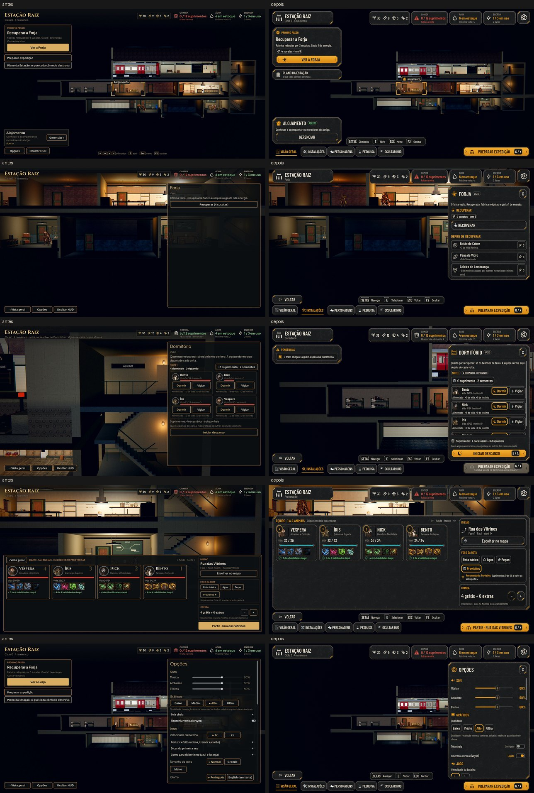

# As doze telas da Estação no kit (#105)

A integração de [hud-estacao.md](../design/hud-estacao.md): a vista geral, a Preparação, a Forja e o Centro de
Pesquisa vazios, a noite no Dormitório, o Dormitório vazio, o trem com a Dora, o Plano, a Cantina, o Depósito, o Bar e
as Opções, no kit da Awesomic (`art/ui/kit/station`) e na moldura da Sala dos Personagens.

As maquetes (à esquerda) e o jogo (à direita), nas doze telas:
- [Normal](station/target_game.jpg)
- [Maior](station/target_game_large.jpg)

As fotos saem de `tools/capture_105.gd` (o daltonismo e o Maior com daltonismo também, com `--colorblind`).

## O que mudou

- **A moldura, uma só** (`AHStationFrame`, usada também pela Sala dos Personagens):
  - no alto, a plaqueta "ESTAÇÃO RAIZ" com o nome da tela, os materiais, Comida, Água, Energia e a engrenagem;
  - faltando Comida, o chip troca o ícone pelo alerta;
  - embaixo, VOLTAR (nos cômodos), a barra das teclas (que segue a troca de tecla nas Opções), as abas (a ativa em
    âmbar) e o botão principal: PREPARAR EXPEDIÇÃO (G / X), PARTIR na Preparação, ou bloqueado com o motivo dentro.
- **A coluna da esquerda:** o PRÓXIMO PASSO, com o custo em chips ("4 sucatas · tem 9") e o botão; o Plano da Estação;
  e as PENDÊNCIAS (a noite, o trem), também com um cômodo aberto.
- **A seleção de cômodo:** os cantos âmbar, a etiqueta com a ponta para baixo e o cartão embaixo à esquerda (o estado
  num chip e GERENCIAR).
- **O painel do cômodo** (no lugar do painel PERSONAGEM):
  - em cima, o ícone, o nome, o chip do estado e o X; o nome que não cabe (a Pesquisa no Maior) quebra antes de
    empurrar o X;
  - o conteúdo rola e o painel tem a altura do conteúdo, até acima do botão principal;
  - as ações da noite e do trem ficam fixas no pé, com o botão âmbar e a tecla de Interagir;
  - RECUSAR é de aço e sem tecla (Esc fecha o painel e não recusa sem querer).
- **Cada cômodo:**
  - **Forja e Pesquisa:** vazias, o custo em chips, RECUPERAR e o que liberam, apagado; recuperadas, FABRICAR e
    PESQUISAR com o custo;
  - **Pesquisa pronta para a árvore da #94:** as pesquisas aparecem por ramo (Classe, Estação, Radar). O painel lê os
    campos opcionais `Branch`, `Requires` (trancada com o nome da que vem antes), `CostScrap` e `Expeditions`. Com os
    dados de hoje, é o ramo Classe;
  - **Cantina:** a conta por recurso com a seta e o chip do resultado (em alerta só quando falta);
  - **Depósito:** a barra de suprimentos, MELHORAR, o estoque em quadrados, as relíquias e as ferramentas;
  - **Bar vazio:** só o ícone e o texto do jogo;
  - **Dormitório:** a noite (contagem, o suprimento extra, DORMIR e VIGIAR por herói, a conta e INICIAR DESCANSO), o
    amanhecer e o vazio;
  - **trem:** o retrato, o ponto forte e o fraco, o pedido e o antes e depois da próxima volta;
  - **Plano:** um bloco por cômodo, com o custo em chips e VER.
- **A Preparação:**
  - os quatro cartões com o medalhão da posição, o retrato, a vida, as habilidades e "N de 4 habilidades daqui";
  - à direita, a Missão, o Foco da rota (a recomendada numa linha à parte, com o pino) e a Comida;
  - PARTIR é o botão principal.
- **As Opções** (`options_panel.gd`, também no título e na rua):
  - as mesmas seções, com ícones;
  - controles deslizantes do kit com o valor em âmbar;
  - liga e desliga com "Ligado"/"Desligado" e a linha inteira como alvo;
  - as opções em grupo, com a marcada em âmbar e a moldura da escolha;
  - as 21 ações com TROCAR.

## A trava do padrão

- `tests/test_kit_guard.gd`: fora do kit (`scripts/ui/kit` e o `AHUiStyle`), nenhuma tela de `scripts/ui` usa
  StyleBoxFlat, cor solta, tamanho de texto solto ou as caixas e botões antigos.
- As telas que faltam migrar ficam em `tools/kit_guard_exceptions.txt`, com o número de hoje. A lista só encolhe: o
  teste reprova a tela nova fora dela, a que ganhou ocorrências e a que perdeu sem baixar o número.
- As telas migradas (Estação, Opções, acampamento, luta, relatório, Sala) estão fora da lista.
- O AGENTS.md ganhou a regra.

## Testes

- `tests/run_all.gd`: 55 de 55, com a paridade 48/48.
- `tests/test_station_screens.gd` (novo): com os cômodos recuperados, os três civis e a noite e o trem pendentes, no
  Normal, no Maior e em inglês, o painel de cada cômodo fica com a largura dele e acima do botão principal, o texto das
  PENDÊNCIAS fica dentro do botão, os cartões da Preparação seguram o conteúdo e as abas estão traduzidas.
- Atualizados para a estrutura nova: `test_keyboard_navigation` (o botão principal e a engrenagem), `test_small_teams`
  (PARTIR travado no botão principal), `test_character_sheet` (os cartões pelo nome) e `test_live_options` (a
  plaqueta).

## Rodadas da QA

### Rodada 1: REPROVADO

**Média, corrigidos:**
- O painel passava da borda da tela na Pesquisa, na Forja e na noite (o texto das linhas tinha largura mínima fixa).
  Agora o texto fica com a largura que sobra, e o `test_station_screens` mede o painel em todos os cômodos, no Normal,
  no Maior e em inglês.
- O texto das PENDÊNCIAS que quebrava a linha saía do botão. Agora o botão cresce com o texto, e o teste confere.
- Em inglês, as abas e as dicas dos materiais voltaram para o português: o `station_frame.gd` estava fora do
  `i18n_scan`. Ele entrou, e as traduções voltaram (1462 de 1462).
- A trava deixava passar `label_px` e os rótulos com tamanho solto, `Color8`, `Color.html`/`from_*`, as cores com nome
  e `&"font_size"`. As regras novas pegam tudo isso; a linha é lida sem o conteúdo dos textos e sem o comentário (sem
  falso positivo em `tr("Color(...)")`), e uma linha errada na lista dá uma mensagem clara. Na luta, os quatro rótulos
  com tamanho solto viraram papéis do kit; a ficha do herói e o cartão da passagem entraram na lista com a contagem
  real. A exploração (de 18 para 32) e os controles de toque (de 2 para 5) não pioraram: é a contagem real com as
  regras novas.

**Baixa, corrigidos:**
- O botão principal mostra a tecla trocada na hora, com as Opções abertas (`refresh_keys` com `ah_format`).
- O rosto de quem caiu, no relatório, e o marcador da luta voltaram às cores de antes (tokens `FALLEN` e
  `AMBER_LIGHT`). O canto do foco ficou no `TEXT` (efe6d6 contra efe5d1, a mesma cor na tela).
- O cartão da Preparação cresce com o conteúdo no Maior: o aviso de baixo é parte dele.
- O teste de teclado volta a ir só pelas setas até PREPARAR EXPEDIÇÃO.

### Rodada 2: APROVADO

Todos os painéis com 596 de largura, dentro da tela e acima do botão principal, no Normal e no Maior, com os cômodos
recuperados e a noite e o trem pendentes; as PENDÊNCIAS e as abas em inglês; 29 amostras da trava; a tecla de
Preparar trocada com as Opções abertas.

**Para a #94:** o painel da Pesquisa já mostra a sucata e o pré-requisito, que `AHStationRules.research` ainda não
cobra. Hoje nenhum dado tem esses campos; a regra entra junto com os dados da #94.

**Limite conhecido da trava:** ela lê linha a linha, então o tamanho indireto (`var size := 22` e depois o
`override(…, size)`, `AHKit.size("row") + 4`) passa. Fica anotado no teste.
