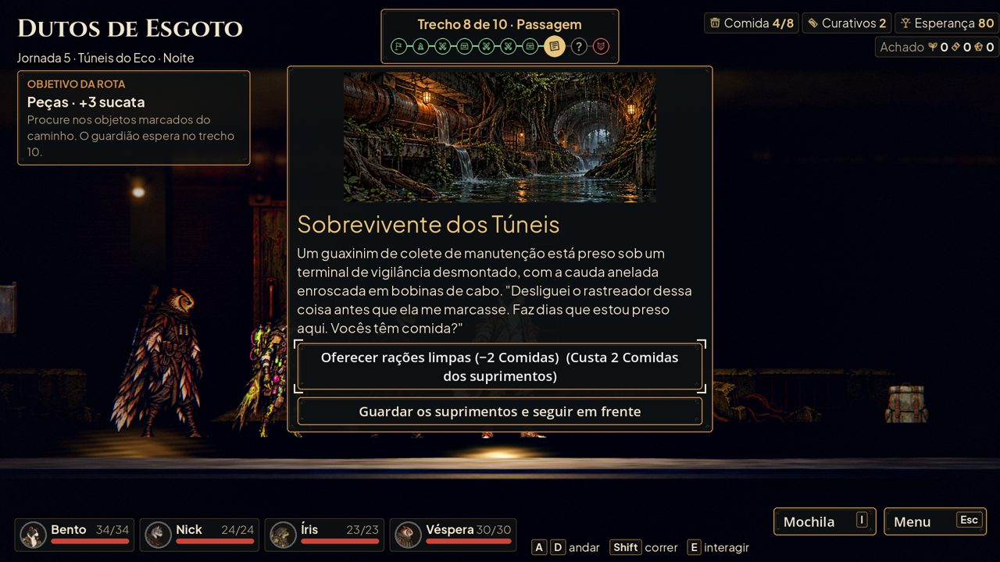
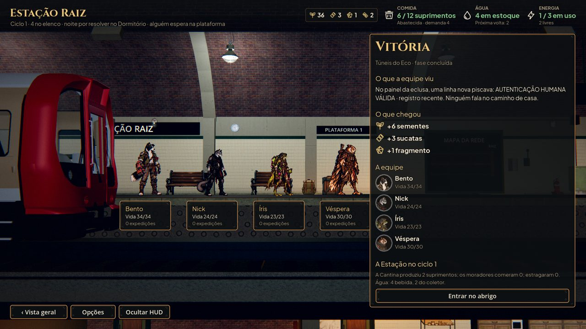

# A escada da história no jogo (#64)

Cada fase com evento de história abre o dela na primeira Passagem do mapa da fase (2: Voz no Interfone; 3: A Porta que
Ainda Espera; 5: Sobrevivente dos Túneis), uma vez por campanha; o que libera o guaxinim volta até ele ser liberado. As
escolhas quebram a linha e a que ainda não dá para escolher não aparece.

A primeira vitória em cada fase traz a linha da camada dela no relatório da volta. Na fase 5, a autenticação humana
recente no painel da eclusa, sem mostrar ninguém (lore §25.4). As respostas às perguntas da revisão estão em
`docs/narrative/review.md` ("Respostas aplicadas").
