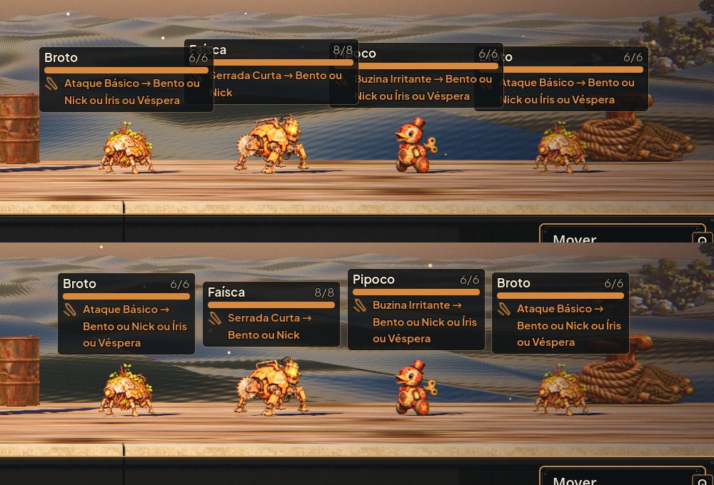
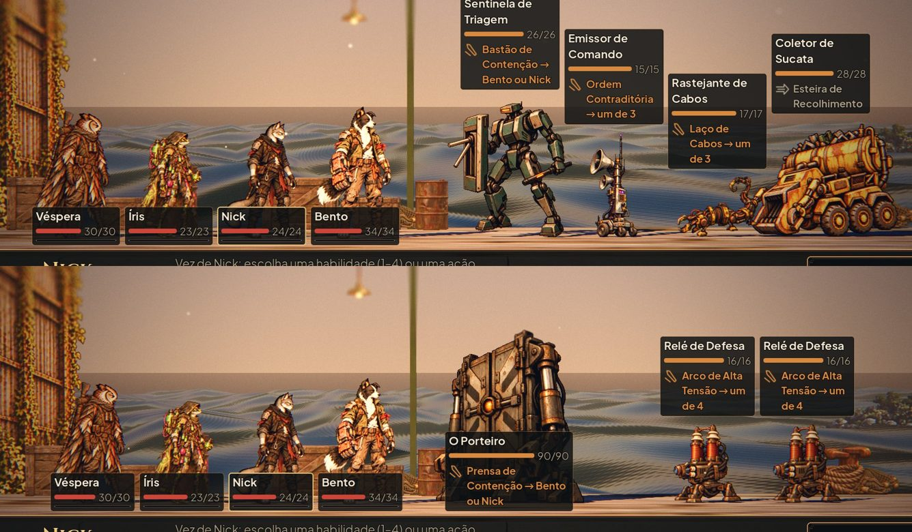
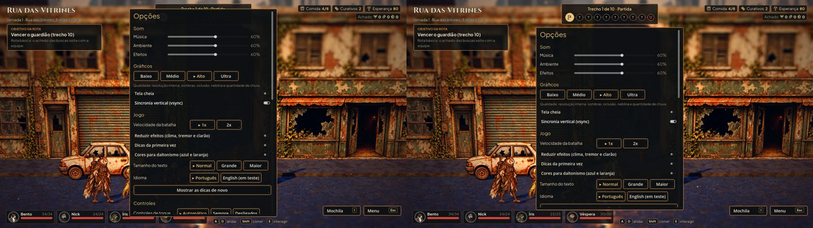

# Varredura visual (#63)

Capturas de todo o jogo (`capture_ui`, `--capture`, `--capture-title`, `capture_scenarios`, `capture_scenario_fight`,
`capture_search_props`) e a lista dos achados na issue #63, com o que foi corrigido, o que virou issue e o que é
decisão.

## As placas dos inimigos

Com quatro inimigos a ~200 px um do outro, as placas de 246 px se cobriam ("Fa|ísca"). Agora cada placa estreita até
os vizinhos, a vida fica ao lado da barra e o nome quebra em duas linhas em vez de ser cortado; com três alvos ou mais
a intenção diz quantos ("um de 4", os nomes no mouse).

No texto Maior, a placa que presa pelo painel de baixo cobriria mais da metade do corpo vai para cima da cabeça (os
Relés de Defesa do chefe sumiam atrás da própria placa).

## As Opções da exploração

Abrem abaixo da faixa dos trechos (antes, por cima dela).

## O aviso da Estação

Ia por cima do "Ocultar HUD". Agora fica logo abaixo do cabeçalho, entre o menu da esquerda e o painel aberto, com
contorno, e acompanha a tela que muda por baixo dele (vista geral, cômodo, Preparação, Opções).
