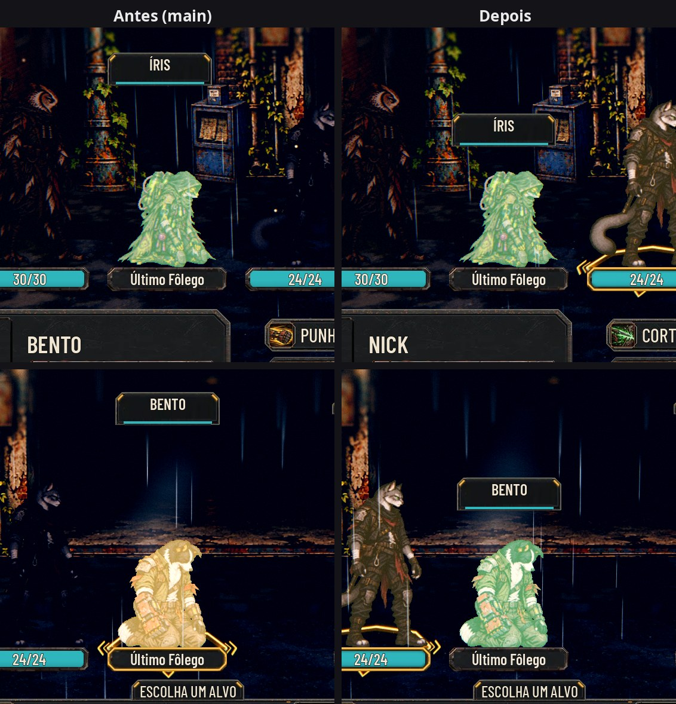

# O ALVO na altura da pose atual (#70)

Achado da QA da #13: no Último Fôlego, os fundadores ficam ajoelhados, mas o "ALVO" (a plaqueta com o nome na mira) e o
retângulo do clique continuavam na altura de quem está de pé, uns 0,5 m acima da cabeça.

As fotos saem de `tools/capture_70.gd` (a primeira luta da Rua das Vitrines; cada fundador vai, um de cada vez, para o
Último Fôlego e a mira de um aliado aponta para ele). O antes é o mesmo roteiro no código da `main`. Quem tem a vez muda
entre as duas execuções (o Bento na `main`, o Nick na branch); o que importa é a altura do ALVO.

## O que muda

- **O topo de cada pose:** o `data/presentation/combat_art.json` ganha o "top" de cada pose de imagem única (a primeira
  linha visível do WebP, nos pixels da tela original), medido por `tools/sync_combat_art.py` (`--tops` sem a pasta da
  Unreal; toda gravação do manifesto mede de novo). As poses de pé ficam entre 0,999 e 1,002 da altura do corpo; as
  ajoelhadas, entre 0,58 e 0,67. As folhas de quadros e os efeitos visuais ficam sem.
- **`AHSpriteCard.pose_top()` e `pose_head_height()`:** o topo da pose atual; sem "top", a âncora menos a altura.
- **Na luta:** o ALVO e o retângulo do clique (`_body_rect`) seguem a pose. A largura do clique continua a do corpo de
  pé. As placas, as intenções e o nome ao apontar (só de quem está de pé) continuam pela altura de pé, para não pularem
  durante os lances.

## Teste

`tests/test_target_kneel.gd`: o topo de cada fundador de pé e ajoelhado; na luta, um fundador no Último Fôlego na mira
de um aliado, com o ALVO logo acima da cabeça ajoelhada, o clique do pé a ela e nada na altura da cabeça de pé.

## QA

Rodada 1: **APROVADO**, com observações baixas, corrigidas na mesma entrega (os efeitos visuais sem "top"; o nome ao
apontar volta à altura de pé). A QA rodou a suíte duas vezes e um clique de verdade (`push_input`) no ajoelhado e logo
acima dele, no Normal e no Maior, para Bento, Íris e Vespera, e conferiu o manifesto (só o "top" a mais, idempotente),
as folhas dos robôs, os recrutas sem pose de caído, a skin Ronda, o Mercador e as capturas.
