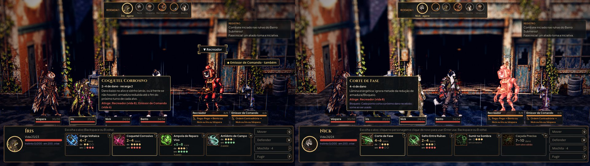

# O alvo escolhido pelo personagem inteiro (#57)

Na rua, a primeira habilidade com dois alvos inimigos aberta (a iniciativa sorteia quem age, por isso o herói muda).
Antes, botões com o nome ("▼ Recreador") e o "também" boiando sobre o cenário. Depois, o clique vale no corpo inteiro:
o alvo apontado acende forte na cor dos inimigos com o ALVO acima, os outros alvos válidos acendem fraco, o herói da
vez fica dourado e quem não pode ser alvo escurece. Um clique escolhe, o segundo usa; as setas e Enter continuam.
