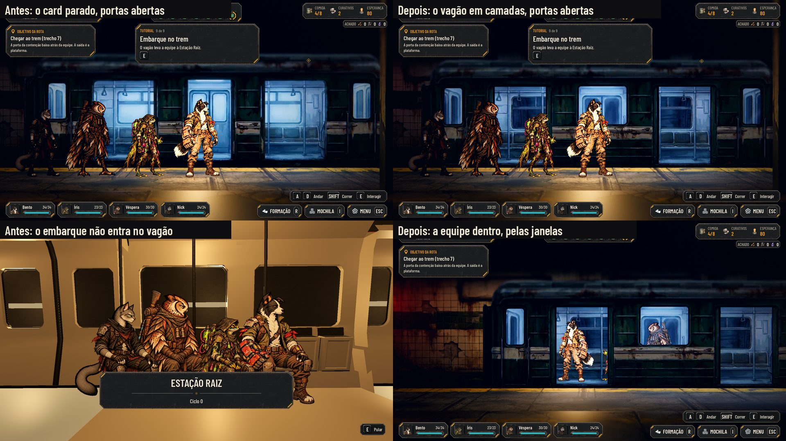
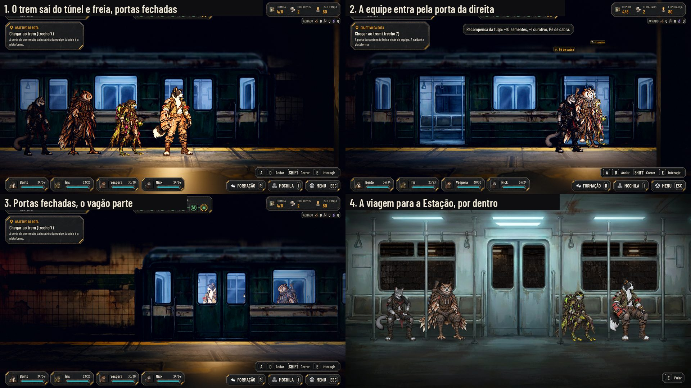
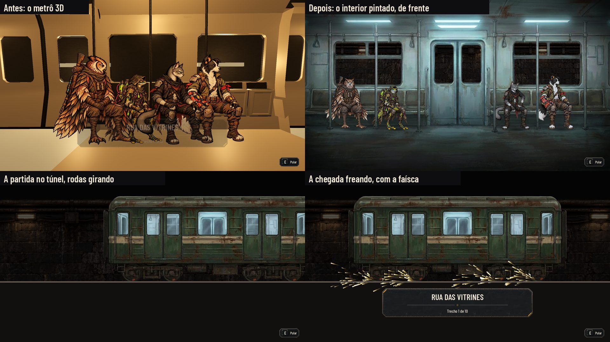
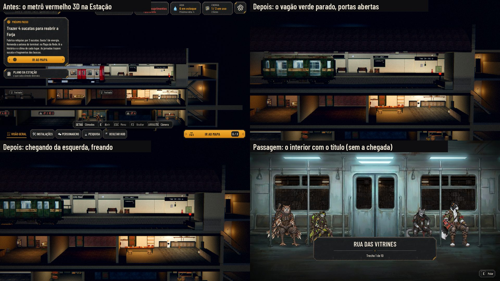
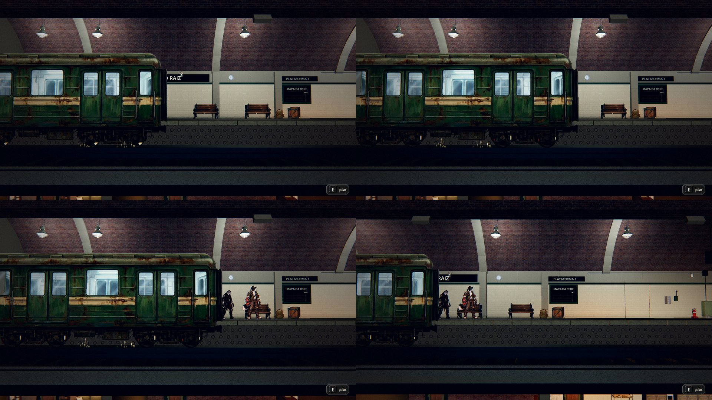

# O trem 2D no jogo (#256)

Fotos de `tools/capture_256.gd` (1920x1080, Compatibility, sem placa de vídeo), nas cenas de verdade: o tutorial direto
na plataforma e o cartão da partida da Preparação. O antes é a mesma sequência rodada na `main` de antes da integração.
O design está em [docs/design/trem-2d.md](../design/trem-2d.md) (#149) e a pose de frente em
[docs/design/poses-frente.md](../design/poses-frente.md) (#253).

Em cima, o mesmo momento: o trem parado com as portas abertas. Antes era o card pintado `T_TU10`; agora é o vagão em
camadas, no mesmo lugar do fosso. Embaixo, uns 3,5 s depois de embarcar: antes a passagem já tinha aberto (a equipe
não entrava no vagão); agora a equipe está dentro, vista pela porta da esquerda e pelas janelas.

1. O trem sai do túnel pela esquerda e freia, com as portas fechadas (anda sempre para a direita: chega e parte no
   mesmo sentido, como no túnel da passagem). A faísca sai na metade de baixo da velocidade, mas o piso
   da plataforma cobre as rodas, como pede o design; aparece só a luz laranja no trilho.
2. Parado, as portas abrem (0,8 s). No Embarcar, a recompensa sobe e a equipe anda até a beira, entra pela porta da
   direita e segue para dentro; a fila vai atrás pelo rastro.
3. As portas fecham e o vagão parte para a direita (`train_departure`), com a equipe dentro, pelas janelas.
4. A passagem para a Estação mostra só o interior, com o trem andando (`train_ride`): a partida já passou no mapa e a
   chegada é na plataforma da Estação.

Em cima, antes e depois do interior. Embaixo, à esquerda, o plano do túnel da partida da Preparação: o vagão sai de
lado com as rodas girando. A chegada freando com a faísca (à direita) saiu depois, pela decisão do Lucas de 29/10: a
faísca é só onde dá para ver o trem parar (a plataforma da Estação e a do Tutorial). Na passagem, a freada volta a ser
só o som, no fim do cartão, como antes.

## A Estação Raiz

As fotos da Estação acima são de 640x360 (o antes, de 1280x720), na vista geral: a Estação renderiza a cerca de 1
quadro por segundo aqui, sem placa de vídeo, e a câmera da plataforma não chegou a fechar a tempo. A faísca não se lê
nesse tamanho.

A volta da equipe, pelo fluxo de verdade (a Estação abre depois da expedição e o HUD toca a chegada), em 1280x720. O
tempo do trem anda à mão e só o quadro da foto é desenhado; por isso a faísca que já tinha saído fica congelada embaixo
do vagão nas fotos dele parado (no jogo ela apaga). Em cima, à esquerda, a freada com a faísca nas rodas (3,15 s); à
direita, parado, as portas da plataforma já abertas e as folhas deste lado fechadas (5,9 s). Embaixo, à esquerda, a
equipe saindo de trás da frente do vagão (6,6 s); à direita, o mesmo momento na câmera do jogo, a da fila do relatório
(6,1 s). Essas três abrem a câmera para a esquerda até o vagão; a vista da plataforma inteira não chegou a desenhar
aqui.

A luz fria das portas abertas não aparece nas fotos: a parede e o chão da plataforma à direita do vagão ficam iguais
com as portas fechadas e abertas (medido nos pixels). As luzes ficam atrás do vagão, com 4,2 m de alcance, e ele as
tapa. O que mostra a descida é a equipe saindo de trás dele.

Pela mesma decisão, o trem da Estação também é o vagão verde: tudo é o mesmo trem. O metrô vermelho 3D sai da
plataforma (`AHStationBuild._train_2d`; um vagão de caixas fica só como reserva, se o contrato faltar). O vagão fica logo à
frente da beira da plataforma, com a frente no fim da linha onde ficava a do metrô, e as rodas no fosso. Ele chega da
esquerda freando, com a faísca da metade da velocidade até parar (sem ela com "Reduzir efeitos"), e parte de volta
para a esquerda, como o metrô (a Estação é o fim da linha). A câmera vê o lado do trilho: as portas que abrem são as
do outro lado, o da plataforma, onde quem desce ou sobe passa (pela da direita), como as do metrô faziam. As folhas à
vista ficam fechadas, e quem desce aparece saindo de trás do vagão. A luz fria do vagão sai pelas portas abertas, mas
fica atrás dele (veja as fotos).

## Como funciona

- **O vagão** (`scripts/world/train_car.gd`, `AHTrainCar`) monta as camadas do contrato
  (`data/presentation/train_2d.json`, a cópia de `docs/design/trem-2d/contract.json` que vai no jogo; o teste confere que
  as duas são iguais), sem luz própria como os cards (`shaders/train_layer*.gdshader`), com o brilho do card que ele
  substitui e o clima do cenário. O interior fica 0,9 m atrás e cresce pela distância da câmera; quem está dentro fica a
  0,45 m, entre o interior e a carroceria. As rodas giram pelo que o vagão anda e a faísca segue o contrato; com
  "Reduzir efeitos", sem faísca e sem a luz dela.
- **No mapa** (`tools/build_containment_corridor.py`): o card some (`hidden`) e `train.car` diz onde fica o vagão (o
  plano do card, o chão na altura da plataforma) e a distância da câmera. Ele fica no grupo `Metro`, com as luzes frias,
  e é o grupo que anda.
- **O embarque** (`AHStreetCorridor._walk_into_train`): o líder vai até a beira na frente da porta da direita, entra e
  anda 4,6 m para dentro; sem a silhueta, que pintava a equipe por cima da carroceria. Na partida, a fila vai presa ao
  rastro (`carry_party`), sem a suavização que a deixava para trás.
- **A passagem** (`scripts/station/wagon_ride.gd`, `AHWagonRide`, agora um Control): o túnel nas janelas, o fundo, as
  sombras de contato, a equipe e as barras na frente. Os lugares são os quatro do contrato; a posição 1 no da direita, e
  uma equipe menor senta junta do lado direito. Quem tem `*_seat_front` senta de frente (o ponto `hip` no assento); quem
  não tem (os recrutas, ou a skin sem a pose, como a Ronda do Bento) fica de pé na frente do lugar, na roupa dele. O
  vagão de lado do túnel é `AHTrainCar2D`. O tempo é pelo relógio, como o do cartão.
- **A pose pela direção do banco** (`AHSkins.seat_pose`): "front" no vagão, "side" na cantina, que não mudou.
- **`tools/sync_assets.py`** grava `facing: side` nas `*_seat` e mantém as entradas de frente que já estão no JSON (elas
  não vêm da Unreal).

## Não verificado

- **Forward+:** as capturas são do Compatibility, sem placa de vídeo.
- **A equipe no túnel:** nos planos de fora da passagem, o vagão passa vazio (a equipe aparece só no interior).
- **A Estação na tela:** a Estação renderiza a cerca de 1 quadro por segundo nesta máquina sem placa de vídeo; ver a
  nota da captura na seção da Estação.
