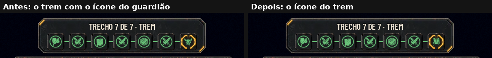

# O ícone do trem no mapa do tutorial (#147)

Decisão do Lucas (28/10): no mapa do tutorial (o Corredor de Contenção), a casa do trem, no fim da barra de trechos,
mostrava o ícone do guardião. Agora mostra o trem do lobby (`train_arrival`, o do serviço do trem na Estação), um glifo
branco tingido como os outros ícones da exploração: âmbar no trecho de agora, verde quando resolvido, claro à frente.
O guardião continua com a caveira, em alerta até ser vencido.

## Testes

- `tests/test_route_bar.gd`: a casa do trem com o glifo do trem (não o do guardião), no âmbar do trecho de agora e na
  cor dos outros à frente; resolvido, verde (com o check quando já não é o de agora).
- `tools/capture_tutorial.gd` (`12-train-hint`), na `main` de antes e na branch.

## QA

- **Rodada 1: APROVADO.** A casa do trem à frente, agora, resolvida agora e resolvida antes, com e sem daltonismo; o
  texto Maior não mexe nela; nenhum outro uso do ícone do guardião para o trem. `run_all` 86/86, paridade 48/48. Nota
  baixa, aplicada: o teste do trem resolvido. Outra, para o Lucas: o trem é um glifo solto, sem o círculo dos `node-*`,
  e fica um pouco menor que os vizinhos (lê bem).
